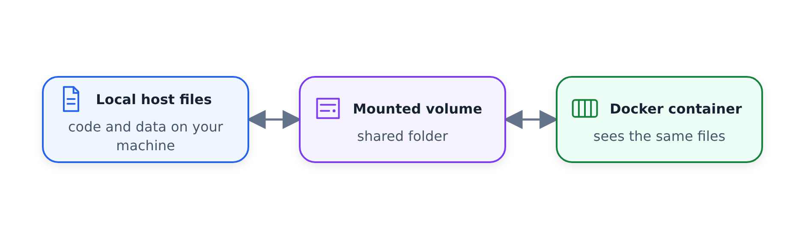

#Giới thiệu về Docker

Docker là một _phần mềm chứa_ cho phép chúng ta tách biệt phần mềm theo cách tương tự như máy ảo nhưng theo cách gọn gàng hơn nhiều.

Hình ảnh Docker là một _snapshot_ của một vùng chứa mà chúng ta có thể xác định để chạy phần mềm của mình hoặc trong trường hợp này là các đường dẫn dữ liệu của chúng ta. Bằng cách xuất hình ảnh Docker của chúng tôi sang các nhà cung cấp Đám mây như Amazon Web Services hoặc Google Cloud Platform, chúng tôi có thể chạy các vùng chứa của mình ở đó.


## Tại sao lại là Docker?

Docker cung cấp các ưu điểm sau:

- Khả năng tái tạo: Cùng một môi trường ở mọi nơi
- Cách ly: Các ứng dụng chạy độc lập
- Tính di động: Chạy ở mọi nơi có cài đặt Docker

Chúng được sử dụng trong nhiều tình huống:

- Kiểm tra tích hợp: đường dẫn CI/CD
- Chạy đường ống trên đám mây: AWS Batch, công việc Kubernetes
- Spark: Công cụ phân tích để xử lý dữ liệu quy mô lớn
- Serverless: AWS Lambda, Google Functions

## Các lệnh Docker cơ bản

Kiểm tra phiên bản Docker:

```bash
docker --version
```

Chạy một container đơn giản:

```bash
docker run hello-world
```

Chạy thứ gì đó phức tạp hơn:

```bash
docker run ubuntu
```

Không có gì xảy ra. Cần chạy nó ở chế độ `-it`:

```bash
docker run -it ubuntu
```

Chúng tôi không có `python` ở đó nên hãy cài đặt nó:

```bash
apt update && apt install python3
python3 -V
```

## Container không trạng thái

Quan trọng: Vùng chứa Docker không có trạng thái - mọi thay đổi được thực hiện bên trong vùng chứa sẽ KHÔNG được lưu khi vùng chứa bị tắt và khởi động lại.

Khi bạn thoát khỏi vùng chứa và sử dụng lại, các thay đổi sẽ không còn nữa:

```bash
docker run -it ubuntu
python3 -V
```

Điều này tốt vì nó không ảnh hưởng đến hệ thống máy chủ của bạn. Giả sử bạn làm điều gì đó điên rồ như thế này:

```bash
docker run -it ubuntu
rm -rf / # don't run it on your computer!
```

Lần tới khi chúng tôi chạy nó, tất cả các tập tin sẽ quay trở lại.

## Quản lý Container

Tuy nhiên, điều này không _hoàn toàn_ chính xác. Trạng thái được lưu ở đâu đó. Chúng ta có thể thấy các container đã dừng:

```bash
docker ps -a
```

Chúng tôi có thể khởi động lại một trong số chúng, nhưng chúng tôi sẽ không làm điều đó vì đó không phải là một cách thực hành tốt. Chúng chiếm dung lượng, vì vậy hãy xóa chúng:

```bash
docker rm $(docker ps -aq)
```

Lần tới khi chạy thứ gì đó, chúng tôi sẽ thêm `--rm`:

```bash
docker run -it --rm ubuntu
```

## Hình ảnh cơ sở khác nhau

Ngoài `hello-world` và `ubuntu` còn có các hình ảnh cơ sở khác. Ví dụ: Python:

```bash
docker run -it --rm python:3.9.16
# add -slim to get a smaller version
```

Cái này khởi động `python`. Nếu muốn bash, chúng ta cần ghi đè `entrypoint`:

```bash
docker run -it \
    --rm \
    --entrypoint=bash \
    python:3.9.16-slim
```

## Tập

Vì vậy, chúng tôi biết rằng với docker, chúng tôi có thể khôi phục bất kỳ vùng chứa nào về trạng thái ban đầu theo cách có thể tái tạo. Nhưng còn dữ liệu thì sao? Cách phổ biến để làm như vậy là sử dụng _volumes_.

Mối quan hệ lâu bền là các tệp máy chủ có thể được chia sẻ với vùng chứa
thông qua ổ đĩa được gắn:



Hãy tạo một số dữ liệu trong `test`:

```bash
mkdir test
cd test
touch file1.txt file2.txt file3.txt
echo "Hello from host" > file1.txt
cd ..
```

Bây giờ hãy tạo một tập lệnh đơn giản `test/list_files.py` hiển thị các tệp trong thư mục:

```python
from pathlib import Path

current_dir = Path.cwd()
current_file = Path(__file__).name

print(f"Files in {current_dir}:")

for filepath in current_dir.iterdir():
    if filepath.name == current_file:
        continue

    print(f"  - {filepath.name}")

    if filepath.is_file():
        content = filepath.read_text(encoding='utf-8')
        print(f"    Content: {content}")
```

Bây giờ, hãy ánh xạ cái này tới vùng chứa Python:

```bash
docker run -it \
    --rm \
    -v $(pwd)/test:/app/test \
    --entrypoint=bash \
    python:3.9.16-slim
```

Bên trong container, chạy:

```bash
cd /app/test
ls -la
cat file1.txt
python list_files.py
```

Bạn sẽ thấy các tệp từ máy chủ của mình có thể truy cập được trong vùng chứa!
