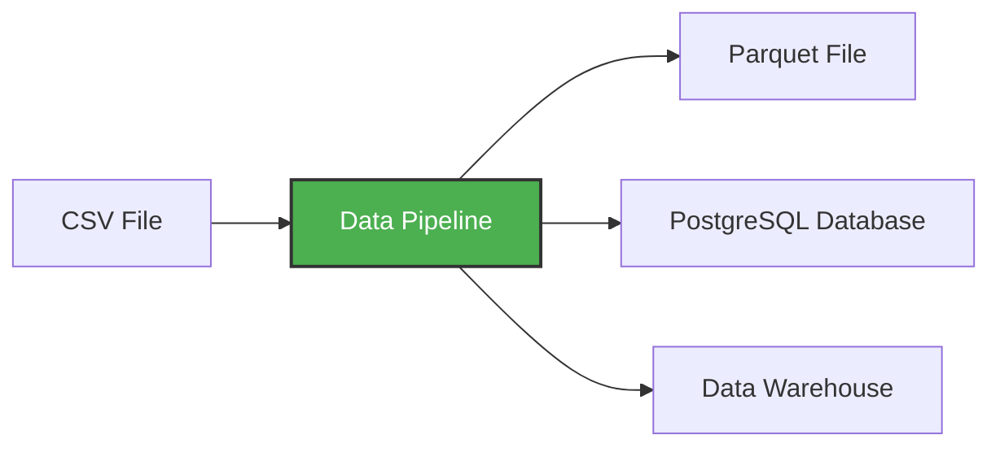

# Môi trường ảo và đường ống dữ liệu

**đường dẫn dữ liệu** là dịch vụ nhận dữ liệu dưới dạng đầu vào và xuất ra nhiều dữ liệu hơn. Ví dụ: đọc tệp CSV, chuyển đổi dữ liệu bằng cách nào đó và lưu trữ dưới dạng bảng trong cơ sở dữ liệu PostgreSQL.




Trong hội thảo này, chúng ta sẽ xây dựng các quy trình:
- Tải xuống dữ liệu CSV từ web
- Chuyển đổi và làm sạch dữ liệu bằng pandas
- Tải dữ liệu vào PostgreSQL để truy vấn
- Xử lý dữ liệu theo khối để xử lý các tệp lớn

## Tạo một đường ống đơn giản

Hãy tạo một đường dẫn ví dụ. Đầu tiên tạo thư mục `pipeline` và bên trong tạo file `pipeline.py`:

```python
import sys
print("arguments", sys.argv)

day = int(sys.argv[1])
print(f"Running pipeline for day {day}")
```

Bây giờ hãy thêm gấu trúc:

```python
import pandas as pd

df = pd.DataFrame({"A": [1, 2], "B": [3, 4]})
print(df.head())

df.to_parquet(f"output_day_{sys.argv[1]}.parquet")
```

## Tại sao lại là môi trường ảo?

Chúng tôi cần gấu trúc nhưng chúng tôi không có nó. Chúng tôi muốn kiểm tra nó trước khi chạy mọi thứ trong vùng chứa.

Chúng ta có thể cài đặt nó với `pip`:

```bash
pip install pandas pyarrow
```

Nhưng điều này sẽ cài đặt nó trên toàn cầu trên hệ thống của bạn. Điều này có thể gây ra xung đột nếu các dự án khác nhau cần các phiên bản khác nhau của cùng một gói.

Thay vào đó, chúng tôi muốn sử dụng **môi trường ảo** - một môi trường Python biệt lập giúp tách biệt các phần phụ thuộc của dự án này với các dự án khác và với hệ thống Python của bạn.

## Sử dụng uv - Trình quản lý gói Python hiện đại

Chúng tôi sẽ sử dụng `uv` - một trình quản lý dự án và gói Python hiện đại, nhanh chóng được viết bằng Rust. Nó nhanh hơn nhiều so với pip và tự động xử lý môi trường ảo.

```bash
pip install uv
```

Bây giờ hãy khởi tạo dự án Python với uv:

```bash
uv init --python=3.13
```

Điều này tạo ra tệp `pyproject.toml` để quản lý các phần phụ thuộc và tệp `.python-version`.

### So sánh các phiên bản Python

```bash
uv run which python  # Python in the virtual environment
uv run python -V

which python        # System Python
python -V
```

Bạn sẽ thấy chúng khác nhau - `uv run` sử dụng môi trường biệt lập.

### Thêm phụ thuộc

Bây giờ hãy thêm gấu trúc:

```bash
uv add pandas pyarrow
```

Thao tác này sẽ thêm gấu trúc vào `pyproject.toml` của bạn và cài đặt nó trong môi trường ảo.

### Chạy Pipeline

Bây giờ chúng ta có thể thực thi tệp:

```bash
uv run python pipeline.py 10
```

Chúng ta sẽ thấy:

* `['pipeline.py', '10']`
* `job finished successfully for day = 10`

## Cấu hình Git

Tập lệnh này tạo ra một tệp nhị phân (sàn gỗ), vì vậy hãy đảm bảo rằng chúng ta không vô tình chuyển nó vào git bằng cách thêm tiện ích mở rộng sàn gỗ vào `.gitignore`:

```
*.parquet
```
