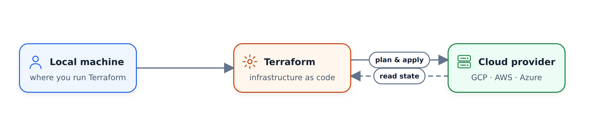

# Tổng quan về địa hình

## Khái niệm
### Giới thiệu
1. [Terraform](https://www.terraform.io) là gì?
* công cụ nguồn mở của [HashiCorp](https://www.hashicorp.com), dùng để cung cấp tài nguyên cơ sở hạ tầng
* hỗ trợ các phương pháp hay nhất của DevOps để quản lý thay đổi
* Quản lý tệp cấu hình trong kiểm soát nguồn để duy trì trạng thái cung cấp lý tưởng
cho môi trường thử nghiệm và sản xuất
2. Là gì IaC?
* Cơ sở hạ tầng dưới dạng mã
* xây dựng, thay đổi và quản lý cơ sở hạ tầng của bạn theo cách an toàn, nhất quán và có thể lặp lại
bằng cách xác định các cấu hình tài nguyên mà bạn có thể tạo phiên bản, sử dụng lại và chia sẻ.
3. Một số ưu điểm
* Quản lý vòng đời cơ sở hạ tầng
* Cam kết kiểm soát phiên bản
* Rất hữu ích cho việc triển khai dựa trên ngăn xếp và với các nhà cung cấp đám mây như AWS, GCP, Azure, K8S…
* Cách tiếp cận dựa trên trạng thái để theo dõi các thay đổi tài nguyên trong suốt quá trình triển khai

Terraform chạy cục bộ và sử dụng nhà cung cấp để lập kế hoạch và áp dụng các thay đổi trong nền tảng đám mây
:

### Tệp
* `main.tf`
* `variables.tf`
* Tùy chọn: `resources.tf`, `output.tf`
* `.tfstate`

### Tuyên bố
* `terraform`: định cấu hình cài đặt Terraform cơ bản để cung cấp cơ sở hạ tầng của bạn
* `required_version`: phiên bản Terraform tối thiểu để áp dụng cho cấu hình của bạn
* `backend`: lưu trữ ảnh chụp nhanh "trạng thái" của Terraform để ánh xạ các tài nguyên trong thế giới thực vào cấu hình của bạn.
* `local`: lưu trữ cục bộ tệp trạng thái dưới dạng `terraform.tfstate`
* `required_providers`: chỉ định các nhà cung cấp được yêu cầu bởi mô-đun hiện tại
* `provider`:
* thêm một tập hợp các loại tài nguyên và/hoặc nguồn dữ liệu Terraform có thể quản lý
* Sổ đăng ký Terraform là thư mục chính của các nhà cung cấp công khai từ hầu hết các nền tảng cơ sở hạ tầng chính.
* `resource`
* khối để xác định các thành phần cơ sở hạ tầng của bạn
* Mô-đun/tài nguyên dự án: google_storage_bucket, google_bigquery_dataset, google_bigquery_table
* `variable` & `locals`
* đối số và hằng số thời gian chạy

### Các bước thực thi
1. `terraform init`:
* Khởi tạo và định cấu hình phần phụ trợ, cài đặt plugin/nhà cung cấp và kiểm tra cấu hình hiện có từ bộ điều khiển phiên bản
2. `terraform plan`:
* So khớp/xem trước các thay đổi cục bộ với điều khiển từ xa nêu rõ và đề xuất Kế hoạch thực hiện.
3. `terraform apply`:
* Yêu cầu phê duyệt kế hoạch được đề xuất và áp dụng các thay đổi cho đám mây
4. `terraform destroy`
* Xóa ngăn xếp của bạn khỏi Đám mây

## Workshop tạo GCP Infra
Tiếp tục [tại đây](./terraform): `week_1_basics_n_setup/1_terraform_gcp/terraform`

## Tài liệu tham khảo
https://learn.hashicorp.com/collections/terraform/gcp-get-started
