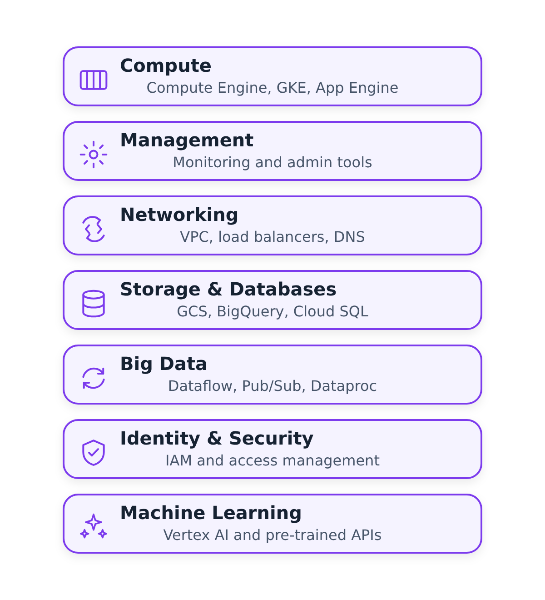

# Tổng quan về GCP


## Các mô-đun cơ sở hạ tầng dự án trong GCP:
* Google Cloud Storage (GCS): Data Lake
* BigQuery: Data Warehouse

Các nền tảng đám mây nhóm các dịch vụ của họ thành các nhóm như điện toán, kết nối mạng
, lưu trữ, dữ liệu lớn, nhận dạng và học máy:



(Các khái niệm được giải thích trong Tuần 2 - Nhập dữ liệu)

## Thiết lập ban đầu
Đối với khóa học này, chúng tôi sẽ sử dụng phiên bản miễn phí (tín dụng tối đa 300 EUR).

1. Tạo một tài khoản bằng ID email Google
của bạn 2. Thiết lập [dự án](https://console.cloud.google.com/) đầu tiên của bạn nếu bạn chưa có
* vd. "Khóa học DTC DE" và ghi lại "ID dự án" (chúng tôi sẽ sử dụng thông tin này sau khi triển khai cơ sở hạ tầng với TF)
3. Thiết lập [tài khoản dịch vụ & xác thực](https://cloud.google.com/docs/authentication/getting-started) cho dự án này
* Cấp vai trò `Viewer` để bắt đầu.
* Tải xuống khóa tài khoản dịch vụ (.json) để xác thực.
4. Tải xuống [SDK](https://cloud.google.com/sdk/docs/quickstart) để thiết lập cục bộ
5. Đặt biến môi trường để trỏ đến khóa GCP đã tải xuống của bạn:
   ```shell
   export GOOGLE_APPLICATION_CREDENTIALS="<path/to/your/service-account-authkeys>.json"

   # Refresh token/session, and verify authentication
   gcloud auth application-default login
   ```

## Thiết lập để truy cập
1. [Vai trò IAM](https://cloud.google.com/storage/docs/access-control/iam-roles) cho tài khoản Dịch vụ:
* Đi tới phần *IAM* của *IAM & Quản trị viên* https://console.cloud.google.com/iam-admin/iam
* Nhấp vào biểu tượng *Chỉnh sửa tiền gốc* cho tài khoản dịch vụ của bạn.
* Thêm các vai trò này ngoài *Người xem* : **Quản trị viên lưu trữ** + **Quản trị viên đối tượng lưu trữ** + **Quản trị viên BigQuery**

2. Kích hoạt các API này cho dự án của bạn:
* https://console.cloud.google.com/apis/library/iam.googleapis.com
* https://console.cloud.google.com/apis/library/iamcredentials.googleapis.com

3. Hãy đảm bảo đã đặt `GOOGLE_APPLICATION_CREDENTIALS` env-var.
   ```shell
   export GOOGLE_APPLICATION_CREDENTIALS="<path/to/your/service-account-authkeys>.json"
   ```

## Workshop tạo GCP Infra
Tiếp tục [tại đây](./terraform): `week_1_basics_n_setup/1_terraform_gcp/terraform`
