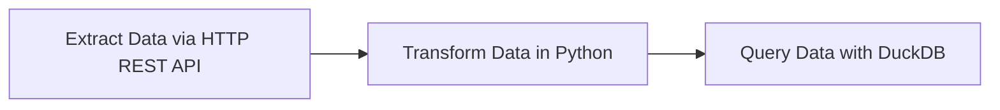

# Đường ống bắt đầu

Luồng giới thiệu này được thêm vào chỉ để minh họa một quy trình dữ liệu đơn giản giúp trích xuất dữ liệu thông qua API HTTP REST, chuyển đổi dữ liệu đó bằng Python rồi truy vấn dữ liệu đó bằng DuckDB. Đối với giai đoạn này, một cơ sở dữ liệu Postgres riêng biệt mới được tạo cho các bài tập.

Thêm luồng [`03_getting_started_data_pipeline.yaml`](flows/03_getting_started_data_pipeline.yaml) từ giao diện người dùng nếu bạn chưa thêm và thực thi nó để xem kết quả. Kiểm tra các tab Gantt và Nhật ký để hiểu cách thực thi luồng.

## Tài nguyên
- [Video hướng dẫn ETL](https://go.kestra.io/de-zoomcamp/etl-tutorial)
- [ETL trong 3 phút](https://go.kestra.io/de-zoomcamp/etl-get-started)
