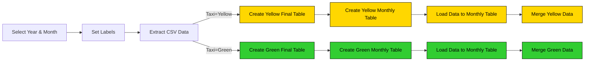

# DB cục bộ: Tải dữ liệu Taxi vào Postgres

Trước khi bắt đầu tải dữ liệu lên GCP, trước tiên chúng ta sẽ thử nghiệm với dữ liệu Taxi màu vàng và màu xanh lá cây bằng cơ sở dữ liệu Postgres cục bộ chạy trong vùng chứa Docker. Chúng tôi sẽ sử dụng cùng một cơ sở dữ liệu từ Mô-đun 1, nằm trong cùng tệp Docker Compose với Kestra.

Luồng sẽ trích xuất dữ liệu CSV được phân vùng theo năm và tháng, tạo bảng, tải dữ liệu vào bảng hàng tháng và cuối cùng hợp nhất dữ liệu vào bảng đích cuối cùng.

Mã luồng: [`04_postgres_taxi.yaml`](flows/04_postgres_taxi.yaml).

> [!NOTE]
> Dữ liệu bản ghi chuyến đi của Ủy ban taxi và xe limousine (TLC) của NYC được cung cấp trên trang web [nyc.gov](https://www.nyc.gov/site/tlc/about/tlc-trip-record-data.page) hiện chỉ có ở định dạng Parquet, nhưng đây KHÔNG phải là tập dữ liệu mà chúng tôi sẽ sử dụng trong khóa học này. Với mục đích của khóa học này, chúng tôi sẽ sử dụng **tệp CSV** có sẵn [tại đây trên GitHub](https://github.com/DataTalksClub/nyc-tlc-data/releases). Điều này là do định dạng Parquet có thể khó hiểu đối với những người mới sử dụng và chúng tôi muốn làm cho khóa học trở nên dễ tiếp cận nhất có thể — định dạng CSV có thể dễ dàng được xem xét nội tâm bằng các công cụ như Excel hoặc Google Trang tính hay thậm chí là một trình soạn thảo văn bản đơn giản.

## Tài nguyên
- [Docker Compose với Kestra, Postgres và pgAdmin](docker-compose.yml)
