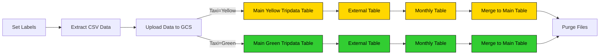

# Quy trình làm việc của GCP: Tải dữ liệu Taxi vào BigQuery

Bây giờ Google Cloud đã được thiết lập với nhóm lưu trữ, chúng ta có thể bắt đầu quá trình ELT.

Mã luồng: [`08_gcp_taxi.yaml`](flows/08_gcp_taxi.yaml).
