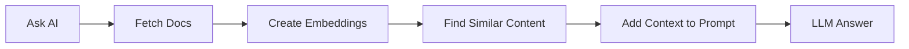

# Phần thưởng: Thế hệ tăng cường truy xuất (RAG)

Để tìm hiểu thêm về cách cung cấp ngữ cảnh cho lời nhắc của bạn, phần bổ sung này sẽ trình bày cách sử dụng RAG.

##RAG là gì?
**RAG (Retrieval Augmented Generation)** là một kỹ thuật:
1. **Truy xuất** thông tin liên quan từ nguồn dữ liệu của bạn
2. **Tăng cường** lời nhắc AI với ngữ cảnh này
3. **Tạo** phản hồi dựa trên dữ liệu thực

Điều này giải quyết vấn đề ảo giác bằng cách đảm bảo AI có quyền truy cập vào thông tin hiện tại, chính xác tại thời điểm truy vấn.

*RAG thêm đường dẫn truy xuất giữa câu hỏi và mô hình để câu trả lời có thể căn cứ vào tài liệu nguồn hiện tại.*

## Cách hoạt động của RAG trong Kestra

**Quy trình:**
1. **Nhập tài liệu**: Tải tài liệu, ghi chú phát hành hoặc các nguồn dữ liệu khác
2. **Tạo phần nhúng**: Chuyển đổi văn bản thành biểu diễn vectơ bằng LLM
3. **Lưu trữ phần nhúng**: Lưu vectơ trong KV Store của Kestra (hoặc cơ sở dữ liệu vectơ)
4. **Truy vấn bằng ngữ cảnh**: Khi bạn đặt câu hỏi, hãy truy xuất các phần nhúng có liên quan và đưa chúng vào lời nhắc
5. **Tạo phản hồi**: LLM có ngữ cảnh thực tế và cung cấp câu trả lời chính xác

## Bài tập: Truy xuất có và không có ngữ cảnh
**Mục tiêu:** Hiểu cách RAG loại bỏ ảo giác bằng cách căn cứ các phản hồi LLM trong dữ liệu thực.

**Phần A: Không có RAG**
1. Điều hướng đến luồng [`10_chat_without_rag.yaml`](flows/10_chat_without_rag.yaml) trong Kestra UI
2. Nhấp vào **Thực thi**
3. Đợi quá trình thực thi hoàn tất
4. Mở tab **Nhật ký**
5. Đọc đầu ra - chú ý cách phản hồi về "các tính năng Kestra 1.1" là:
-
mơ hồ hoặc chung chung -
có thể không chính xác - Thiếu chi tiết cụ thể
- Chỉ dựa trên dữ liệu đào tạo của mô hình (có thể đã lỗi thời)

**Phần B: Với RAG**
1. Điều hướng đến luồng [`11_chat_with_rag.yaml`](flows/11_chat_with_rag.yaml)
2. Nhấp vào **Thực thi**
3. Xem quá trình thực thi:
- Nhiệm vụ đầu tiên: **Ingests** Tài liệu phát hành Kestra 1.1, tạo **các phần nhúng** và lưu trữ chúng
- Nhiệm vụ thứ hai: **Nhắc LLM** với ngữ cảnh được truy xuất từ các phần nhúng được lưu trữ
4. Mở tab **Nhật ký**
5. So sánh kết quả đầu ra này với kết quả trước đó - để ý xem nó như thế nào:
- ✅
cụ thể và chi tiết - ✅ Chính xác với thực tế các tính năng từ bản phát hành
- ✅ Căn cứ vào tài liệu thực tế

**Học tập chính:** RAG (Thế hệ tăng cường truy xuất) đưa ra các phản hồi AI trong tài liệu hiện tại, loại bỏ ảo giác và cung cấp các câu trả lời chính xác, phù hợp với ngữ cảnh.

## Các phương pháp hay nhất về RAG
1. **Luôn cập nhật tài liệu**: Thường xuyên nhập lại để đảm bảo thông tin cập nhật
2. **Chip một cách thích hợp**: Chia tài liệu lớn thành các phần có ý nghĩa
3. **Kiểm tra chất lượng truy xuất**: Xác minh rằng các tài liệu phù hợp được truy xuất

## Tài nguyên AI bổ sung
Tài liệu Kestra:
- [Tổng quan về công cụ AI](https://go.kestra.io/de-zoomcamp/ai-tools)
- [AI Copilot](https://go.kestra.io/de-zoomcamp/ai-copilot)
- [RAG Workflows](https://go.kestra.io/de-zoomcamp/rag-workflows)
- [Quy trình làm việc AI](https://go.kestra.io/de-zoomcamp/ai-workflows)
- [Kestra Blueprints](https://go.kestra.io/de-zoomcamp/blueprints) - Ví dụ về quy trình làm việc được tạo sẵn

Tài liệu về plugin Kestra:
- [AI Plugin](https://go.kestra.io/de-zoomcamp/ai-plugin)
- [RAG Tasks](https://go.kestra.io/de-zoomcamp/ai-rag-task)

Tài liệu bên ngoài:
- [Google Gemini](https://go.kestra.io/de-zoomcamp/gemini-docs)
- [Google AI Studio](https://go.kestra.io/de-zoomcamp/ai-studio)
