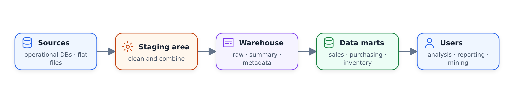
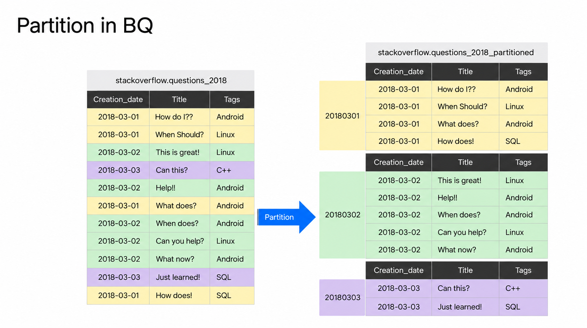
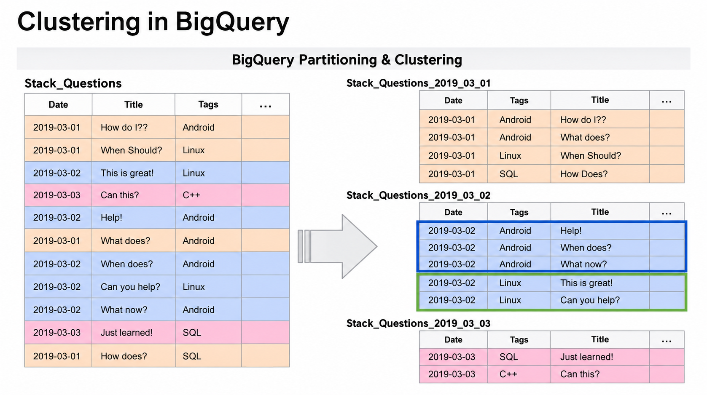

# Kho dữ liệu và BigQuery

Trong phần này, chúng ta nói về kho dữ liệu nói chung và BigQuery dưới dạng
, ví dụ của chúng tôi: cơ sở dữ liệu phân tích khác với cơ sở dữ liệu
giao dịch đằng sau các ứng dụng hàng ngày như thế nào, kho dữ liệu trông như thế nào về mặt kiến ​​trúc
và chuyến tham quan thực tế đầu tiên về BigQuery — giao diện, bộ dữ liệu công khai
, bảng bên ngoài, giá cả, phân vùng và phân cụm.

## OLTP so với OLAP

Cơ sở dữ liệu có hai loại và sự khác biệt bắt đầu từ trường hợp sử dụng
.

OLTP là viết tắt của xử lý giao dịch trực tuyến. Đây là loại cơ sở dữ liệu
mà bạn sử dụng trong các dịch vụ phụ trợ, trong đó bạn nhóm một vài truy vấn SQL
lại với nhau thành một giao dịch và khôi phục trong trường hợp một trong số chúng
không thành công. Một ví dụ điển hình là một cửa hàng: đơn đặt hàng, thanh toán và cập nhật hàng tồn kho
đều xảy ra hoặc không xảy ra.

OLAP là viết tắt của xử lý phân tích trực tuyến. Các cơ sở dữ liệu này là
được thiết kế cho một mục đích khác: đưa nhiều dữ liệu vào và
khám phá những hiểu biết ẩn giấu. Chúng chủ yếu được sử dụng cho công việc phân tích
bởi các nhà phân tích dữ liệu và nhà khoa học dữ liệu.

Hai loại này khác nhau ở hầu hết mọi khía cạnh:

- Trong OLTP các bản cập nhật nhanh nhưng nhỏ. Trong OLAP, dữ liệu được
làm mới định kỳ và kích thước dữ liệu thường lớn hơn nhiều.
- Cơ sở dữ liệu OLTP được chuẩn hóa để đạt hiệu quả. Cơ sở dữ liệu OLAP không được chuẩn hóa
để phân tích.
- OLTP tăng năng suất cho người dùng cuối. OLAP tăng năng suất
cho các nhà phân tích và điều hành dữ liệu.
- Người dùng OLTP là nhân viên làm việc trực tiếp với khách hàng, nhân viên bán hàng và người mua hàng trực tuyến. Người dùng OLAP
là những người lao động tri thức: nhà phân tích dữ liệu, nhà phân tích kinh doanh
và giám đốc điều hành.

| | OLTP | OLAP |
| --- | --- | --- |
| Mục đích | Kiểm soát và điều hành các hoạt động kinh doanh thiết yếu trong thời gian thực | Lập kế hoạch, giải quyết vấn đề, hỗ trợ ra quyết định, khám phá những hiểu biết sâu sắc |
| Cập nhật dữ liệu | Cập nhật ngắn, nhanh do người dùng thực hiện | Dữ liệu được làm mới định kỳ với các công việc hàng loạt được lên lịch, chạy dài |
| Thiết kế cơ sở dữ liệu | Cơ sở dữ liệu được chuẩn hóa để đạt hiệu quả | Cơ sở dữ liệu không chuẩn hóa để phân tích |
| Yêu cầu về không gian | Nói chung là nhỏ nếu dữ liệu lịch sử được lưu trữ | Nói chung lớn do tổng hợp các bộ dữ liệu lớn |

## Kho dữ liệu
là gì
Kho dữ liệu là một giải pháp OLAP được sử dụng để báo cáo và phân tích dữ liệu
.

Kho thường bao gồm dữ liệu thô, siêu dữ liệu và dữ liệu tóm tắt.
Nó có nhiều nguồn dữ liệu - hệ điều hành, tệp phẳng, có thể là cơ sở dữ liệu
OLTP - và tất cả các hệ thống này báo cáo về khu vực tổ chức, sau đó
được ghi vào kho dữ liệu.

Là đầu ra, kho dữ liệu có thể được chuyển đổi thành siêu thị dữ liệu:
nhỏ hơn, các lát theo chủ đề cụ thể như mua hàng, bán hàng và khoảng không quảng cáo
mà những người dùng khác nhau có thể truy cập trực tiếp. Đối với các nhà phân tích,
sử dụng siêu thị dữ liệu làm giao diện là tình huống lý tưởng. Nhưng trong một số trường hợp sử dụng
nhất định, đặc biệt là đối với các nhà khoa học dữ liệu, việc xem
dữ liệu thô trực tiếp từ kho là điều hợp lý. Kho dữ liệu cung cấp tất cả các khả năng này của
.



## BigQuery

BigQuery là một giải pháp kho dữ liệu và ưu điểm lớn nhất của nó là
là không có máy chủ: không có máy chủ để quản lý và không cần cài đặt phần mềm cơ sở dữ liệu
.

Điều này quan trọng vì khi một công ty bắt đầu hành trình kho dữ liệu của mình,
thường mất một lượng lớn thời gian để tạo và duy trì kho
. BigQuery xóa bỏ nỗi đau đó: nó cũng cung cấp phần mềm
làm cơ sở hạ tầng, với khả năng mở rộng và tính sẵn sàng cao.
Bạn có thể bắt đầu với vài gigabyte dữ liệu và dễ dàng mở rộng quy mô thành
petabyte mà không gặp vấn đề gì.

Một số tính năng tích hợp thực sự vượt trội:

- học máy thông qua giao diện SQL của BigQuery
- xử lý dữ liệu không gian địa lý
- truy vấn thông minh kinh doanh

Một lợi thế lớn khác là tính linh hoạt trong cách lưu trữ dữ liệu. Trong thiết lập cổ điển
, một máy chủ lớn chứa bộ lưu trữ và tính toán cùng nhau, vì vậy
khi kích thước dữ liệu của bạn tăng lên, máy cũng phải phát triển theo.
BigQuery tách công cụ điện toán khỏi bộ lưu trữ và phân tích dữ liệu
của bạn trên bộ lưu trữ mà bạn chọn. Đó là một chiến thắng lớn về mặt chi phí.

## BigQuery có giá bao nhiêu

BigQuery có hai mô hình định giá.

Giá theo yêu cầu dựa trên lượng dữ liệu bạn quét hoặc xử lý:
mỗi terabyte được xử lý có giá khoảng 5 USD.

Định giá cố định dựa trên số lượng vị trí được yêu cầu trước — đơn vị công suất xử lý của
BigQuery. 100 vị trí có giá khoảng
2.000 USD mỗi tháng, chuyển đổi thành khoảng 400 TB dữ liệu được xử lý
theo mức giá theo yêu cầu. Vì vậy, tốc độ cố định không có ý nghĩa trừ khi
của bạn đang quét trên 200 TB dữ liệu.

Các khe cắm cũng thay đổi cách hệ thống hoạt động khi có tải. Nếu bạn có 50 truy vấn
đang chạy và tất cả 100 vị trí của bạn đã đầy thì truy vấn thứ 51 phải đợi
. Điều đó sẽ không xảy ra theo yêu cầu: BigQuery cung cấp cho bạn nhiều vị trí
hơn dựa trên yêu cầu của truy vấn.

## Bộ dữ liệu công khai

Trước khi làm việc với BigQuery, bạn nên biết hai điều. Đầu tiên, BigQuery
thường lưu trữ các kết quả truy vấn vào bộ nhớ đệm — đối với các bản demo trong mô-đun này, bộ nhớ đệm
đã bị tắt để có được kết quả nhất quán. Thứ hai, BigQuery gửi rất nhiều dữ liệu công khai nguồn mở
mà bạn có thể truy vấn ngay lập tức.

Một ví dụ là dữ liệu của các trạm Citi Bike ở Thành phố New York. Bạn có thể
tìm kiếm bất kỳ tập dữ liệu nào theo tên bảng trong thanh tìm kiếm và mở bảng
để xem các cột của nó: id trạm, tên, tên viết tắt, vĩ độ, kinh độ
và các cột khác. Bảng này chỉ có 1.584 hàng và kích thước của nó chỉ bằng vài
KB — một tập dữ liệu rất nhỏ. Bạn cũng có thể xem trước nhanh
để xem dữ liệu được sắp xếp như thế nào.

Hãy truy vấn nó:

```sql
SELECT
    station_id,
    name
FROM bigquery-public-data.new_york_citibike.citibike_stations
LIMIT 100;
```

Id và tên trạm hiển thị trong bảng kết quả truy vấn ở cuối
. Từ đó, bạn có thể lưu kết quả dưới dạng CSV hoặc khám phá thêm
trong Data Studio.

## Bảng ngoài

Đối với mô-đun này, chúng tôi sử dụng dữ liệu chuyến đi bằng taxi ở NYC, dữ liệu này đã được
tải lên Google Cloud Storage. BigQuery cho phép bạn tạo bảng
bên ngoài trên các tệp như vậy: dữ liệu vẫn nằm trong Cloud Storage và
BigQuery chỉ giữ lại siêu dữ liệu.

Giao diện sắp xếp mọi thứ thành các dự án, tập dữ liệu và bảng:
`taxi-rides-ny` là dự án, `nytaxi` là tập dữ liệu và
`external_yellow_tripdata` là một bảng trong đó. Nhóm chứa các tệp CSV
dữ liệu chuyến đi cho năm 2019, 2020, v.v. và bảng bên ngoài trỏ đến các tệp
2019 và 2020:

```sql
CREATE OR REPLACE EXTERNAL TABLE `taxi-rides-ny.nytaxi.external_yellow_tripdata`
OPTIONS (
    format = 'CSV',
    uris = [
        'gs://nyc-tl-data/trip data/yellow_tripdata_2019-*.csv',
        'gs://nyc-tl-data/trip data/yellow_tripdata_2020-*.csv'
    ]
);
```

Sau khi tạo bảng, hãy mở bảng: BigQuery đã đọc tên cột
của CSV và đã hiểu các loại, đồng thời tìm ra cột
nào có thể rỗng. Bạn không cần phải xác định lược đồ - mặc dù
có thể làm điều đó nếu bạn muốn.

Bây giờ, hãy xem chi tiết của bảng: bộ nhớ dài hạn là 0 byte, kích thước bảng
là 0 byte và số lượng hàng là 0. Khi bạn tạo bảng bên ngoài
, BigQuery không thể xác định các hàng hoặc kích thước của bảng đó — dữ liệu
không nằm trong BigQuery mà nằm trong hệ thống bên ngoài, Google Cloud
Storage.

Bảng bên ngoài kết quả có các chi tiết sau:

| Lĩnh vực | Giá trị |
| --- | --- |
| ID bảng | `taxi-rides-ny.nytaxi.external_yellow_tripdata` |
| Kích thước bàn | 0 B |
| Kích thước lưu trữ dài hạn | 0 B |
| Số hàng | 0 |
| Bảng hết hạn | Không bao giờ |
| Vị trí dữ liệu | `europe-west3` |
| URI nguồn | `gs://nyc-tlc/data/trip_data/yellow_tripdata_2019-*.csv` |
| URI nguồn | `gs://nyc-tlc/data/trip_data/yellow_tripdata_2020-*.csv` |
| Lược đồ tự động phát hiện | `true` |
| Định dạng nguồn | CSV |

Truy vấn nó hoạt động giống như bất kỳ bảng nào khác:

```sql
SELECT *
FROM taxi-rides-ny.nytaxi.external_yellow_tripdata
LIMIT 10;
```

Bạn nhận được id nhà cung cấp, ngày đón và trả khách, số lượng hành khách, khoảng cách chuyến đi
, thông tin địa điểm cũng như giá vé và tổng số tiền.

## Phân vùng

Phân vùng là một tính năng BigQuery rất hữu ích. Lấy tập dữ liệu về các câu hỏi tràn Stack
từ năm 2018 với các cột như ngày tạo, tiêu đề và thẻ
. Giả sử hầu hết các truy vấn của bạn lọc theo ngày - hãy cung cấp cho tôi số lượng
câu hỏi chỉ được hỏi trong tháng 3 hoặc chỉ trong tuần đầu tiên của tháng 3.
Phân vùng theo ngày tạo thực sự có thể cải thiện hiệu suất.

Khi bạn phân vùng bảng theo ngày tạo, mỗi ngày sẽ trở thành phân vùng riêng
: tất cả các hàng được tạo vào ngày 1 tháng 3 năm 2018 sẽ đi vào phân vùng
đầu tiên, ngày 2 tháng 3 vào phân vùng thứ hai, v.v. Điều này rất hiệu quả vì
khi BigQuery hiểu rằng nó chỉ cần dữ liệu cho ngày 2 tháng 3 năm 2018 thì
sẽ không đọc hoặc xử lý dữ liệu trong ngày 1 hoặc ngày 3 tháng 3. Xử lý ít dữ liệu
hơn giúp giảm chi phí.



Quay lại dữ liệu taxi. Cho đến bây giờ chúng tôi chỉ có bảng bên ngoài, bảng
chưa được phân vùng. Trước tiên, hãy tạo một bảng đơn giản, không phân vùng
bằng cách sao chép nội dung của bảng bên ngoài:

```sql
CREATE OR REPLACE TABLE taxi-rides-ny.nytaxi.yellow_tripdata_non_partitioned AS
SELECT *
FROM taxi-rides-ny.nytaxi.external_yellow_tripdata;
```

Quá trình này sẽ mất một chút thời gian vì dữ liệu được sao chép từ Bộ lưu trữ Google Cloud
vào bộ lưu trữ BigQuery thực tế. Phiên bản được phân vùng chỉ thêm
một dòng, `PARTITION BY`:

```sql
CREATE OR REPLACE TABLE taxi-rides-ny.nytaxi.yellow_tripdata_partitioned
PARTITION BY DATE(tpep_pickup_datetime) AS
SELECT *
FROM taxi-rides-ny.nytaxi.external_yellow_tripdata;
```

Bảng được phân vùng biết kích thước của nó — khoảng 13-14 GB — và chi tiết
cho thấy bảng được phân vùng theo ngày trên `tpep_pickup_datetime`. Trong chế độ xem lược đồ
, bạn cũng có thể nhận thấy sự khác biệt: bảng không được phân vùng
là một khối cột vững chắc, trong khi bảng được phân vùng có một điểm ngắt ở giữa
. Đó là một cách nhanh chóng để biết bảng nào được phân vùng.

Bây giờ là phần thưởng. Chạy cùng một truy vấn đối với cả hai bảng — id nhà cung cấp
riêng biệt cho tháng 6 năm 2019:

```sql
SELECT DISTINCT(VendorID)
FROM taxi-rides-ny.nytaxi.yellow_tripdata_non_partitioned
WHERE DATE(tpep_pickup_datetime) BETWEEN '2019-06-01' AND '2019-06-30';
```

Trên bảng không được phân vùng, BigQuery ước tính nó sẽ xử lý 1,6 GB
— gần như tất cả dữ liệu trong bảng. Chỉ thay đổi tên bảng thành tên bảng được phân vùng
và ước tính giảm xuống còn khoảng 106 MB. Nếu bạn chạy đi chạy lại
truy vấn này, bạn xử lý 106 MB mỗi lần thay vì
1,6 GB, điều này trực tiếp giảm chi phí của bạn.

Ước tính của truy vấn được phân vùng và số byte được xử lý thực tế là:

| Truy vấn | Byte được xử lý |
| --- | ---: |
| Ước tính trước khi chạy | 105,9 MIB |
| Thực tế sau khi chạy | 105,9 MIB |

Bạn cũng có thể tự kiểm tra các phân vùng. Mọi tập dữ liệu đều có
`INFORMATION_SCHEMA` với chế độ xem `PARTITIONS`:

```sql
SELECT
    table_name,
    partition_id,
    total_rows
FROM `nytaxi.INFORMATION_SCHEMA.PARTITIONS`
WHERE table_name = 'yellow_tripdata_partitioned'
ORDER BY total_rows DESC;
```

Điều này cho thấy có bao nhiêu hàng rơi vào phân vùng nào: trong bảng của chúng tôi,
ngày 1 tháng 2 năm 2019 có nhiều hàng nhất và ngày 5 tháng 4 năm 2019 có khoảng 292.000 hàng
. Đây cũng là cách kiểm tra nhanh độ lệch — liệu một số phân vùng là
có nhận được nhiều dữ liệu hơn các phân vùng khác hay không.

## Phân cụm

Từ việc phân vùng, chúng ta chuyển sang một khái niệm thú vị khác: phân cụm.

Quay lại ví dụ về Stack Overflow. Chúng tôi đã phân vùng bảng theo ngày.
Bây giờ chúng tôi cũng phân cụm nó theo thẻ. Trong mỗi phân vùng, các hàng có cùng thẻ
được lưu trữ cùng nhau: trong phân vùng thứ hai, các hàng android
xuất hiện trước, sau đó là các hàng linux; trong phân vùng đầu tiên, android được nhóm
lại với nhau, linux theo sau và sql sau đó.

Vì các hàng liên quan nằm cạnh nhau nên BigQuery cũng có thể bỏ qua dữ liệu
bên trong một phân vùng. Điều này cải thiện chi phí cũng như hiệu suất truy vấn
.



Đối với dữ liệu taxi, chúng tôi tạo một bảng vừa được phân vùng vừa được phân cụm
:

```sql
CREATE OR REPLACE TABLE taxi-rides-ny.nytaxi.yellow_tripdata_partitioned_clustered
PARTITION BY DATE(tpep_pickup_datetime)
CLUSTER BY VendorID AS
SELECT * 
FROM taxi-rides-ny.nytaxi.external_yellow_tripdata;
```

Tại sao lại là `VendorID`? Do cách truy vấn dữ liệu: trong trường hợp sử dụng
này, dữ liệu luôn được lọc theo id nhà cung cấp và ngày nhận, đồng thời việc phân vùng và phân cụm
này nhắm mục tiêu chính xác vào các bộ lọc đó. Chế độ xem chi tiết
xác nhận điều đó: được phân vùng theo ngày trên `tpep_pickup_datetime` và
được nhóm bởi `VendorID`.

Bây giờ so sánh hai bảng bằng cách đếm tất cả các chuyến đi từ nhà cung cấp 1 trong khoảng thời gian từ
từ ngày 1 tháng 6 năm 2019 đến ngày 31 tháng 12 năm 2020:

```sql
SELECT count(*) as trips
FROM taxi-rides-ny.nytaxi.yellow_tripdata_partitioned
WHERE DATE(tpep_pickup_datetime) BETWEEN '2019-06-01' AND '2020-12-31'
  AND VendorID=1;
```

Trước khi chạy, BigQuery ước tính 1,1 GB. Sau khi chạy: 0,7 giây,
và 1,1 GB dữ liệu thực sự được xử lý. Đây là một quy tắc cần nhớ:
bất kỳ điều gì BigQuery hiển thị trước khi chạy đều là giá trị gần đúng — các byte được xử lý
thực tế chỉ xuất hiện sau khi chạy.

Chạy cùng một truy vấn trên bảng được phân vùng và phân cụm. Ước tính
vẫn cho biết 1,1 GB - giá trị gần đúng không thể biết
sẽ bỏ qua phân cụm nào. Nhưng quá trình chạy thực tế xử lý ít hơn: 843,5 MB thay vì 1,1 GB.
Đó là hiệu ứng phân cụm.

So sánh giữa các truy vấn được phân vùng và phân cụm là:

| Bảng | Số byte ước tính | Byte thực tế |
| --- | ---: | ---: |
| Đã phân vùng | 1,1 GB | 1,1 GB |
| Phân vùng và phân cụm | 1,1 GB | 843,5 MB |

Khi nào nên phân vùng, khi phân cụm và khi cả hai - đó là
chủ đề của [đơn vị tiếp theo](02-partitioning-vs-clustering.md).

## Vật liệu

- [Slides](https://docs.google.com/presentation/d/1a3ZoBAXFk8-EhUsd7rAZd-5p_HpltkzSeujjRGB2TAI/edit?usp=sharing)
cho toàn bộ mô-đun
- [`big_query.sql`](big_query.sql) — SQL được sử dụng thông qua mô-đun. Các câu lệnh
đầu tiên thuộc về đơn vị này: truy vấn tập dữ liệu công khai BigQuery và
tạo bảng bên ngoài qua các tệp CSV taxi trong Cloud Storage.
