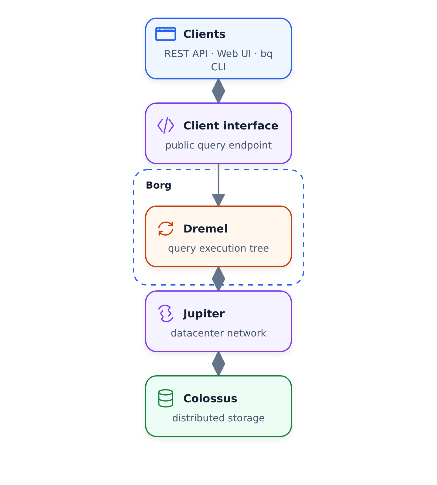
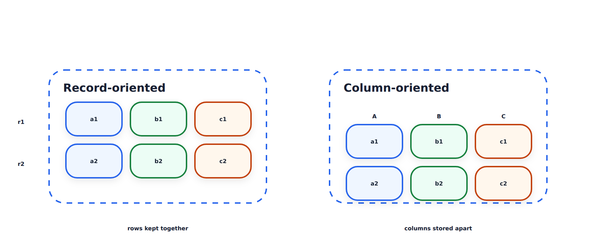
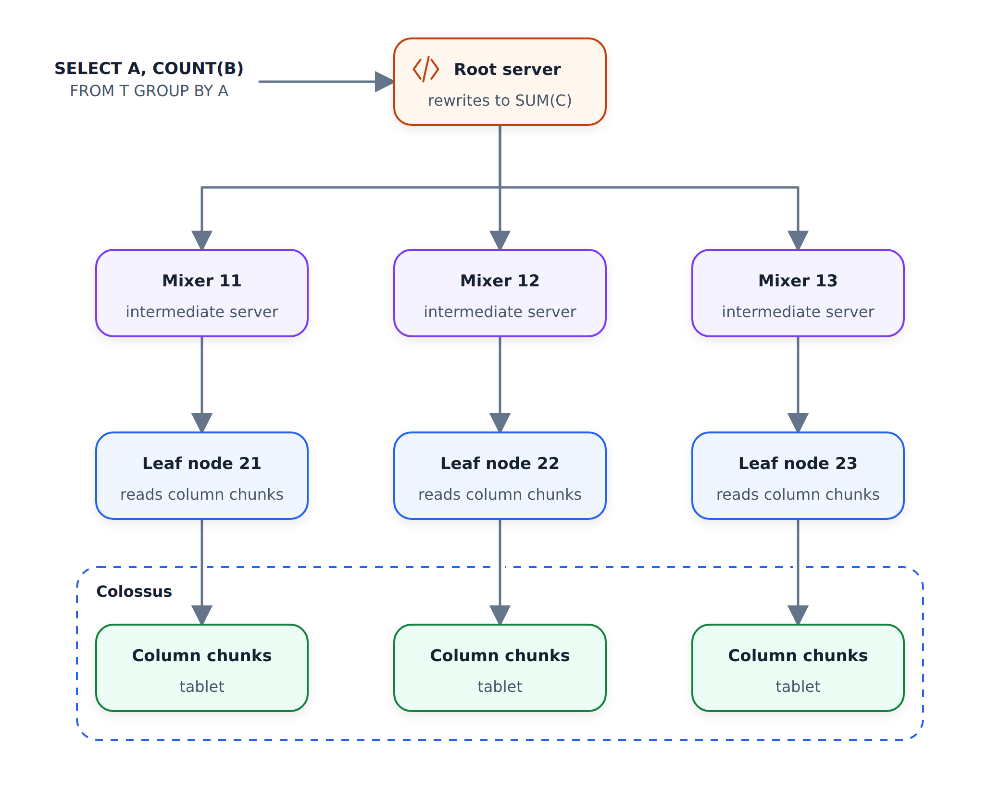

# Nội bộ của BigQuery

Trong phần này, chúng ta tìm hiểu bên trong BigQuery: cách nó lưu trữ dữ liệu, cách lưu trữ và điện toán
giao tiếp với nhau cũng như cách thực thi một truy vấn. Bạn không cần
nội bộ để sử dụng BigQuery — [các phương pháp hay nhất](03-bigquery-best-practices.md)
cũng như việc phân vùng và phân cụm là đủ cho công việc hàng ngày. Nhưng
hiểu cách xây dựng kho dữ liệu như thế này sẽ giúp ích cho bạn khi
thiết kế các sản phẩm dữ liệu của riêng mình.

Sơ đồ trên là kiến ​​trúc cấp cao. Ba cái tên cần nhớ:

- Colossus — bộ lưu trữ
- Jupiter — mạng giữa bộ lưu trữ và điện toán
- Dremel — công cụ thực thi truy vấn

## Colossus: lưu trữ và tính toán riêng biệt

BigQuery lưu trữ dữ liệu của bạn trong một hệ thống lưu trữ riêng có tên Colossus.
Colossus là bộ lưu trữ giá rẻ giúp lưu giữ dữ liệu ở định dạng cột — mỗi cột
được lưu trữ riêng, chúng ta sẽ tìm hiểu thêm ở bên dưới.

Việc tách bộ lưu trữ khỏi điện toán là một quyết định thiết kế quan trọng và
giúp giảm đáng kể chi phí. Nếu kích thước dữ liệu của bạn tăng lên vào ngày mai, bạn chỉ phải trả
để lưu trữ dữ liệu đó trong Colossus, một mức giá rất rẻ. Phần đắt tiền là
đọc dữ liệu và chạy truy vấn — đó là tính toán và nó chỉ xảy ra
khi bạn thực sự chạy thứ gì đó.

## Sao Mộc: mạng ở giữa

Sự tách biệt đặt ra một câu hỏi rõ ràng. Tính toán và lưu trữ nằm trên phần cứng khác nhau của
— chúng giao tiếp với nhau như thế nào? Nếu mạng giữa
chậm thì mọi truy vấn sẽ dành thời gian chờ dữ liệu và số lần truy vấn
sẽ bị ảnh hưởng.

Đó là những gì mạng lưới Jupiter giải quyết được. Jupiter là mạng bên trong các trung tâm dữ liệu BigQuery
và cung cấp khoảng một terabyte mỗi
giây. Với lượng băng thông lớn như vậy, khả năng tính toán và lưu trữ có thể hoạt động trên phần cứng
riêng biệt và vẫn liên lạc với nhau mà không có bất kỳ độ trễ nào.

## Lưu trữ theo cột

Trước khi tìm hiểu cách thực thi các truy vấn, hãy xem nhanh cách trình bày dữ liệu
. Video gọi phần này là Polymer — thành phần trên bộ lưu trữ
— và so sánh bộ lưu trữ theo định hướng bản ghi với bộ lưu trữ
theo định hướng cột.

Bên trái là bộ lưu trữ hướng bản ghi: mỗi bản ghi (hàng `r1`, `r2`) là
được lưu trữ dưới dạng một phần. Điều này rất giống với các cấu trúc như CSV và
dễ xử lý và dễ hiểu.

Bên phải là lưu trữ theo cột. Ở đó, một hàng xuất hiện ở nhiều vị trí
: mỗi cột được lưu trữ riêng biệt với các cột khác.

BigQuery sử dụng cấu trúc hướng theo cột và nó mang lại lợi ích rất lớn.
Lưu trữ theo định hướng cột giúp việc tổng hợp trên các cột nhanh hơn nhiều và
trong kho, chúng tôi hiếm khi truy vấn tất cả các cột cùng một lúc. Yêu cầu điển hình của
là đọc một số cột, lọc và tổng hợp trên các cột khác -
với các cột được lưu trữ riêng biệt, phần còn lại của bảng không bao giờ được chạm vào.
Đó cũng là lý do tại sao `SELECT *` lại đắt đến vậy.

## Dremel: thực hiện truy vấn dưới dạng cây

Dremel là công cụ thực hiện truy vấn. Nó nhận truy vấn của bạn và chia
thành cấu trúc cây, theo cách mà mỗi nút thực thi một tập hợp con
riêng lẻ của truy vấn.

Hãy xem qua ví dụ trong sơ đồ. Giả sử một truy vấn như
`SELECT A, COUNT(B) FROM T GROUP BY A` - đếm các hàng trên mỗi nhóm của cột
A.

- Máy chủ gốc nhận được truy vấn. Nó hiểu truy vấn
muốn gì và biết cách chia nó thành các mô-đun con nhỏ hơn. Trong trường hợp của chúng tôi,
`SELECT A, COUNT(B)` trở thành `SELECT A, SUM(C)`: thay vì đếm,
chúng tôi sẽ tổng hợp một phần số lượng mà các cấp thấp hơn tạo ra. Truy vấn
được viết lại được chia nhỏ hơn và gửi xuống dưới dạng các lát `R1` tới `R1+n`.
- Bộ trộn (cấp trung gian) nhận truy vấn đã sửa đổi, chia
thành các tập hợp con và chuyển chúng đến các nút lá.
- Các nút lá là những nút thực sự giao tiếp với cơ sở dữ liệu Colossus.
Chúng tìm nạp dữ liệu, thực hiện các thao tác thích hợp trên lát cắt của chúng,
và trả kết quả về bộ trộn.
- Bộ trộn trả kết quả của chúng về máy chủ gốc, nơi mọi thứ được
tổng hợp và trả về cho bạn dưới dạng kết quả cuối cùng.

Sự phân bổ công nhân này là lý do khiến BigQuery hoạt động nhanh như vậy. Nếu tất cả công việc
phải được thực hiện trên một nút duy nhất, thời gian truy vấn sẽ tăng rất nhanh khi kích thước dữ liệu
tăng lên. Vì BigQuery chia truy vấn thành các phần
nhỏ hơn và đẩy chúng xuống các nút lá nên truy vấn sẽ chia tỷ lệ.

## Tài liệu tham khảo

Video kết thúc bằng một trang trình bày tham chiếu và các liên kết đáng để đọc
- một số bao gồm các phần bên trong Dremel, một số khác bao gồm các phần bên trong BigQuery trong
nói chung:

- [Tài liệu về BigQuery: cách thực hiện](https://cloud.google.com/bigquery/docs/how-to)
- [Bài viết của Dremel trên Google Research](https://research.google/pubs/pub36632/)
- [Hướng dẫn kiến trúc BigQuery trên Panoply](https://panoply.io/data-warehouse-guide/bigquery-architecture/)
- [Xem qua Dremel](http://www.goldsborough.me/distributed-systems/2019/05/18/21-09-00-a_look_at_dremel/)
