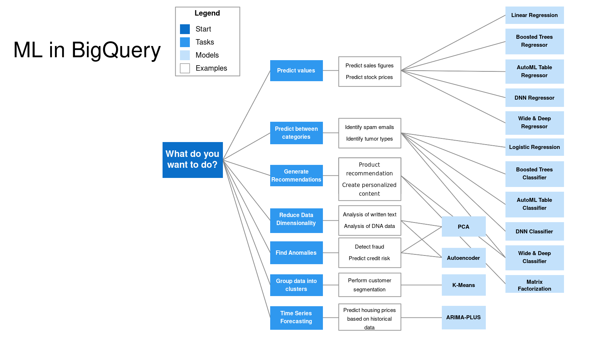

# Học máy trong BigQuery

Trong phần này, chúng tôi đào tạo, đánh giá và giải thích mô hình học máy mà không cần
rời khỏi BigQuery. Chúng tôi xây dựng mô hình hồi quy tuyến tính dự đoán số tiền
của mẹo taxi - tất cả đều bằng SQL - và kết thúc bằng việc điều chỉnh siêu tham số. Trong
[đơn vị tiếp theo](06-deploying-a-machine-learning-model.md), chúng tôi xuất mô hình
này và chạy nó bên trong Docker.

Các truy vấn chúng tôi chạy được thu thập trong [`big_query_ml.sql`](big_query_ml.sql),
nên bạn không cần sao chép chúng từ video.

## Tại sao phải học máy trong BigQuery

BigQuery ML nhắm đến các nhà phân tích và quản lý dữ liệu. Bạn không cần phải biết Python
hay Java: SQL cộng thêm một số kiến ​​thức về thuật toán machine learning là đủ.

Ưu điểm khác là dữ liệu vẫn ở trong kho. Thông thường,
bạn sẽ xuất dữ liệu từ kho dữ liệu, xây dựng và huấn luyện mô hình trong hệ thống riêng
, sau đó triển khai nó. BigQuery cho phép chúng tôi xây dựng mô hình bên trong kho
nên bước xuất bổ sung sẽ biến mất.

Một cảnh báo trước khi chúng ta bắt đầu: video này và video tiếp theo là các bước nâng cao cho
BigQuery. Nếu bạn không quen với học máy, vui lòng bỏ qua
.

## Giá

Giá cả là điều kiện thực tế khi bạn chọn giữa việc sử dụng công nghệ máy học trong BigQuery
và xây dựng một mô hình riêng biệt. Tại thời điểm ghi:

- Gigabyte dung lượng lưu trữ dữ liệu là miễn phí.
- Một terabyte truy vấn được xử lý mỗi tháng là miễn phí.
- Khi sử dụng bước `CREATE MODEL`, 10 gigabyte đầu tiên mỗi tháng cũng là
miễn phí.

Sau bậc miễn phí, bạn phải trả khoảng 250 đô la mỗi terabyte để tạo hồi quy logistic
, hồi quy tuyến tính, phân cụm và mô hình chuỗi thời gian,
và khoảng 5 đô la mỗi terabyte cho AutoML, DNN và mô hình cây nâng cao,
kèm theo chi phí đào tạo Vertex AI bổ sung. Đây là giá ở Hoa Kỳ - nếu bạn là
ở một khu vực khác, hãy kiểm tra chi phí cho khu vực của bạn.

## Quy trình làm việc của máy học

Trước khi tạo mô hình, cần nhớ lại các bước phát triển
học máy. Đầu tiên, chúng tôi thu thập dữ liệu - phần đó đã xong, chúng tôi đã tải dữ liệu
của xe taxi vào BigQuery trong các đơn vị trước đó. Sau đó, chúng tôi xử lý dữ liệu và thực hiện kỹ thuật tính năng
, chia dữ liệu thành các tập huấn luyện và kiểm tra, xây dựng mô hình
với thuật toán phù hợp, tối ưu hóa các tham số của nó (điều chỉnh siêu tham số),
và xác thực nó dựa trên các chỉ số lỗi. Khi chúng tôi hài lòng với mô hình,
chúng tôi sẽ triển khai nó.

BigQuery trợ giúp mọi bước. Nó có kỹ thuật tính năng, bao gồm tiền xử lý tính năng tự động
. Nó tự phân chia dữ liệu thành các tập huấn luyện và đánh giá
. Nó cung cấp nhiều lựa chọn về thuật toán, điều chỉnh siêu tham số
và nhiều chỉ số lỗi để xác thực. Và nó cho phép chúng tôi triển khai
mô hình được đào tạo bằng hình ảnh Docker - đó là đơn vị tiếp theo.

## Chọn thuật toán

Thuật toán nào phù hợp với trường hợp sử dụng nào? Tài liệu BigQuery trả lời
này bằng sơ đồ quyết định:



Dự đoán một con số - số liệu bán hàng, giá cổ phiếu - yêu cầu hồi quy
tuyến tính, cây được tăng cường, AutoML, bộ hồi quy DNN hoặc hồi quy
rộng và sâu. Phân khúc khách hàng là công việc của k-means. Dự đoán danh mục
- ví dụ: xác định thư rác - yêu cầu hồi quy logistic, phân loại cây được tăng cường
hoặc bảng AutoML. Bạn luôn có thể quay lại sơ đồ
này, tìm trường hợp sử dụng mà bạn đang cố gắng giải quyết và chọn các thuật toán mà
đề xuất cho nó.

Trong video này, chúng tôi xây dựng mô hình hồi quy tuyến tính: chúng tôi dự đoán số tiền boa
khi đi taxi, là một con số.

## Chọn tính năng

Tập dữ liệu của chúng tôi là `yellow_tripdata_partitioned` từ các đơn vị trước đó. Nhãn
- thứ chúng tôi muốn dự đoán - là `tip_amount`, tiền tip trả cho tài xế
khi kết thúc hành trình.

Đối với các tính năng, chúng tôi chọn một số cột từ chuyến đi:

```sql
SELECT passenger_count, trip_distance, PULocationID, DOLocationID, payment_type, fare_amount, tolls_amount, tip_amount
FROM `taxi-rides-ny.nytaxi.yellow_tripdata_partitioned` WHERE fare_amount != 0;
```

Bộ lọc `WHERE fare_amount != 0` có ở đó vì rất nhiều chuyến đi có số tiền vé
bằng 0 và những chuyến đi đó hầu như luôn có số tiền tip bằng 0
- họ sẽ dạy sai cho mô hình.

## Tính năng tiền xử lý

BigQuery ML có tính năng xử lý trước theo hai cách: tự động và thủ công.

Quá trình xử lý trước tự động áp dụng các phép biến đổi tiêu chuẩn cho chúng tôi: tiêu chuẩn hóa
của các trường số, mã hóa một lần các trường phân loại,
và mã hóa nhiều mảng. Mã hóa một lần nóng biến tính năng danh mục
thành một vectơ thưa - một vị trí cho mỗi danh mục, với số 1 ở vị trí
của giá trị hiện có.

Quá trình xử lý trước thủ công bao gồm phân loại, mở rộng đa thức, tính năng giao nhau
, n-gram, chia tỷ lệ tối thiểu-tối đa, v.v. Ví dụ của chúng tôi không cần xử lý trước
thủ công - chỉ cần xử lý tự động là đủ.

Nhưng có một nhược điểm. `PULocationID`, `DOLocationID` và `payment_type` là
được lưu trữ dưới dạng số nguyên, tuy nhiên chúng không thực sự là số - chúng là các danh mục.
`payment_type` là viết tắt của một phương thức thanh toán như thẻ hoặc tiền mặt và vị trí
ID 264 không có nghĩa là vị trí đó là "264 lần" bất cứ thứ gì. Còn lại dưới dạng số nguyên,
BigQuery sẽ chuẩn hóa chúng giống như số thay vì mã hóa chúng một lần
.

## Chuẩn bị bảng tính năng

Vì vậy, chúng tôi tạo một bảng riêng biệt có cùng các cột nhưng chuyển ba cột danh mục
thành `STRING`. Một cột chuỗi được coi là một tính năng
phân loại và BigQuery sẽ tự động mã hóa một lần:

```sql
CREATE OR REPLACE TABLE `taxi-rides-ny.nytaxi.yellow_tripdata_ml` (
`passenger_count` INTEGER,
`trip_distance` FLOAT64,
`PULocationID` STRING,
`DOLocationID` STRING,
`payment_type` STRING,
`fare_amount` FLOAT64,
`tolls_amount` FLOAT64,
`tip_amount` FLOAT64
) AS (
SELECT passenger_count, trip_distance, cast(PULocationID AS STRING), CAST(DOLocationID AS STRING),
CAST(payment_type AS STRING), fare_amount, tolls_amount, tip_amount
FROM `taxi-rides-ny.nytaxi.yellow_tripdata_partitioned` WHERE fare_amount != 0
);
```

Quá trình chạy này đã xử lý khoảng 6,5 GB dữ liệu và tạo ra một bảng có loại
chính xác cho mô hình học máy của chúng tôi:

## Tạo mô hình

Bây giờ là mô hình thực tế. Chúng tôi đặt tên nó là `tip_model` và sử dụng hồi quy tuyến tính làm thuật toán
. Cột nhãn là `tip_amount` và phương thức phân tách dữ liệu
`'AUTO_SPLIT'` yêu cầu BigQuery chia dữ liệu thành các bộ
đào tạo và đánh giá cho chúng ta - bộ đánh giá sẽ được sử dụng sau:

```sql
CREATE OR REPLACE MODEL `taxi-rides-ny.nytaxi.tip_model`
OPTIONS
(model_type='linear_reg',
input_label_cols=['tip_amount'],
DATA_SPLIT_METHOD='AUTO_SPLIT') AS
SELECT
*
FROM
`taxi-rides-ny.nytaxi.yellow_tripdata_ml`
WHERE
tip_amount IS NOT NULL;
```

Quá trình đào tạo mất khoảng năm phút. Việc mở mô hình trong Explorer sẽ hiển thị
những gì BigQuery đã làm: loại mô hình là hồi quy tuyến tính và được đào tạo trên tập dữ liệu đào tạo tạm thời
với tập dữ liệu đánh giá tạm thời. Tab đánh giá
hiển thị số liệu lỗi của quá trình huấn luyện - lỗi bình phương
trung bình là khoảng 8 và lỗi tuyệt đối trung bình là khoảng 1:

Điều đó không tối ưu lắm, nhưng đối với một mô hình và tập dữ liệu đơn giản thì
hoàn toàn ổn - mục tiêu ở đây là quy trình làm việc chứ không phải mô hình tối ưu nhất.

## Kiểm tra tính năng

`ML.FEATURE_INFO` hiển thị cách BigQuery xem từng tính năng:

```sql
SELECT * FROM ML.FEATURE_INFO(MODEL `taxi-rides-ny.nytaxi.tip_model`);
```

Các cột số - số hành khách, khoảng cách chuyến đi, số tiền vé, số tiền
- đi kèm với các giá trị tối thiểu, tối đa và trung bình, được sử dụng để tiêu chuẩn hóa
. Ba cột chúng tôi chuyển thành chuỗi - vị trí nhận hàng, vị trí giao hàng
và loại thanh toán - hiển thị dưới dạng các tính năng phân loại với
số lượng danh mục của chúng.

##Đánh giá mô hình

`ML.EVALUATE` chấm điểm mô hình dựa trên tập dữ liệu:

```sql
SELECT
*
FROM
ML.EVALUATE(MODEL `taxi-rides-ny.nytaxi.tip_model`,
(
SELECT
*
FROM
`taxi-rides-ny.nytaxi.yellow_tripdata_ml`
WHERE
tip_amount IS NOT NULL
));
```

Ở đây, chúng tôi thấy sai số tuyệt đối trung bình là 1 và sai số bình phương trung bình là
khoảng 150. Các số liệu đánh giá này là những số liệu chúng tôi sẽ sử dụng để tối ưu hóa mô hình
sau này.

## Dự đoán

`ML.PREDICT` áp dụng mô hình cho tập dữ liệu và thêm dự đoán dưới dạng cột bổ sung
:

```sql
SELECT
*
FROM
ML.PREDICT(MODEL `taxi-rides-ny.nytaxi.tip_model`,
(
SELECT
*
FROM
`taxi-rides-ny.nytaxi.yellow_tripdata_ml`
WHERE
tip_amount IS NOT NULL
));
```

Bây giờ, mỗi hàng mang một cột `predicted_tip_amount` bên cạnh
`tip_amount` thực tế. Khi cả hai đặt cạnh nhau, chúng ta cũng có thể thực hiện đánh giá thủ công mô hình
nếu muốn.

## Giải thích dự đoán

BigQuery cũng có thể cho chúng tôi biết tính năng nào thúc đẩy dự đoán.
`ML.EXPLAIN_PREDICT` với `top_k_features` được đặt thành 3 liệt kê ba tính năng
hàng đầu được sử dụng cho mỗi dự đoán - bạn cũng có thể yêu cầu bốn tính năng
hàng đầu:

```sql
SELECT
*
FROM
ML.EXPLAIN_PREDICT(MODEL `taxi-rides-ny.nytaxi.tip_model`,
(
SELECT
*
FROM
`taxi-rides-ny.nytaxi.yellow_tripdata_ml`
WHERE
tip_amount IS NOT NULL
), STRUCT(3 as top_k_features));
```

Nhìn vào ba tính năng hàng đầu, tất cả các tính năng phân loại của chúng tôi đều có - Vị trí nhận hàng
, vị trí giao hàng và loại thanh toán là những gì mà mô hình dựa vào
nhiều nhất và mô hình tương tự lặp lại ở hàng thứ hai, v.v.

## Điều chỉnh siêu tham số

Chúng tôi thấy mô hình không tối ưu. Cách tiêu chuẩn để cải thiện nó là điều chỉnh siêu tham số
. Đối với hồi quy tuyến tính, BigQuery cho phép chúng tôi chạy một số thử nghiệm
(`num_trials`), thực thi song song một số thử nghiệm trong số đó để truy vấn chạy
nhanh hơn (`max_parallel_trials`), đồng thời thử một phạm vi và các giá trị ứng viên cho siêu tham số chính quy hóa
L1 và L2:

```sql
CREATE OR REPLACE MODEL `taxi-rides-ny.nytaxi.tip_hyperparam_model`
OPTIONS
(model_type='linear_reg',
input_label_cols=['tip_amount'],
DATA_SPLIT_METHOD='AUTO_SPLIT',
num_trials=5,
max_parallel_trials=2,
l1_reg=hparam_range(0, 20),
l2_reg=hparam_candidates([0, 0.1, 1, 10])) AS
SELECT
*
FROM
`taxi-rides-ny.nytaxi.yellow_tripdata_ml`
WHERE
tip_amount IS NOT NULL;
```

Đây là một bộ phong phú. Tài liệu `CREATE MODEL` tương tự liệt kê nhiều tùy chọn
khác - chiến lược tốc độ học tập, dừng sớm, tiến độ tương đối tối thiểu,
chính tốc độ học tập. Nếu bạn đã quen với học máy, bạn có thể
sử dụng tất cả các tham số này để điều chỉnh mô hình của mình.

Đó là vòng lặp đầy đủ trong BigQuery: mô hình được xây dựng, đánh giá, giải thích
và điều chỉnh, tất cả đều bằng SQL. Trong
[đơn vị tiếp theo](06-deploying-a-machine-learning-model.md), chúng tôi xuất nó và phân phát
từ vùng chứa Docker.

## Vật liệu

- [`big_query_ml.sql`](big_query_ml.sql) — xây dựng bảng tính năng ML,
tạo và đánh giá mô hình mẹo `linear_reg`, dự đoán, giải thích các dự đoán
và biến thể điều chỉnh siêu tham số.

## Tham khảo

- [Hướng dẫn BigQuery ML](https://cloud.google.com/bigquery-ml/docs/tutorials)
- [Tham số tham chiếu BigQuery ML](https://cloud.google.com/bigquery-ml/docs/analytics-reference-patterns)
- [Điều chỉnh siêu tham số](https://cloud.google.com/bigquery-ml/docs/reference/standard-sql/bigqueryml-syntax-create-glm)
- [Tiền xử lý tính năng](https://cloud.google.com/bigquery-ml/docs/reference/standard-sql/bigqueryml-syntax-preprocess-overview)
