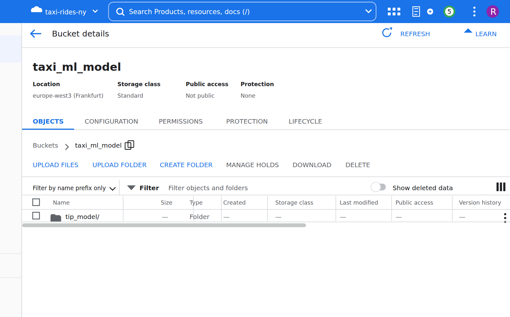
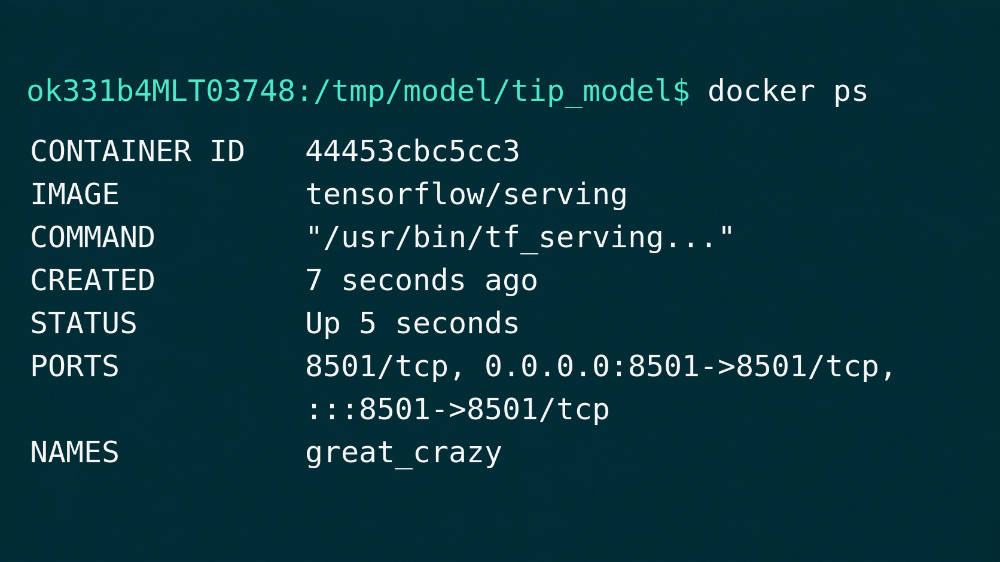
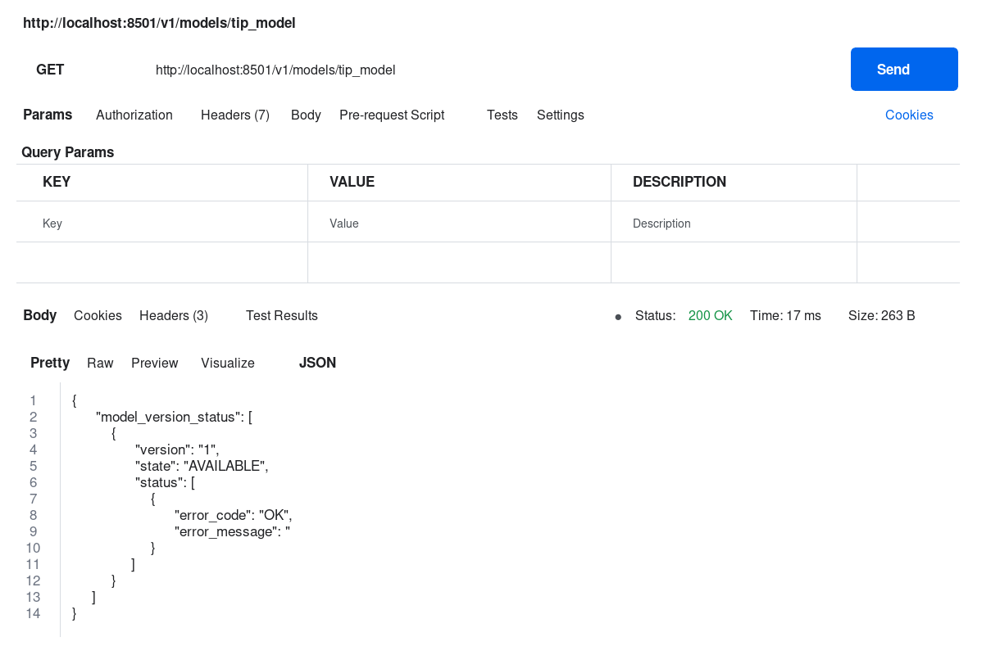
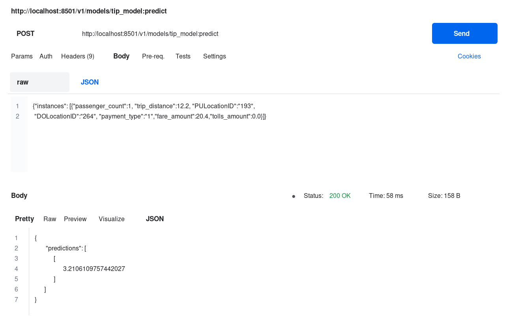
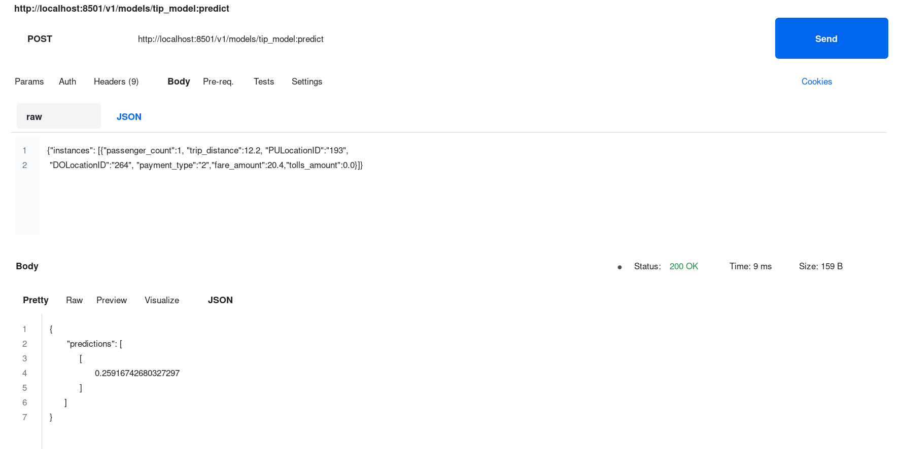

# Triển khai Mô hình Machine Learning từ BigQuery

Trong [học phần trước](05-machine-learning-in-bigquery.md), chúng tôi đã đào tạo mô hình
trong BigQuery để dự đoán mẹo taxi. Ở đây, chúng tôi lấy mô hình đó ra khỏi BigQuery:
, chúng tôi xuất mô hình đó sang Cloud Storage, phân phát cục bộ bằng TensorFlow Serve trong vùng chứa Docker
và gọi mô hình đó qua HTTP để nhận dự đoán.

Các bước thực hiện theo [Hướng dẫn về mô hình xuất khẩu
của Google](https://cloud.google.com/bigquery-ml/docs/export-model-tutorial).

## Xuất mô hình sang Cloud Storage

Sau `gcloud auth login` (đã được thực hiện trong video), chúng tôi sử dụng công cụ dòng lệnh `bq`
để trích xuất mô hình vào nhóm Lưu trữ đám mây:

```bash
bq --project_id taxi-rides-ny extract -m nytaxi.tip_model gs://taxi_ml_model/tip_model
```

Sau khi quá trình xuất kết thúc, thư mục `tip_model` sẽ hiển thị trong nhóm
`taxi_ml_model`:



## Sao chép mô hình cục bộ

Tiếp theo chúng ta kéo mô hình xuống máy của mình với `gsutil`:

```bash
mkdir /tmp/model
gsutil cp -r gs://taxi_ml_model/tip_model /tmp/model
```

Bản sao đầu ra cho biết mô hình BigQuery đã xuất được tạo thành từ đâu - đó là mô hình
TensorFlow: `assets`, `variables` và một vài tệp siêu dữ liệu:

## Phục vụ model bằng Docker

TensorFlow Serve yêu cầu một bố cục cụ thể: một thư mục được đặt tên theo mô hình
, với một thư mục con cho mỗi phiên bản, được đánh số. Vì vậy, chúng tôi tạo
`serving_dir/tip_model/1` và sao chép các tệp mô hình vào thư mục phiên bản.
Thư mục phục vụ có thể tồn tại ở mọi nơi - trong dự án hoặc trong thư mục
tạm thời:

```bash
mkdir -p serving_dir/tip_model/1
cp -r /tmp/model/tip_model/* serving_dir/tip_model/1
docker pull tensorflow/serving
docker run -p 8501:8501 \
  --mount type=bind,source=`pwd`/serving_dir/tip_model,target=/models/tip_model \
  -e MODEL_NAME=tip_model -t tensorflow/serving &
```

Điều này ánh xạ cổng 8501 của vùng chứa tới cổng 8501 trên máy của chúng tôi, gắn thư mục phục vụ
của chúng tôi vào vùng chứa và cho TensorFlow Serve biết mô hình
nào sẽ phân phát thông qua biến môi trường `MODEL_NAME`.

Với `docker ps` chúng ta có thể kiểm tra xem container có đang chạy hay không:



## Kiểm tra model

Dịch vụ TensorFlow hiển thị API REST. Siêu dữ liệu mô hình tồn tại ở
`http://localhost:8501/v1/models/tip_model` - GET ở đó (trong video, với
Postman) sẽ cho chúng tôi biết mô hình vẫn ổn:



Thật vậy, phản hồi cho biết đã có sẵn mô hình tiền boa, phiên bản 1 - không có lỗi.

## Dự đoán qua HTTP

Bây giờ là dự đoán thực tế. Chúng tôi ĐĂNG nội dung JSON có cùng các cột mà mô hình
đã được đào tạo - số lượng hành khách, khoảng cách chuyến đi, điểm đón và trả khách
ID địa điểm, loại thanh toán, số tiền vé và số tiền phí cầu đường - tới
`http://localhost:8501/v1/models/tip_model:predict`:

```bash
curl -d '{"instances": [{"passenger_count":1, "trip_distance":12.2, "PULocationID":"193", "DOLocationID":"264", "payment_type":"1","fare_amount":20.4,"tolls_amount":0.0}]}' \
  -X POST http://localhost:8501/v1/models/tip_model:predict
```

Đối với chuyến đi này, người mẫu dự đoán số tiền tip khoảng 3,2 đô la:



Nếu chúng tôi thay đổi loại thanh toán thành 2 và gửi lại yêu cầu, số tiền boa
dự đoán sẽ giảm đáng kể - xuống còn khoảng 0,26 đô la:



Và đó là toàn bộ vòng lặp: một mô hình được đào tạo bằng SQL bên trong BigQuery, xuất
và dùng làm dịch vụ REST từ vùng chứa Docker trên máy
của riêng chúng tôi.
