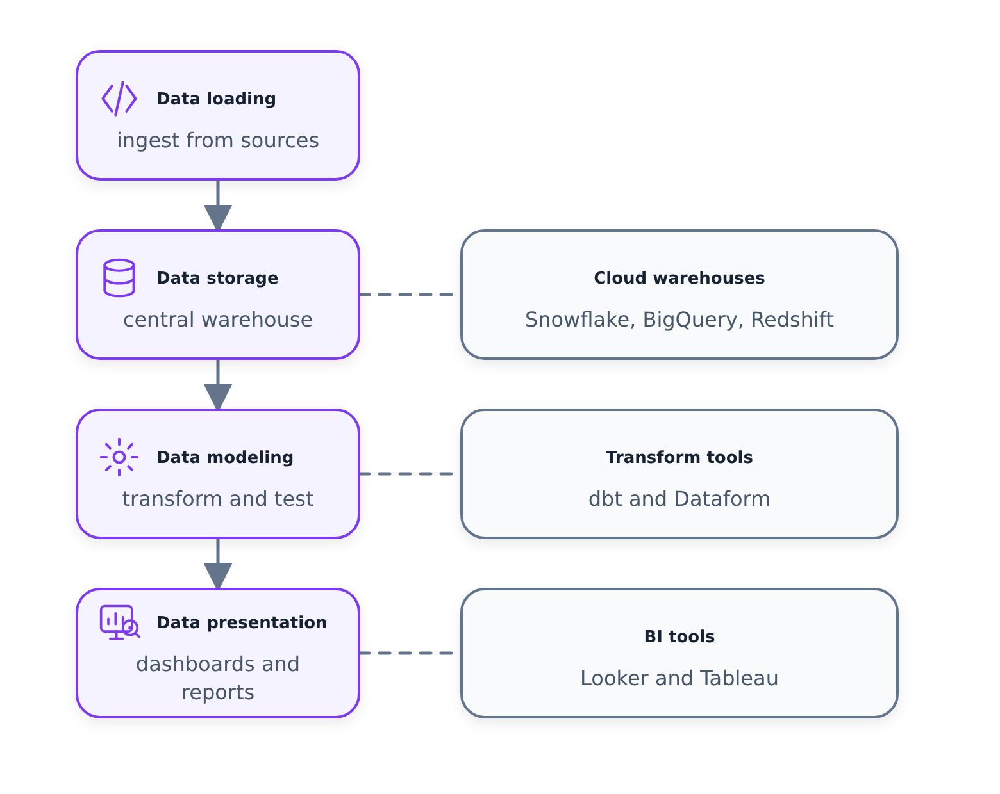

# Khái niệm cơ bản về kỹ thuật phân tích

> 📄 Đọc thêm: [Kỹ thuật phân tích là gì?](https://docs.getdbt.com/docs/introduction)
> 📄 Mô hình hóa thứ nguyên của Kimball: *Bộ công cụ kho dữ liệu* (Ralph Kimball & Margy Ross)

Đây là video khởi động cho Mô-đun 4. Ở đây không có mã hóa thực hành - tất cả chỉ là về việc thiết lập giai đoạn. Tại sao kỹ thuật phân tích tồn tại, nó thực sự làm gì và các khái niệm lập mô hình dữ liệu mà chúng ta sẽ dựa vào trong phần còn lại của mô-đun là gì. Đáng để ngồi trước khi đi sâu vào nội dung dbt.

---

## Tại sao kỹ thuật phân tích tồn tại

Một vài thay đổi trong thế giới dữ liệu đã tạo ra một khoảng trống mà không ai có thể lấp đầy:

- **Kho dữ liệu trên đám mây** (BigQuery, Snowflake, Redshift) giúp cho việc lưu trữ và điện toán trở nên rẻ hơn. Bạn không còn phải phẫu thuật về những dữ liệu bạn tải.
- **Công cụ EL** như Fivetran và Stitch khiến việc đưa dữ liệu vào kho trở nên gần như đơn giản — các bước trích xuất và tải về cơ bản hiện đã được tự động hóa.
- **Các công cụ BI đầu tiên của SQL** như Looker đã đưa tính năng kiểm soát phiên bản vào quy trình làm việc dữ liệu. Và các công cụ như Chế độ hỗ trợ phân tích tự phục vụ cho người dùng doanh nghiệp.
- **Quản trị dữ liệu** đã trở thành một cuộc trò chuyện lớn hơn khi có nhiều người bắt đầu chạm vào dữ liệu hơn.

Tất cả những điều này đã thay đổi cách các nhóm dữ liệu làm việc và cách các bên liên quan sử dụng dữ liệu. Nhưng nó để lại khoảng cách giữa những người xây dựng cơ sở hạ tầng và những người sử dụng dữ liệu.

### Nhóm dữ liệu truyền thống

Trong mô hình cũ, bạn có ba vai trò và được phân chia khá rõ ràng:

- **Kỹ sư dữ liệu** — xây dựng và duy trì cơ sở hạ tầng. Kỹ sư phần mềm giỏi nhưng không nhất thiết phải gần với cách doanh nghiệp thực sự sử dụng dữ liệu.
- **Nhà phân tích dữ liệu** — sử dụng dữ liệu để trả lời các câu hỏi và giải quyết các vấn đề kinh doanh. Hiểu rõ về doanh nghiệp nhưng chưa được đào tạo thành kỹ sư phần mềm.
- **Nhà khoa học dữ liệu** — câu chuyện tương tự với nhà phân tích. Ngày nay, việc viết mã ngày càng nhiều hơn, nhưng các phương pháp thực hành tốt nhất về công nghệ phần mềm không nằm trong chương trình đào tạo.

### Khoảng trống

Các nhà phân tích và nhà khoa học đang viết nhiều mã hơn nhưng họ chưa được đào tạo về việc đó. Các kỹ sư rất giỏi trong việc xây dựng hệ thống, nhưng không phải lúc nào họ cũng biết dữ liệu được sử dụng ở hạ lưu như thế nào. Không ai thu hẹp khoảng cách đó.

### Kỹ sư phân tích

Kỹ sư phân tích là cầu nối. Họ đưa các phương pháp thực hành tốt nhất về công nghệ phần mềm — kiểm soát phiên bản, thử nghiệm, tài liệu, tính mô đun — vào công việc mà các nhà phân tích và nhà khoa học đang thực hiện. Đó là một vai trò nằm ở điểm giao thoa giữa kỹ sư dữ liệu và nhà phân tích dữ liệu.

Về mặt chuỗi công cụ, kỹ sư phân tích có thể chạm vào:

- **Tải dữ liệu** — các công cụ như Fivetran, Stitch (lớp EL)
- **Lưu trữ dữ liệu** — kho dữ liệu đám mây, lãnh thổ chung với các kỹ sư dữ liệu
- **Mô hình hóa dữ liệu** — đây là cốt lõi của nó. Các công cụ như dbt hoặc Dataform. Đây là nơi hầu hết Mô-đun 4 sinh sống.
- **Trình bày dữ liệu** — Các công cụ BI như Google Looker Studio. Sản phẩm cuối cùng mà người dùng doanh nghiệp thực sự nhìn thấy.

Trọng tâm của tuần này là mô hình hóa và trình bày - mọi thứ ở giữa "dữ liệu trong kho" và "người dùng doanh nghiệp nhìn thấy trang tổng quan".

---

## ETL vs ELT - tóm tắt nhanh

Hai triết lý để chuyển đổi và sẵn sàng dữ liệu:

**ETL (Trích xuất → Chuyển đổi → Tải)** — bạn chuyển đổi dữ liệu *trước khi* nó được đưa vào kho. Mất nhiều thời gian thiết lập hơn vì logic chuyển đổi phải được xây dựng trước nhưng dữ liệu trong kho luôn sạch sẽ và ổn định ngay từ ngày đầu tiên.

**ELT (Trích xuất → Tải → Chuyển đổi)** — bạn tải dữ liệu thô trước, sau đó chuyển đổi nó *bên trong* kho. Nhanh hơn và linh hoạt hơn. Đây là cách tiếp cận mà kho lưu trữ đám mây có thể thực hiện được — dung lượng lưu trữ rẻ nên chỉ cần tải mọi thứ và tìm hiểu các chuyển đổi sau này.

ELT hiện là phương pháp chủ đạo và cũng là phương pháp chúng tôi sẽ sử dụng. dbt hoàn toàn khớp với chữ "T" của ELT — nó chạy các phép biến đổi bên trong kho bằng cách sử dụng SQL.

---

## Mô hình hóa thứ nguyên - các khái niệm chính

Đây là khuôn khổ của Kimball và là mô hình tinh thần chính về cách chúng ta sắp xếp dữ liệu của mình trong tuần này. Mục tiêu gồm có hai phần: làm cho dữ liệu **dễ hiểu đối với người dùng doanh nghiệp** và thực hiện **truy vấn nhanh**.

Lưu ý: không giống như dạng chuẩn thứ ba (3NF), mô hình hóa các chiều có chủ ý cho phép dư thừa một số dữ liệu. Ưu tiên là khả năng sử dụng và hiệu suất, không loại bỏ sự trùng lặp.

### Bảng sự kiện và bảng thứ nguyên (Lược đồ hình sao)

Hai khối xây dựng:

- **Bảng dữ kiện** — số đo, số liệu, sự kiện kinh doanh. Hãy coi chúng như **động từ**. "Một cuộc mua bán đã xảy ra." "Một đơn đặt hàng đã được đặt." Chúng tương ứng với một quy trình kinh doanh.
- **Bảng thứ nguyên** — bối cảnh xung quanh những dữ kiện đó. Hãy coi chúng như **danh từ**. "Ai đã mua nó? Sản phẩm gì? Khi nào?" Chúng tương ứng với một thực thể kinh doanh như khách hàng hoặc sản phẩm.

Chúng cùng nhau tạo thành một **lược đồ sao** — bảng dữ kiện ở giữa, các bảng thứ nguyên tỏa ra xung quanh nó. Đó là cách bố trí cổ điển mà bạn sẽ thấy ở hầu hết các kho dữ liệu.

### Tương tự nhà bếp

Cuốn sách của Kimball sử dụng sự tương tự về nhà hàng để mô tả cách dữ liệu truyền qua nhà kho. Nó ánh xạ khá rõ ràng về những gì chúng ta sẽ làm trong dự án:

- **Khu vực tổ chức (phòng đựng thức ăn)** — dữ liệu thô nằm ở đây. Không dành cho người dùng doanh nghiệp. Chỉ những người biết họ đang làm gì mới nên tìm hiểu về nó.
- **Khu vực xử lý (nhà bếp)** — đây là nơi dữ liệu thô được chuyển đổi thành các mô hình dữ liệu phù hợp. Một lần nữa, chỉ giới hạn ở những người nấu ăn - kỹ sư dữ liệu và kỹ sư phân tích. Trọng tâm ở đây là hiệu quả và các tiêu chuẩn sau đây.
- **Khu vực trình bày (phòng ăn)** — sản phẩm cuối cùng, được đánh bóng. Đây là những gì các bên liên quan kinh doanh thực sự nhìn thấy và tương tác. Sạch sẽ, có cấu trúc, sẵn sàng để tiêu thụ.

Chúng ta sẽ xây dựng chính xác cấu trúc phân lớp này trong dự án dbt của mình trong suốt mô-đun.
