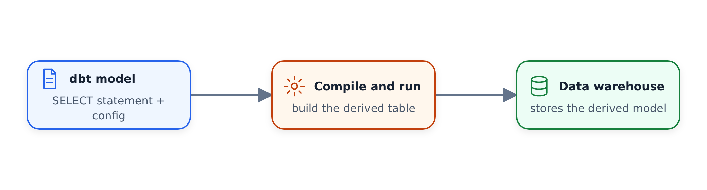

#dbt là gì?

> 📄 Tài liệu chính thức: [Giới thiệu về dbt](https://docs.getdbt.com/docs/introduction)
> 📄 dbt Cloud vs Core: [Chọn dbt của bạn](https://docs.getdbt.com/docs/cloud/about-cloud/dbt-cloud-features)

Đây là tổng quan toàn cảnh về dbt trước khi chúng ta bắt đầu xây dựng bất cứ thứ gì. Nó là gì, nó giải quyết được vấn đề gì và chúng ta sẽ sử dụng nó như thế nào trong khóa học. Chưa có công việc thực hành nào - chỉ là đóng khung.

---

##dbt là gì?

dbt là một công cụ quy trình chuyển đổi. Nó nằm trên kho dữ liệu của bạn và giúp bạn biến dữ liệu thô thành thứ gì đó hữu ích cho người tiêu dùng ở hạ nguồn (nhà phân tích, công cụ BI, quy trình ML, bất cứ thứ gì cần dữ liệu có cấu trúc, sạch sẽ).

Bạn viết SQL (hoặc Python) để xác định các phép biến đổi của mình và dbt xử lý phần còn lại: biên dịch nó, chạy nó trên kho, quản lý các phần phụ thuộc và lưu giữ kết quả dưới dạng bảng hoặc dạng xem.

Trong cơ sở thiết lập công ty thực sự, bạn sẽ có dữ liệu được truyền đến từ khắp nơi — hệ thống phụ trợ, ứng dụng giao diện người dùng, API của bên thứ ba như dữ liệu thời tiết. Tất cả những thứ đó sẽ được tải vào kho của bạn (BigQuery, Snowflake, Databricks, bất cứ thứ gì) và dbt là lớp biến đổi dữ liệu thô đó thành thứ mà doanh nghiệp thực sự có thể tiêu thụ.

---

## Nó giải quyết được vấn đề gì

Bước biến đổi đã luôn tồn tại. Những gì dbt mang đến là **các phương pháp hay nhất về kỹ thuật phần mềm dành cho mã phân tích**. Những điều mà các kỹ sư phần mềm đã làm trong nhiều năm nhưng chưa có con đường rõ ràng để bước vào thế giới phân tích:

- **Kiểm soát phiên bản** — các chuyển đổi của bạn tồn tại trong git, giống như bất kỳ mã nào khác
- **Modularity** — chia logic phức tạp thành các phần có thể sử dụng lại thay vì các truy vấn spaghetti khổng lồ
- **Thử nghiệm** — kiểm tra chất lượng dữ liệu tự động chạy trong mỗi lần triển khai
- **Tài liệu** — được tạo từ mã của bạn, không phải một wiki riêng biệt đã lỗi thời
- **Môi trường** — nhà phát triển và sản phẩm riêng biệt. Mỗi nhà phát triển có hộp cát riêng để làm việc mà không cần dẫm chân lên nhau
- **CI/CD** — triển khai tự động với xác thực và khôi phục

Kết quả là đường ống chất lượng cao hơn, dễ bảo trì hơn và ít bị hỏng hơn trong quá trình sản xuất.

---

## Cách thức hoạt động — cơ chế

Bạn viết một tệp SQL. Nó trông giống như một câu lệnh `SELECT` bình thường. dbt lấy tệp đó, tìm ra vị trí cần đặt trong kho (lược đồ nào, tập dữ liệu nào, môi trường nào), gói nó trong DDL/DML cần thiết, biên dịch nó bằng bất kỳ khuôn mẫu Jinja nào bạn đã sử dụng và chạy nó.

Khi bạn chạy `dbt run`, nó:
1. Biên dịch SQL của bạn (giải quyết các cuộc gọi `ref()`, các cuộc gọi `source()`, macro Jinja, mọi thứ)
2. Gửi SQL đã biên dịch đến kho
của bạn 3. Hiện thực hóa kết quả dưới dạng bảng, dạng xem, tăng dần bảng hoặc CTE tạm thời - bất cứ thứ gì bạn đã định cấu hình

Bạn không tự mình viết các câu lệnh `CREATE TABLE`. Bạn chỉ cần viết `SELECT` và dbt sẽ xử lý phần còn lại.

---

## dbt Core so với dbt Cloud

Có hai cách để sử dụng dbt và bạn nên hiểu sự khác biệt:

### dbt Core

Nguồn mở. Miễn phí. Bạn cài đặt nó cục bộ trên máy của mình (hoặc bất cứ nơi nào) và chạy các lệnh từ thiết bị đầu cuối. Bạn chịu trách nhiệm về:

- Thiết lập môi trường nhà phát triển của bạn
- Điều phối các hoạt động sản xuất (Luồng khí, công việc định kỳ, bất cứ điều gì bạn muốn)
- Tài liệu lưu trữ nếu bạn muốn có thể truy cập được
- Quản lý nhật ký và siêu dữ liệu

Đó là động cơ thô. Bạn có toàn quyền kiểm soát, nhưng bạn cũng phải tự mình xây dựng cơ sở hạ tầng xung quanh.

### dbt Đám mây

Sản phẩm SaaS chạy dbt Core dưới mui xe. Nó mang lại cho bạn:

- IDE dựa trên web để viết các phép biến đổi (hoặc bạn có thể sử dụng Cloud CLI nếu bạn thích phát triển cục bộ)
- Quản lý môi trường — dev/staging/prod, tất cả đều được xử lý cho bạn
- Điều phối tích hợp (lập kế hoạch công việc, trình kích hoạt, phần phụ thuộc)
- Tài liệu được lưu trữ (được tạo và phân phát tự động)
- Ghi nhật ký và khả năng quan sát
- API để quản trị và truy cập siêu dữ liệu
- Lớp ngữ nghĩa cho các số liệu (nếu bạn cần)

Có gói Nhà phát triển miễn phí phù hợp cho các nhóm nhỏ hoặc học tập cá nhân. Đối với bất cứ điều gì lớn hơn, đó là một sản phẩm phải trả phí.

---

## Thiết lập khóa học — hai đường dẫn

Zoomcamp cung cấp cho bạn hai tùy chọn và các video sẽ xen kẽ giữa chúng (phiên bản A và phiên bản B):

### Tùy chọn A: BigQuery + dbt Cloud (khuyên dùng)

- Kho dữ liệu: BigQuery (giả sử bạn đã thiết lập kho dữ liệu này vào các tuần trước)
- dbt: dbt Cloud Developer plan (tài khoản miễn phí, web IDE)
- Không cần cài đặt cục bộ

Đây là con đường mà hầu hết các video sẽ đi theo. Đó là cách nhanh nhất để bắt đầu và gần nhất với cách các nhóm thực sự sử dụng dbt trong sản xuất.

### Tùy chọn B: DuckDB + dbt Core

- Kho dữ liệu: DuckDB (cục bộ hoặc tuy nhiên bạn đã thiết lập)
- dbt: dbt Core được cài đặt cục bộ
- Môi trường nhà phát triển: IDE của riêng bạn (Mã VS, v.v.)
- Điều phối: bạn sẽ cần xử lý việc này một cách riêng biệt (Airflow, Prefect, bất cứ thứ gì)

Đường dẫn này giúp bạn kiểm soát thực tế hơn nhưng yêu cầu thiết lập nhiều hơn.

---

## Luồng dự án

Khi chúng ta kết thúc mô-đun, đây là những gì chúng ta đã xây dựng:

1. Dữ liệu thô trong kho — dữ liệu chuyến đi từ các tuần trước, cùng với bảng tra cứu để chứng minh việc kết hợp nhiều nguồn
2. các phép biến đổi dbt biến dữ liệu thô đó thành các bảng được mô hình hóa phù hợp theo các khái niệm mô hình hóa thứ nguyên từ 4.1.1
3. Bảng điều khiển sử dụng đầu ra cuối cùng và làm cho nó hữu ích cho các bên liên quan trong kinh doanh

Các video tiếp theo sẽ hướng dẫn cách thiết lập và xây dựng nó từng bước một.
