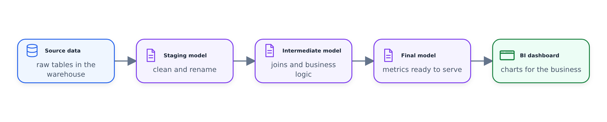

#Tài liệu

> 📄 Tài liệu chính thức: [Tài liệu](https://docs.getdbt.com/docs/build/documentation)
> 📄 Thuộc tính mô hình: [Thuộc tính mô hình](https://docs.getdbt.com/reference/model-properties)

Các mô hình được xây dựng. Bây giờ là lúc đảm bảo rằng những người khác thực sự có thể hiểu được những gì họ làm. Video này trình bày cách hoạt động của hệ thống tài liệu của dbt - bạn viết gì, viết ở đâu và dbt làm gì với nó.


---

## Nơi tài liệu tồn tại — Tệp YAML

Bạn đã thấy các tệp YAML trong bối cảnh nguồn. Nhưng chúng còn làm được nhiều việc hơn là chỉ khai báo nơi lưu trữ dữ liệu thô — chúng còn là **nơi chính để ghi lại toàn bộ dự án của bạn**.

Quy ước phổ biến nhất là có một tệp duy nhất có tên `schema.yml` cho mỗi thư mục. Một số nhóm thích **một tệp YAML cho mỗi mô hình** — điều đó cũng không sao, nó giúp mọi thứ không trở nên khó sử dụng khi các dự án có quy mô lớn. Đối với khóa học này, chúng tôi sử dụng `schema.yml`.

> 📄 [Thuộc tính mô hình - tham khảo đầy đủ](https://docs.getdbt.com/reference/model-properties)

---

## Những gì bạn có thể ghi lại

Hầu hết mọi thứ trong dbt đều có thể được ghi lại. Cấu trúc có cùng một mẫu bất kể bạn đang ghi lại nội dung gì:

### Nguồn

Bạn đã có `sources.yml` - bạn có thể thêm mô tả vào chính nguồn đó và vào từng bảng bên trong nó.

```yaml
version: 2

sources:
  - name: staging
    description: >
      Raw NYC taxi trip data loaded from BigQuery external tables.
      Contains both yellow and green taxi trip records for 2019-2020.
    database: production
    schema: trips_data_all

    tables:
      - name: green_tripdata
        description: >
          Green taxi trip records. Green taxis operate primarily in
          outer boroughs (outside Manhattan).

      - name: yellow_tripdata
        description: Yellow taxi trips, primarily from Manhattan
```

### Model

Trong `schema.yml`, bạn chuyển từ `sources:` sang `models:`. Cùng một ý tưởng - đặt tên và mô tả cho mỗi mô hình, sau đó đi sâu vào các cột.

```yaml
version: 2

models:
  - name: dim_zones
    description: >
      Zone lookup table containing LocationID, borough, zone name and service zone.
      One row per taxi zone in NYC.
    columns:
      - name: locationid
        description: Primary key for taxi zones
        tests:
          - unique
          - not_null

      - name: borough
        description: NYC borough name (Manhattan, Queens, Brooklyn, Bronx, Staten Island, EWR)

      - name: zone
        description: Taxi zone name/neighborhood

      - name: service_zone
        description: Service zone type (Yellow, Green, or Airports)
```

### Cột
Trong mỗi mô hình, bạn có thể liệt kê mọi cột với:
- **name** — phải khớp với tên cột thực tế
- **description** — ý nghĩa của nó
- **data_type** — loại cột đó phải là gì (thông tin, không được thực thi)
- **kiểm tra** — chúng tôi sẽ đề cập đến những điều này trong video tiếp theo, nhưng vị trí ở đây là
- **meta** — thẻ khóa-giá trị tùy chỉnh (xem thêm về điều này bên dưới)

### Macro và hạt giống
Bạn cũng có thể ghi lại những thứ này bằng cách sử dụng cùng một mẫu YAML. Tiêu đề `version: 2` tương tự, chỉ khác các khóa cấp cao nhất.

---

## Mô tả nhiều dòng

Nếu bạn cần nhiều dòng cho một mô tả, hãy sử dụng **toán tử ống** YAML (`|`) hoặc **toán tử lớn hơn** (`>`). Mọi thứ được thụt vào bên dưới nó sẽ trở thành một phần của mô tả. `>` gấp các dòng mới vào khoảng trắng, trong khi `|` giữ nguyên chúng.

```yaml
version: 2

models:
  - name: fct_trips
    description: |
      Fact table containing all taxi trips from both yellow and green taxis.

      This is the core analytical table for trip-level analysis.
      Each row represents a single trip with:
      - Trip identifiers and service type
      - Pickup and dropoff locations and timestamps
      - Trip details (distance, passenger count, etc.)
      - Payment information and amounts

      Data is filtered for 2019-2020 only and excludes records
      with unknown pickup or dropoff locations.
```

---

## Thẻ meta - siêu dữ liệu tùy chỉnh

Trường `meta` cho phép bạn đính kèm các cặp khóa-giá trị tùy ý vào bất kỳ cột hoặc mô hình nào. Không có bộ nào được xác định trước — bạn và nhóm của bạn quyết định điều gì quan trọng. Ví dụ phổ biến:

- **PII** — cột gắn cờ chứa thông tin nhận dạng cá nhân
- **chủ sở hữu** — người chịu trách nhiệm về nội dung dữ liệu này, người liên hệ nếu có sự cố xảy ra
- **tầm quan trọng** — đánh dấu cột hoặc mô hình nào là quan trọng so với
mang tính thông tin
Những điều này không ảnh hưởng đến cách dbt chạy bất cứ thứ gì. Chúng hoàn toàn nhằm mục đích quản trị, khả năng khám phá và giúp nhóm của bạn điều hướng dự án.

---

## Tạo và xem tài liệu

Hai lệnh, chạy theo thứ tự:

### `dbt docs generate`
- Biên dịch mọi thứ — mô tả YAML, mã mô hình và siêu dữ liệu từ kho (như loại cột và kích thước bảng thực tế) — vào tệp JSON
- Trong **dbt Cloud**, điều này diễn ra tự động. Thậm chí còn có một hộp kiểm cho nó
- Trong **dbt Core**, bạn phải tự chạy nó

### `dbt docs serve`
- Lấy JSON được tạo và tạo một trang web cục bộ (mặc định là `localhost:8080`)
- Chỉ cần nếu bạn đang sử dụng **dbt Core** — dbt Cloud lưu trữ tài liệu cho bạn
- Nếu bạn muốn người khác nhìn thấy nó, bạn sẽ cần lưu trữ nó ở đâu đó (S3, Netlify, v.v.)

### Trang web tài liệu hiển thị cho bạn những gì
- **Mã mẫu** — cả phiên bản Jinja bạn đã viết và SQL đã biên dịch thực sự truy cập vào cơ sở dữ liệu
- **Thông tin cột** — loại, mô tả, mọi thứ bạn đã thêm
- **Biểu đồ dòng** — một DAG trực quan hiển thị các nguồn có màu xanh lục, cho đến tận các mô hình mart cuối cùng của bạn. Bạn có thể biết chính xác điều gì phụ thuộc vào điều gì và liệu một thay đổi có thể phá vỡ điều gì đó ở hạ lưu
- **Cấu trúc dự án** — chuyển đổi giữa chế độ xem thư mục và chế độ xem cơ sở dữ liệu



Nó giống một công cụ **tài liệu kỹ thuật** hơn là một danh mục dữ liệu đẹp mắt. Nó sẽ không thay thế những thứ như danh mục dữ liệu của Looker hoặc Confluent dành cho các bên liên quan phi kỹ thuật. Nhưng đối với những người xây dựng mô hình, nó thực sự hữu ích - bạn có thể xem nhanh nội dung dữ liệu nào tồn tại, cách chúng kết nối và cách chúng hoạt động.
