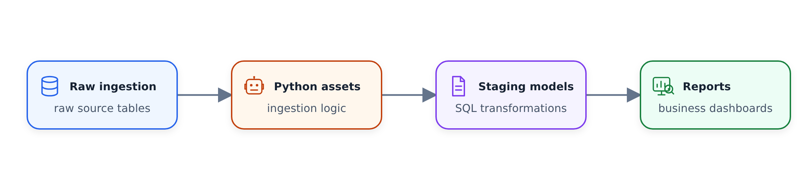

# Xây dựng đường ống từ đầu đến cuối với dữ liệu taxi NYC

## Kiến trúc

Đường dẫn ba lớp sử dụng DuckDB làm cơ sở dữ liệu được lưu trữ cục bộ:

1. Lớp nhập: trích xuất dữ liệu và lưu trữ ở định dạng thô
2. Lớp phân tầng: tiền xử lý, làm sạch, chuyển đổi, nối với các bảng tra cứu
3. Lớp báo cáo: tổng hợp dữ liệu và chạy tính toán

Tất cả nội dung đều có phần phụ thuộc tạo ra dòng dữ liệu mà Bruin sử dụng để điều phối.


*Ba lớp tách biệt việc trích xuất thô, làm sạch và nối cũng như các tập hợp dành cho doanh nghiệp trong khi vẫn bảo toàn dòng dõi.*



## Thiết lập dự án

Khởi tạo từ mẫu zoomcamp:

```bash
bruin init zoomcamp my-taxi-pipeline
cd my-taxi-pipeline
```

Cấu trúc dự án:

```text
zoomcamp/
├── .bruin.yml
├── README.md
└── pipeline/
    ├── pipeline.yml
    └── assets/
        ├── ingestion/
        │   ├── trips.py
        │   ├── requirements.txt
        │   ├── payment_lookup.asset.yml
        │   └── payment_lookup.csv
        ├── staging/
        │   └── trips.sql
        └── reports/
            └── trips_report.sql
```

### .bruin.yml

```yaml
default_environment: default

environments:
  default:
    connections:
      duckdb:
        - name: duckdb-default
          path: duckdb.db
```

### pipe.yml

```yaml
name: nyc_taxi
schedule: daily
start_date: "2022-01-01"
default_connections:
  duckdb: duckdb-default
variables:
  taxi_types:
    type: array
    items:
      type: string
    default: ["yellow"]
```

- `start_date`: khi chạy làm mới hoàn toàn, xử lý dữ liệu bắt đầu từ ngày này
- Biến tùy chỉnh: `taxi_types` cho phép bạn kiểm soát loại taxi nào sẽ nhập (vàng, xanh lục hoặc cả hai)
- Biến có thể được ghi đè khi chạy bằng `--var`

## Lớp tiêu hóa

### Nội dung Python: trip.py

Tài sản Python kết nối với API taxi NYC và trích xuất dữ liệu.

```python
"""@bruin
name: ingestion.trips
type: python
image: python:3.11

materialization:
  type: table
  strategy: append

columns:
  - name: pickup_datetime
    type: timestamp
    description: "When the meter was engaged"
  - name: dropoff_datetime
    type: timestamp
    description: "When the meter was disengaged"
@bruin"""

import os
import json
import pandas as pd

def materialize():
    start_date = os.environ["BRUIN_START_DATE"]
    end_date = os.environ["BRUIN_END_DATE"]
    taxi_types = json.loads(os.environ["BRUIN_VARS"]).get("taxi_types", ["yellow"])

    # Generate list of months between start and end dates
    # Fetch parquet files from:
    # https://d37ci6vzurychx.cloudfront.net/trip-data/{taxi_type}_tripdata_{year}-{month}.parquet

    return final_dataframe
```

- `materialize()` trả về DataFrame; Bruin xử lý việc chèn nó vào chiến lược
- `append` đích: mỗi lần chạy sẽ chèn dữ liệu mà không chạm vào các hàng hiện có
- Sử dụng các biến môi trường `BRUIN_START_DATE` / `BRUIN_END_DATE` cho cửa sổ thời gian
- Sử dụng `BRUIN_VARS` để đọc `taxi_types` biến đường ống

### Tệp hạt giống: Payment_lookup.asset.yml

Tệp hạt giống nhập dữ liệu từ tệp CSV cục bộ vào cơ sở dữ liệu.

```yaml
name: ingestion.payment_lookup
type: duckdb.seed
parameters:
  path: payment_lookup.csv
columns:
  - name: payment_type_id
    type: integer
    description: "Numeric code for payment type"
    primary_key: true
    checks:
      - name: not_null
      - name: unique
  - name: payment_type_name
    type: string
    description: "Human-readable payment type"
    checks:
      - name: not_null
```

Payment_lookup.csv:

```csv
payment_type_id,payment_type_name
0,flex_fare
1,credit_card
2,cash
3,no_charge
4,dispute
5,unknown
6,voided_trip
```

Kiểm tra chất lượng (`not_null`, `unique`) chạy tự động sau khi nội dung kết thúc.

###Yêu cầu.txt

```
pandas
requests
pyarrow
python-dateutil
```

Bruin xử lý môi trường và cài đặt các phần phụ thuộc cục bộ trong đường ống.

## Lớp dàn dựng

### Nội dung SQL: staging/trips.sql

```sql
/* @bruin
name: staging.trips
type: duckdb.sql

depends:
  - ingestion.trips
  - ingestion.payment_lookup

materialization:
  type: table
  strategy: time_interval
  incremental_key: pickup_datetime
  time_granularity: timestamp

columns:
  - name: pickup_datetime
    type: timestamp
    primary_key: true
    checks:
      - name: not_null

custom_checks:
  - name: row_count_greater_than_zero
    query: |
      SELECT CASE WHEN COUNT(*) > 0 THEN 1 ELSE 0 END
      FROM staging.trips
    value: 1
@bruin */

SELECT
    t.pickup_datetime,
    t.dropoff_datetime,
    t.pickup_location_id,
    t.dropoff_location_id,
    t.fare_amount,
    t.taxi_type,
    p.payment_type_name
FROM ingestion.trips t
LEFT JOIN ingestion.payment_lookup p
    ON t.payment_type = p.payment_type_id
WHERE t.pickup_datetime >= '{{ start_datetime }}'
  AND t.pickup_datetime < '{{ end_datetime }}'
QUALIFY ROW_NUMBER() OVER (
    PARTITION BY t.pickup_datetime, t.dropoff_datetime,
                 t.pickup_location_id, t.dropoff_location_id, t.fare_amount
    ORDER BY t.pickup_datetime
) = 1
```

- Chiến lược `time_interval`: xóa các hàng trong cửa sổ thời gian, sau đó chèn kết quả truy vấn
- Mệnh đề `WHERE` phải lọc về cùng một cửa sổ thời gian để tránh trùng lặp
- `QUALIFY ROW_NUMBER()` loại bỏ trùng lặp bằng khóa tổng hợp
- Phụ thuộc vào cả hai `ingestion.trips` và `ingestion.payment_lookup` đảm bảo điều này chạy sau khi nhập

## Lớp báo cáo

### Nội dung SQL: report/trips_report.sql

```sql
/* @bruin
name: reports.trips_report
type: duckdb.sql

depends:
  - staging.trips

materialization:
  type: table
  strategy: time_interval
  incremental_key: trip_date
  time_granularity: date

columns:
  - name: trip_date
    type: date
    primary_key: true
  - name: taxi_type
    type: string
    primary_key: true
  - name: payment_type
    type: string
    primary_key: true
  - name: trip_count
    type: bigint
    checks:
      - name: non_negative
@bruin */

SELECT
    CAST(pickup_datetime AS DATE) AS trip_date,
    taxi_type,
    payment_type_name AS payment_type,
    COUNT(*) AS trip_count,
    SUM(fare_amount) AS total_fare,
    AVG(fare_amount) AS avg_fare
FROM staging.trips
WHERE pickup_datetime >= '{{ start_datetime }}'
  AND pickup_datetime < '{{ end_datetime }}'
GROUP BY 1, 2, 3
```

## Chạy toàn bộ đường ống

```bash
# Validate structure and definitions
bruin validate ./pipeline/pipeline.yml

# Run with a small date range for testing
bruin run ./pipeline/pipeline.yml --start-date 2022-01-01 --end-date 2022-02-01

# Full refresh
bruin run ./pipeline/pipeline.yml --full-refresh

# Query results
bruin query --connection duckdb-default --query "SELECT COUNT(*) FROM ingestion.trips"
```

Mở tệp YAML quy trình trong bảng điều khiển Bruin và xem tab dòng dõi để xem tất cả nội dung và phần phụ thuộc của chúng. Lệnh thực hiện:

1. Nội dung truyền dẫn chạy trước (các chuyến đi + tra cứu, song song)
2. Nội dung phân giai đoạn chạy sau khi cả hai nội dung truyền nhập hoàn tất
3. Nội dung báo cáo chạy sau khi phân giai đoạn hoàn tất

## Tóm tắt chiến lược vật chất hóa

| Chiến lược | Hành vi |
|----------|----------|
| `table` | Thả và tạo lại bảng mỗi lần |
| `append` | Chèn dữ liệu mới mà không cần chạm vào các hàng hiện có |
| `merge` | Upsert dựa trên các cột chính |
| `time_interval` | Xóa các hàng trong phạm vi ngày rồi chèn lại |
| `delete+insert` | Xóa các hàng phù hợp, sau đó chèn |
| `create+replace` | Tạo hoặc thay thế bảng |
