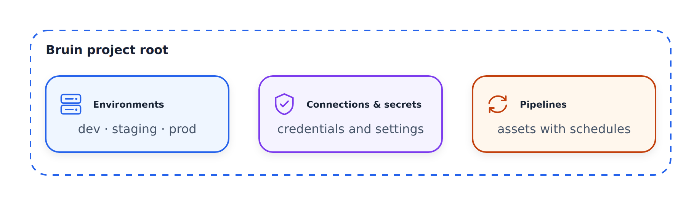

# Khái niệm cốt lõi: Dự án

## Dự án là gì?

**Dự án** là thư mục gốc nơi bạn tạo toàn bộ đường dẫn dữ liệu Bruin của mình. Nó đóng vai trò là nền tảng để tổ chức tất cả nội dung dữ liệu, cấu hình và kết nối của bạn.


*Dự án là ranh giới cho cấu hình: các bí mật cục bộ nằm ngoài tầm kiểm soát phiên bản trong khi các môi trường chọn kết nối của riêng chúng.*



## Khởi tạo dự án

Dự án phải được khởi tạo bằng `bruin init` để công cụ CLI có thể hiểu cấu trúc thư mục và điều hướng tệp một cách chính xác.

```bash
bruin init zoomcamp my-pipeline
cd my-pipeline
```

## Tệp `.bruin.yml`

Nằm ở thư mục gốc của dự án, tệp này xác định môi trường, kết nối và bí mật.

**Quan trọng:** Tệp này luôn được thêm vào `.gitignore` để bảo vệ bí mật. Nó chỉ tồn tại cục bộ và không bao giờ được đẩy tới kho lưu trữ của bạn.

### Môi trường

Xác định các môi trường khác nhau cho các giai đoạn khác nhau:

```yaml
default_environment: default

environments:
  default:
    connections:
      duckdb:
        - name: duckdb-default
          path: duckdb.db
      motherduck:
        - name: motherduck
          token: <your-token>

  production:
    connections:
      bigquery:
        - name: bq-prod
          project: my-project
          dataset: production
```

**Lợi ích:**
- Chạy quy trình cục bộ hoặc trên máy chủ mà không để lộ thông tin xác thực sản xuất
- Các nhóm khác nhau có thể có quyền truy cập kết nối khác nhau
- Mặc định là môi trường `dev` để ngăn việc chạy sản xuất vô tình

### Kiểu kết nối

Các kết nối tích hợp bao gồm:
- DuckDB, MotherDuck
- PostgreSQL, MySQL
- BigQuery, Redshift, Snowflake
- Kết nối tùy chỉnh (dành cho khóa API, bí mật, v.v.)

### Môi trường mặc định

Đặt môi trường nào được sử dụng theo mặc định:

```yaml
default_environment: dev
```

Điều này đảm bảo quy trình chạy trong quá trình phát triển trừ khi được yêu cầu rõ ràng là sử dụng sản xuất.

## Tham khảo nhanh

```bash
# Initialize a new project
bruin init zoomcamp my-pipeline

# Navigate to your project
cd my-pipeline

# Check project is valid
bruin validate .
```

## Đọc thêm

- [Tài liệu về Bruin - Dự án](https://getbruin.com/docs/bruin/core-concepts/project.html)
- [Bruin GitHub - Mẫu](https://github.com/bruin-data/bruin/tree/main/templates)
