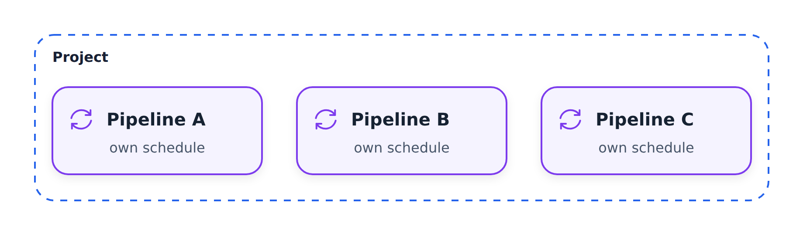
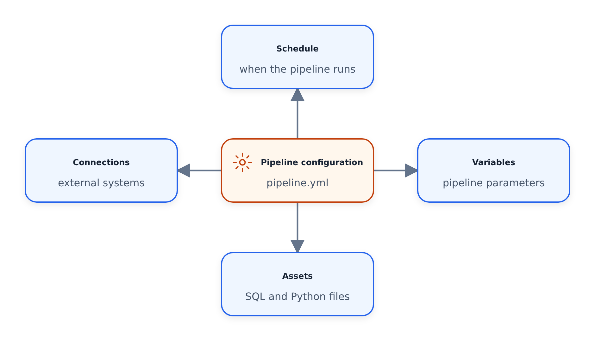

# Khái niệm cốt lõi: Đường ống

## Đường ống là gì?

**Đường dẫn** là một cơ chế nhóm để tổ chức nội dung dựa trên lịch trình thực thi và yêu cầu cấu hình của chúng. Trong một dự án, bạn có thể có nhiều đường ống.


*Một quy trình là nhóm hoạt động: lịch trình được chia sẻ và phạm vi kết nối xung quanh biểu đồ phụ thuộc của nội dung.*





## Đặc điểm chính

### Lịch đơn

Mỗi quy trình có **một lịch trình** - đây là lý do chính để nhóm các nội dung lại với nhau:
- Các nội dung có cùng lịch trình thuộc về cùng một quy trình
- Các lịch trình chung: `hourly`, `daily`, `monthly` hoặc biểu thức cron

### Cấu trúc đường ống

Mỗi đường ống có thư mục riêng chứa tệp `pipeline.yml`:

```text
project/
├── .bruin.yml
├── pipelines/
│   ├── nyc-taxi/
│   │   ├── pipeline.yml
│   │   └── assets/
│   └── another-pipeline/
│       ├── pipeline.yml
│       └── assets/
```

## Tệp `pipeline.yml`

```yaml
name: nyc_taxi
schedule: monthly
start_date: "2019-01-01"
default_connections:
  duckdb: duckdb-default
```

### Tùy chọn cấu hình

| Cài đặt | Mô tả |
|---------|-------------|
| `name` | Mã định danh đường ống |
| `schedule` | Khi nào nên chạy (cron, hàng ngày, hàng tháng, v.v.) |
| `start_date` | Khi đường dẫn bắt đầu hoạt động |
| `default_connections` | Sử dụng kết nối nào |
| `variables` | Biến tùy chỉnh cho quy trình |

### Phạm vi kết nối

Mặc dù các kết nối được xác định ở cấp dự án (`.bruin.yml`), mỗi quy trình chỉ định **kết nối nào nó sử dụng**.

**Tại sao điều này lại quan trọng:**
- Trong các tổ chức lớn, các nhóm khác nhau có thể cần thông tin xác thực khác nhau
- Ngăn chặn việc tiết lộ bí mật không cần thiết
- Chỉ khởi tạo các kết nối cần thiết cho quá trình chạy quy trình cụ thể
- Cách ly bảo mật giữa các phòng ban

## Tham khảo nhanh

```bash
# Validate a pipeline
bruin validate ./pipelines/nyc-taxi/pipeline.yml

# View pipeline lineage
bruin lineage ./pipelines/nyc-taxi/pipeline.yml

# Run the entire pipeline
bruin run ./pipelines/nyc-taxi/pipeline.yml
```

## Đọc thêm

- [Tài liệu về Bruin - Đường ống](https://getbruin.com/docs/bruin/pipelines/definition.html)
- [Tham khảo cấu hình đường ống](https://getbruin.com/docs/bruin/pipelines/definition.html)
