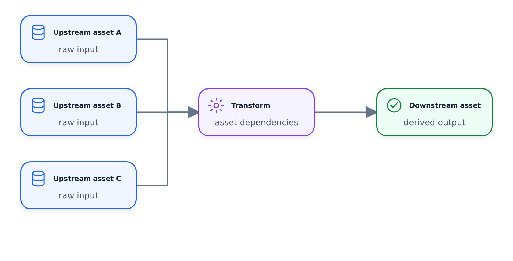

# Khái niệm cốt lõi: Tài sản

## Tài sản là gì?

**Tài sản** là một tệp duy nhất thực hiện một tác vụ cụ thể, hầu như luôn liên quan đến việc tạo hoặc cập nhật bảng hoặc dạng xem trong cơ sở dữ liệu đích.

Mỗi tệp nội dung chứa hai phần:

1. **Định nghĩa** (Cấu hình) - Siêu dữ liệu, tên, loại, kết nối
2. **Nội dung** (Mã) - Mã SQL, Python hoặc R thực tế để thực thi


*Một nội dung kết hợp một loại tệp với định nghĩa, hành vi thực thi, hiện thực hóa và các mối quan hệ phụ thuộc của nó.*



## Loại tài sản

| Loại | Mô tả | Trường hợp sử dụng |
|------|-------------|----------|
| **Trăn** | Tập lệnh Python | Nhập, xử lý dữ liệu, mô hình ML |
| **SQL** | Truy vấn SQL | Các phép biến đổi, tập hợp |
| **YAML/Hạt giống** | Bảng dựa trên tệp | Dữ liệu tham khảo, tra cứu tĩnh |
| **R** | Tập lệnh R | Phân tích thống kê, quy trình làm việc dành riêng cho R |

## Đặt tên tài sản

Tên nội dung có thể là:
1. **Được xác định rõ ràng** trong trình trang trí
2. **Được suy ra từ đường dẫn tệp** (hành vi mặc định)

**Quy ước:** Nhóm nội dung theo lược đồ/tập dữ liệu:
- `assets/raw/trips_raw.py` → Tạo bảng `raw.trips_raw`
- `assets/staging/trips_summary.sql` → Tạo bảng `staging.trips_summary`

## Ví dụ về tài sản SQL

```sql
@bruin.asset(
    name="staging.trips_summary",
    type="sql",
    connection="duckdb-default",
    materialization="table"
)

SELECT
    pickup_date,
    COUNT(*) as trip_count,
    SUM(fare_amount) as total_fare
FROM raw.trips_raw
WHERE pickup_date >= '{{ start_date }}'
  AND pickup_date < '{{ end_date }}'
GROUP BY pickup_date
```

### Chiến lược vật chất hóa

| Chiến lược | Hành vi |
|----------|----------|
| `table` | Tạo lại bảng trên mỗi lần chạy |
| `view` | Tạo chế độ xem (không lưu trữ dữ liệu) |
| `insert` | Nối dữ liệu mới vào bảng hiện có |
| `incremental` | Hợp nhất thông minh dựa trên các cột chính |

## Ví dụ về tài sản Python (Nhập)

```python
@bruin.asset(
    name="raw.trips_raw",
    type="python",
    connection="duckdb-default"
)
def ingest_trips():
    import requests
    import pandas as pd

    # Connect to API, fetch data
    response = requests.get("https://api.example.com/trips")
    data = response.json()

    # Return pandas DataFrame
    # Bruin handles materialization to database
    return pd.DataFrame(data)
```

## Ví dụ về YAML/Seed Asset

```yaml
@bruin.asset(
    name="lookup.taxi_types",
    type="seed",
    connection="duckdb-default"
)

path: reference_data/taxi_types.csv
```

Chỉ cần tải tệp CSV cục bộ và tạo bảng trong cơ sở dữ liệu đích.

## Dòng dõi & Phụ thuộc

Nội dung tự động xác định các phần phụ thuộc dựa trên nội dung chúng đọc:

- Nếu Nội dung B đọc từ bảng của Nội dung A, **B phụ thuộc vào A**
- Hiển thị trong phần mở rộng Mã VS
- Được sử dụng để thực hiện thứ tự trong quá trình chạy

```sql
-- This asset depends on raw.trips_raw
@bruin.asset(name="staging.trips_summary", type="sql")
SELECT * FROM raw.trips_raw  -- Creates dependency
```

## Tham khảo nhanh

```bash
# Run a specific asset
bruin run ./pipeline.yml --asset raw.trips_raw

# Run asset with all downstream dependencies
bruin run ./pipeline.yml --asset raw.trips_raw --downstream

# Run asset with all upstream dependencies
bruin run ./pipeline.yml --asset staging.trips_summary --upstream

# View lineage for an asset
bruin lineage ./pipeline.yml --asset raw.trips_raw
```

## Đọc thêm

- [Tài liệu về Bruin - Tài sản](https://getbruin.com/docs/bruin/assets/definition-schema.html)
- [Chiến lược vật chất hóa](https://getbruin.com/docs/bruin/assets/materialization.html)
