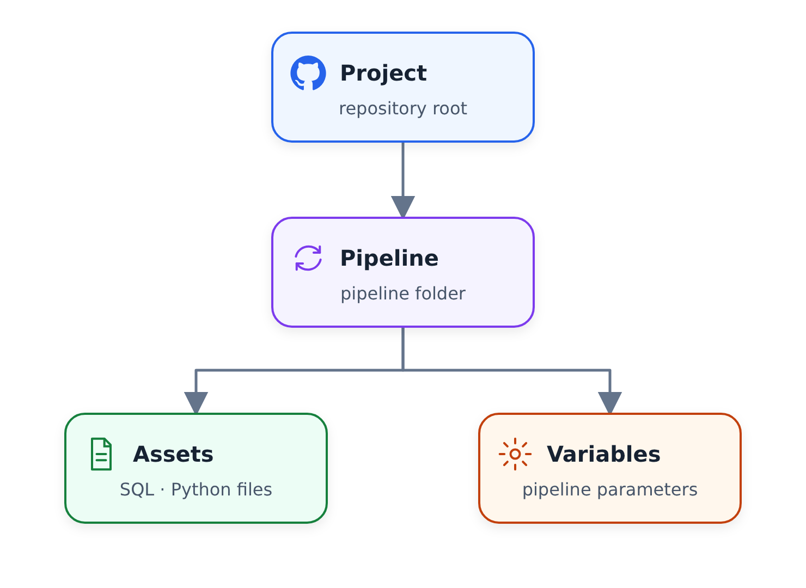

# Khái niệm cốt lõi: Lệnh

## Lệnh Bruin CLI

Lệnh là cách bạn tương tác với dự án Bruin của mình - chạy đường ống, xác thực cấu hình, truy vấn dữ liệu, v.v.


*Sử dụng các lệnh như một vòng lặp: kiểm tra dự án, hiểu các phần phụ thuộc, kiểm tra dữ liệu, sau đó thực thi phạm vi được yêu cầu.*



## `bruin run` - Thực thi Pipeline

Tạo một **phiên bản thực thi duy nhất** ("chạy") của quy trình của bạn.

### Cách sử dụng cơ bản

```bash
bruin run ./pipelines/nyc-taxi/pipeline.yml
```

### Chạy tùy chọn phạm vi

| Tùy chọn | Mô tả |
|--------|-------------|
| Toàn bộ đường ống | Chạy tất cả nội dung theo thứ tự phụ thuộc |
| Tài sản duy nhất | `--asset staging.trips_summary` |
| Với thượng nguồn | `--asset X --upstream` - Chạy X cộng với tất cả các phần phụ thuộc |
| Với hạ lưu | `--asset X --downstream` - Chạy X cộng với tất cả người phụ thuộc |

### Cờ chạy chung

| Cờ | Mô tả |
|------|-------------|
| `--start-date DATE` | Đặt ngày bắt đầu thực hiện |
| `--end-date DATE` | Đặt ngày kết thúc thực hiện |
| `--full-refresh` | Thả và tạo lại bảng (ghi đè tăng dần) |
| `--exclusive-end-date` | Ngày kết thúc là độc quyền (mặc định: bao gồm) |
| `--environment ENV` | Sử dụng môi trường cụ thể (dev/prod) |
| `--var KEY=VALUE` | Ghi đè các biến tùy chỉnh |

### Ví dụ lệnh chạy

```bash
# Simple run
bruin run ./pipelines/nyc-taxi/pipeline.yml

# With date range
bruin run ./pipelines/nyc-taxi/pipeline.yml \
  --start-date 2020-01-01 \
  --end-date 2020-01-31

# Full refresh with variables
bruin run ./pipelines/nyc-taxi/pipeline.yml \
  --full-refresh \
  --var taxi_types=["yellow","green"] \
  --environment default
```

## `bruin validate` - Xác thực đường ống

Kiểm tra vấn đề cấu hình trước khi chạy:

```bash
bruin validate ./pipelines/nyc-taxi/pipeline.yml
```

**Xác thực:**
- Không có phần phụ thuộc vòng tròn trong dòng
- Định nghĩa nội dung là chính xác
- Các kết nối tồn tại và được định cấu hình đúng
- Không có tham chiếu nào bị hỏng

**Luôn xác thực trước khi chạy!**

## `bruin lineage` - Xem biểu đồ phụ thuộc

Trực quan hóa cách kết nối các tài sản:

```bash
bruin lineage ./pipelines/nyc-taxi/pipeline.yml
```

Hiển thị mối quan hệ ngược dòng và xuôi dòng giữa các nội dung.

## `bruin query` - Truy vấn dữ liệu

Chạy các truy vấn đặc biệt đối với các kết nối của bạn:

```bash
bruin query --connection duckdb-default \
  --query "SELECT * FROM ingestion.trips LIMIT 10"
```

## "Chạy" là gì?

**run** là một phiên bản thực thi quy trình duy nhất:
- Có thời gian bắt đầu/kết thúc duy nhất
- Có thể chạy tất cả nội dung hoặc một tập hợp con
- Có các giá trị biến riêng
- Tạo nhật ký và kết quả thực thi

## Kết hợp tất cả lại với nhau

Quy trình làm việc Bruin hoàn chỉnh:

```
1. Project (root, initialized)
   └── .bruin.yml (environments, connections)

2. Pipeline (scheduled grouping)
   └── pipeline.yml (schedule, default connection, variables)

3. Assets (the actual work)
   ├── Python (ingestion, processing)
   ├── SQL (transformations)
   └── YAML/Seed (static data)

4. Commands (make it happen)
   ├── bruin run (execute)
   ├── bruin validate (check)
   └── bruin query (inspect)
```

## Tham khảo nhanh

```bash
# Initialize new project
bruin init zoomcamp my-pipeline

# Validate before running
bruin validate ./pipeline/pipeline.yml

# Run entire pipeline
bruin run ./pipeline/pipeline.yml

# Run with date range
bruin run ./pipeline/pipeline.yml \
  --start-date 2020-01-01 \
  --end-date 2020-01-31

# Run single asset with downstream
bruin run ./pipeline/pipeline.yml \
  --asset raw.trips \
  --downstream

# View lineage
bruin lineage ./pipeline/pipeline.yml

# Query a table
bruin query --connection duckdb-default \
  --query "SELECT COUNT(*) FROM staging.trips"
```

## Đọc thêm

- [Tài liệu về Bruin - Tham khảo CLI](https://getbruin.com/docs/bruin/commands/overview.html)
- [Kho lưu trữ Bruin GitHub](https://github.com/bruin-data/bruin)
