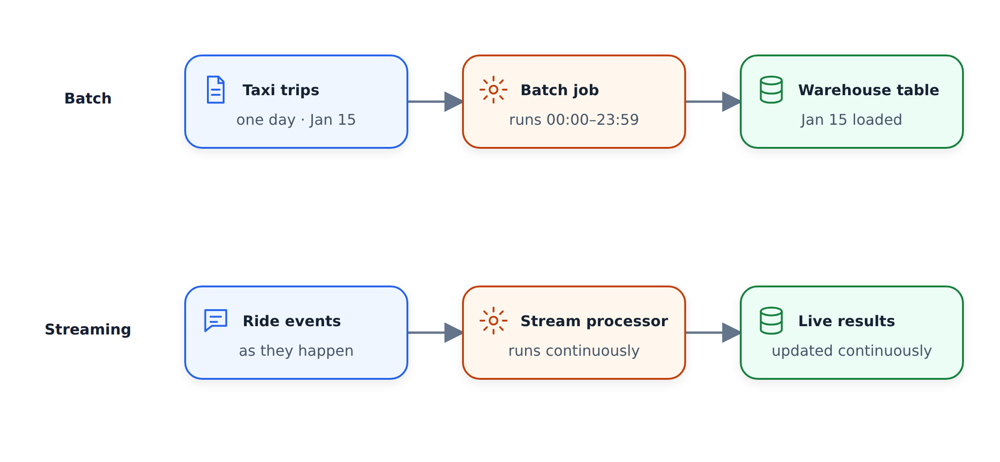
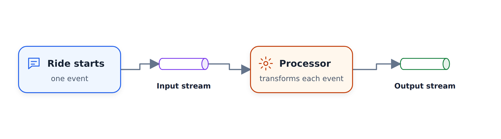
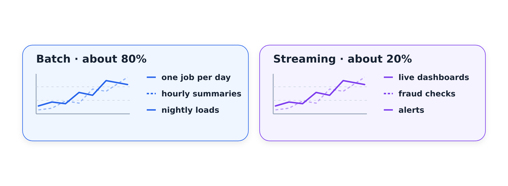

#Giới thiệu về xử lý hàng loạt

Đây là bài học đầu tiên của module xử lý hàng loạt. Chúng tôi xác định quá trình xử lý
hàng loạt, đối chiếu nó với phát trực tuyến và xem Spark phù hợp ở đâu trong số các công cụ
khác mà chúng tôi đã sử dụng cho các công việc hàng loạt.

## Sơ đồ mô-đun

Trước khi đi sâu vào xử lý hàng loạt, đây là nội dung chúng tôi đề cập trong tuần này:

-
xử lý hàng loạt là gì - Spark: nó là gì và tại sao chúng ta cần nó
- Cài đặt Spark trên Linux (trên máy ảo từ Google Cloud)
- Cái nhìn đầu tiên về Spark với PySpark - chúng tôi sử dụng Python, không phải Scala
- Các tính năng của Spark: DataFrames, SQL, tham gia
- RDD (Bộ dữ liệu phân tán có khả năng phục hồi), một khái niệm Spark tương đối cũ,
và chúng khác với DataFrames
- Một số nội bộ Spark
- Chạy công việc Spark với Docker
- Cuối cùng, triển khai công việc Spark lên đám mây và kết nối chúng với kho dữ liệu

## Hàng loạt so với phát trực tuyến

Có nhiều cách xử lý dữ liệu. Hai cái chính là xử lý và phát trực tuyến
hàng loạt. Tuần này là về đợt; phát trực tuyến là mô-đun tiếp theo của
.

Với hàng loạt, hãy tưởng tượng chúng ta có một cơ sở dữ liệu chứa dữ liệu chuyến đi taxi. Chúng tôi lấy toàn bộ tập dữ liệu
trong một ngày - chẳng hạn như toàn bộ ngày 15 tháng 1, từ 00:00 đến
23:59 - và một công việc duy nhất sẽ lấy tất cả dữ liệu này và tạo ra một số tập dữ liệu
khác. Đó là một công việc hàng loạt: chúng tôi tích lũy một khối dữ liệu và
xử lý tất cả chỉ trong một lần.

Truyền phát là khác nhau. Hãy tưởng tượng tôi đang ở New York và gọi một chiếc taxi
màu vàng. Khi chuyến đi bắt đầu, thiết bị bên trong xe taxi sẽ gửi sự kiện
cùng với một số siêu dữ liệu tới luồng dữ liệu. Thứ gì đó - bộ xử lý luồng -
đọc các sự kiện từ luồng này, xử lý chúng và đưa kết quả vào
một luồng khác. Tất cả điều này xảy ra một cách nhanh chóng, trong thời gian thực.

## Khi nào các tác vụ hàng loạt chạy

Các công việc hàng loạt thường chạy theo lịch trình:

- Hàng tuần: xử lý tất cả dữ liệu được thu thập trong tuần
- Hàng ngày: có lẽ là phổ biến nhất - khi ngày kết thúc, xử lý
mọi thứ từ ngày hôm qua
- Hàng giờ: hết một giờ một lần, xử lý mọi thứ từ giờ
trước đó

Bạn có thể chuyển sang mức độ chi tiết tốt hơn - ba lần mỗi giờ hoặc
năm phút một lần - nhưng những điều này ít điển hình hơn. Hàng ngày và hàng giờ là những gì
bạn sẽ thấy hầu hết thời gian.

## Công nghệ xử lý hàng loạt

Các công cụ chúng tôi sử dụng cho các công việc hàng loạt thường chỉ là các tập lệnh Python. Bạn có nhớ
đường dẫn dữ liệu mà chúng tôi đã viết trong tuần đầu tiên không? Nó lấy một tệp CSV và nhập
vào cơ sở dữ liệu. Đó là một tập lệnh bó và chúng tôi đã thực thi nó một lần
mỗi tháng, một lần chạy cho mỗi tháng dữ liệu taxi.

SQL cũng rất phổ biến. Trong tuần thứ tư, chúng tôi đã sử dụng SQL để xác định các phép biến đổi
: chúng tôi nhận được một lượng lớn dữ liệu và xử lý nó trong một lần.
SQL phổ biến cho việc này vì nó tiện lợi và được mọi người biết đến.

Sau đó là Spark, chủ đề của tuần này và các công cụ khác
như Flink.

Lưu ý về tập lệnh Python: chúng có thể chạy ở mọi nơi - trong Kubernetes, trong dịch vụ hàng loạt
, ở mọi nơi. Để sắp xếp tất cả các công việc này, chúng tôi sử dụng các công cụ xử lý công việc
như Airflow. Một quy trình công việc điển hình có thể trông như thế này:

- Một số dữ liệu nằm trong hồ dữ liệu, chẳng hạn như tệp CSV
- Tập lệnh Python lấy các tệp này, thực hiện điều gì đó và đưa kết quả
vào cơ sở dữ liệu hoặc kho
- Công việc SQL (bạn có thể sử dụng dbt hoặc các công cụ tương tự) chuẩn bị dữ liệu
- Sau đó, có thể Spark chạy và sau đó lại là Python

Mỗi bước là một công việc hàng loạt. Họ sử dụng các công nghệ khác nhau và Airflow
điều phối toàn bộ đường ống.

## Ưu nhược điểm của lô

Công việc hàng loạt rất thuận tiện và dễ quản lý. Các công cụ quy trình làm việc cho phép
xác định tất cả các bước, tham số hóa chúng và dễ dàng thử lại chúng. Quy trình công việc
có một tham số cho khoảng thời gian mà nó xử lý, vì vậy nếu
có lỗi gì đó, chúng ta có thể thực hiện lại quy trình đó một cách đơn giản. Việc thử lại khá an toàn
vì không có gì xảy ra trong thời gian thực.

Hàng loạt cũng dễ dàng hơn để mở rộng quy mô. Nếu tập lệnh Python gặp khó khăn với tệp
lớn hơn, chúng ta sẽ có một máy lớn hơn. Nếu Spark gặp khó khăn, chúng tôi sẽ nhận được cụm
lớn hơn hoặc thêm nhiều máy hơn vào cụm hiện có. Chúng tôi có thể mở rộng quy mô
khi cần.

Nhược điểm chính là sự chậm trễ. Vì chúng tôi chạy mọi thứ theo định kỳ
nên chúng tôi luôn chờ đợi. Giả sử chúng tôi xử lý dữ liệu hàng giờ và việc thực thi
, mỗi bước trong quy trình làm việc của chúng tôi mất năm phút, với bước cuối cùng mất ba phút
. Tổng cộng là khoảng hai mươi phút. Giờ kết thúc, quy trình làm việc
bắt đầu và chỉ sau 20 phút đó, dữ liệu mới sẵn sàng.
Trong trường hợp xấu nhất, chúng tôi đợi gần 90 phút trước khi có thể thực hiện điều gì đó
với dữ liệu đến vào đầu giờ trước.

Truyền trực tuyến giải quyết được vấn đề này, nhưng thường thì bạn không cần phải phản ứng nhanh như vậy. Đối với nhiều số liệu
, bạn có thể đợi một giờ, một ngày hoặc thậm chí một tuần trước khi
chúng hiển thị trên trang tổng quan. Vì lô rất thuận tiện nên phần lớn các công việc xử lý dữ liệu của
- theo kinh nghiệm của tôi, 80% trở lên - là lô
. 10-20% còn lại đang phát trực tuyến.

Chúng ta đã biết cách thực hiện các phép biến đổi hàng loạt bằng SQL trong mô-đun
trước đó và chúng ta đã chạm vào các tập lệnh Python trong tuần đầu tiên. Vì vậy phần còn lại của mô-đun
này là về Spark. Hẹn gặp lại các bạn trong video tiếp theo.
