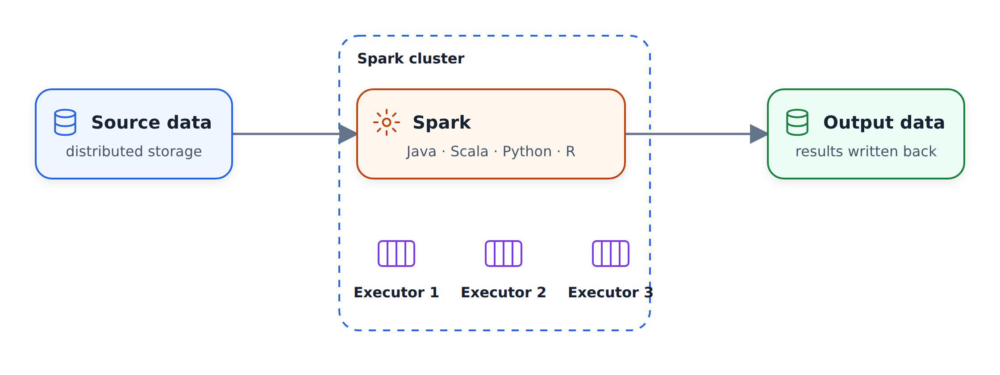
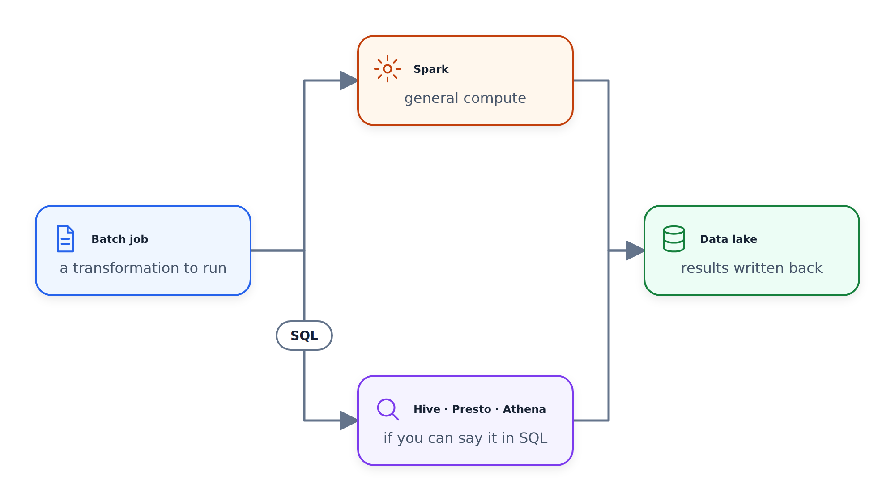
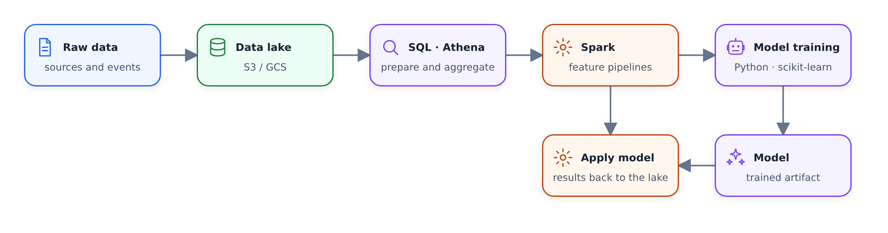

#Giới thiệu về Spark

Trong bài học này, chúng ta xem xét Apache Spark: nó là gì,
bạn có thể sử dụng ngôn ngữ nào với nó và khi nào bạn nên sử dụng nó thay vì SQL thuần túy.

## Spark
là gì
Nếu bạn google "Apache Spark", bạn sẽ nhận được câu quá tải này: một công cụ đa ngôn ngữ
để thực thi kỹ thuật dữ liệu, khoa học dữ liệu và học máy
trên các máy hoặc cụm một nút. Cách đơn giản hơn để nghĩ về nó: Spark là một công cụ xử lý dữ liệu quy mô lớn.

Động cơ là từ quan trọng ở đây. Giả sử chúng tôi có dữ liệu trong cơ sở dữ liệu hoặc hồ dữ liệu
. Spark kéo dữ liệu này về máy của chính nó - người thực thi -
thực hiện điều gì đó với dữ liệu đó và ghi kết quả trở lại hồ dữ liệu hoặc kho dữ liệu
. Quá trình xử lý diễn ra bên trong Spark. Đó là lý do tại sao nó là động cơ
.

Nó cũng được phân phối. Chúng ta có thể có một cụm với hàng chục, hàng trăm hoặc hàng nghìn máy
và tất cả chúng đều lấy dữ liệu, xử lý và
lưu kết quả ở đâu đó.

## Ngôn ngữ

Spark được viết bằng Scala, vì vậy Scala là cách nói chuyện tự nhiên với nó.
Java cũng hoạt động. Ngoài ra còn có các trình bao bọc dành cho các ngôn ngữ khác:
có một trình bao bọc cho R (tôi không biết mức độ phổ biến của nó) và có trình bao bọc Python
, PySpark, rất phổ biến. Ở nhiều công ty,
PySpark là cách viết công việc Spark ưa thích: kỹ sư dữ liệu
viết mã Python và đôi khi, khi họ cần linh hoạt hơn, họ
viết lại các phần của nó trong Scala. Một số công ty chỉ sử dụng Scala và trong
, một số kỹ sư dữ liệu chỉ viết Java - nhưng PySpark khá phổ biến.

Spark được sử dụng để thực hiện các công việc hàng loạt, nhưng nó cũng có thể thực hiện phát trực tuyến.
Ý tưởng là bạn có thể xem luồng dữ liệu dưới dạng một chuỗi các lô nhỏ
và áp dụng các kỹ thuật tương tự như xử lý hàng loạt.
Chúng tôi sẽ không đề cập đến tính năng phát trực tuyến trong khóa học này - chúng tôi tập trung vào hàng loạt.

## Khi nào nên sử dụng Spark

Thông thường, bạn sử dụng Spark khi dữ liệu của bạn nằm trong hồ dữ liệu. Hồ dữ liệu
thường chỉ là một vị trí trong S3 hoặc Google Cloud Storage với một loạt tệp
- thường là các tệp sàn gỗ. Spark lấy dữ liệu này vào, thực hiện một số xử lý
và đưa kết quả trở lại hồ.

Điều này trái ngược với kho dữ liệu. Nếu dữ liệu của chúng tôi nằm trong kho
như BigQuery, chúng tôi sẽ chỉ sử dụng SQL. Nhưng khi chúng tôi chỉ có một loạt tệp
trong S3 hoặc Google Cloud Storage, thì việc chạy SQL không phải lúc nào cũng dễ dàng với
- và đây chính là lúc Spark xuất hiện.

Ngày nay, bạn thực sự có thể chạy SQL trực tiếp trên hồ dữ liệu bằng cách sử dụng các công cụ
như Hive hoặc Presto - Bản thân Spark cũng có thể làm được điều đó. Trên AWS có
một phiên bản được quản lý của Presto có tên Athena. Vì vậy, nguyên tắc chung là: nếu
, bạn có thể thể hiện công việc của mình dưới dạng truy vấn SQL, hãy sử dụng Presto, Athena hoặc
BigQuery với các bảng bên ngoài hồ của bạn.

Đôi khi bạn không thể diễn đạt công việc bằng SQL. Có thể bạn cần
linh hoạt hơn, có thể mã trở nên quá khó quản lý dưới dạng một truy vấn
lớn - bạn muốn chia nó thành các mô-đun và bao gồm các bài kiểm tra đơn vị.
Hoặc đơn giản là chức năng này không tồn tại trong SQL. Đây chính xác là
khi bạn muốn sử dụng Spark.

Theo kinh nghiệm của tôi với tư cách là một nhà khoa học dữ liệu, những điều tôi không thể biểu diễn
bằng SQL thường liên quan đến machine learning: vừa đào tạo mô hình
vừa áp dụng nó vào dữ liệu.

## Quy trình làm việc điển hình

Đây là một quy trình làm việc điển hình mà tôi thấy ở nơi làm việc. Chúng tôi bắt đầu với dữ liệu thô trên hồ dữ liệu
. Đầu tiên, chúng tôi chạy một loạt các phép biến đổi SQL - tập hợp, nối
, chuẩn bị dữ liệu - sử dụng cái gì đó như Athena hoặc Presto. Sau khi dữ liệu
được chuẩn bị, chúng ta cần thực hiện một số thao tác phức tạp hơn mà SQL
không thể diễn đạt và đây là lúc Spark xuất hiện: công việc Spark đào tạo mô hình máy học
hoặc công việc Python chạy theo mô hình đó.

Sau đó, thường có một luồng khác: công việc Spark thứ hai lấy mô hình
đã được đào tạo và áp dụng nó vào dữ liệu. Kết quả sẽ quay trở lại hồ dữ liệu
và từ đó họ có thể biến nó thành kho dữ liệu.

Vì vậy, khuyến nghị là: sử dụng SQL khi bạn có thể và sử dụng Spark cho các trường hợp
mà bạn không thể. Trong video tiếp theo, chúng tôi cài đặt Spark cục bộ và
chạy thử nghiệm đầu tiên với nó.
