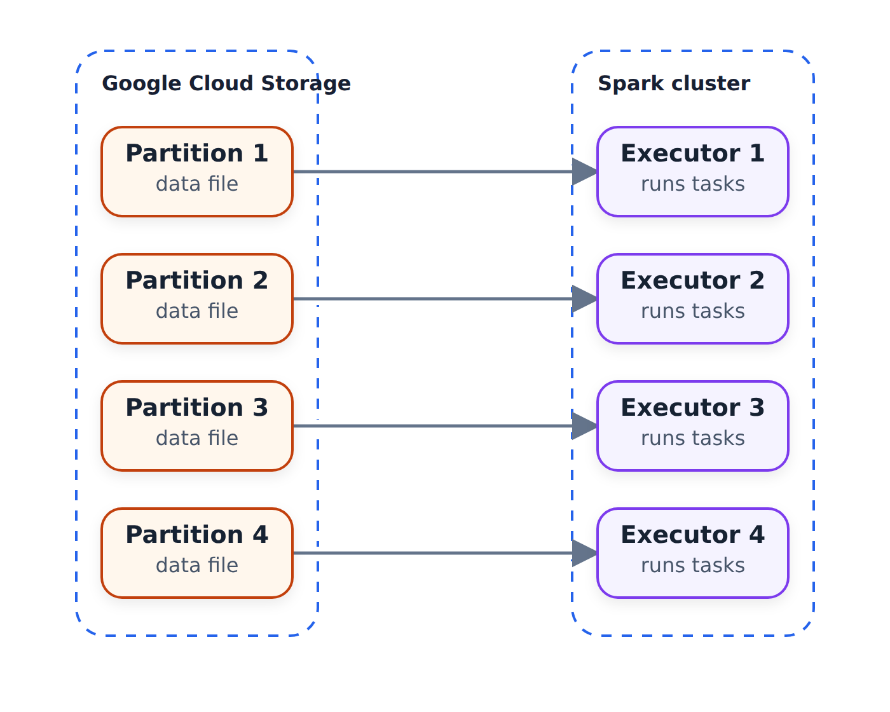

# Cái nhìn đầu tiên về Spark/PySpark

Trong phần này, chúng ta sẽ có cái nhìn thực tế đầu tiên về PySpark: chúng ta đọc một tệp CSV
lớn, nói về các phân vùng, lưu dữ liệu dưới dạng gỗ và xem mọi thứ
trong giao diện người dùng Spark master.

## Bộ dữ liệu

Thay vì dữ liệu taxi màu vàng hoặc xanh lục mà chúng tôi đã sử dụng trước đây, chúng tôi lấy bản ghi chuyến đi FHV (cho thuê xe) khối lượng lớn
cho tháng 1 năm 2021 -
Spark có nhiệm vụ xử lý dữ liệu khối lượng lớn, vì vậy hãy cung cấp cho nó một tệp lớn hơn
. Nó vẫn không phải là một tập dữ liệu quá lớn nhưng cũng không phải là
nhỏ: khoảng 700 MB CSV và gần 12 triệu bản ghi.

## Đọc CSV

Như trong phần trước, chúng tôi thực hiện xuất `PYTHONPATH` trước tiên và
khởi động Jupyter trên máy từ xa. Chúng tôi cũng chuyển tiếp cổng 4040 - thêm
sau này.

Chúng tôi sao chép nội dung nhập từ sổ ghi chép trước đó. `SparkSession` là
đối tượng chúng tôi sử dụng để tương tác với Spark - điểm vào chính của chúng tôi.
Đó là những gì chúng tôi sử dụng để đọc mọi thứ:

```python
df = spark.read \
    .option("header", "true") \
    .csv('fhvhv_tripdata_2021-01.csv')
```

Nếu chúng tôi chạy `df.show()`, Spark sẽ lấy chính xác tên của các cột.
Và nếu chúng ta mở localhost:4040 và làm mới, chúng ta sẽ thấy trang Công việc
của ứng dụng Spark. Sau khi một tác vụ trong sổ tay chạy, nó sẽ xuất hiện ở đây dưới dạng một công việc.

Trước hành động đầu tiên, trang trống:

| Trang giao diện người dùng Spark | Trạng thái ban đầu |
| --- | --- |
| `localhost:4040` → Việc làm | Chưa có công việc nào chạy |

## Vấn đề về lược đồ

Thay vì `show()`, hãy lấy `df.head(5)` để lấy năm bản ghi
đầu tiên. Bây giờ chúng ta có thể thấy một vấn đề: Spark đọc dấu thời gian dưới dạng chuỗi
và thậm chí `PULocationID` - được cho là một số -
là một chuỗi.

Không giống như gấu trúc, Spark không cố gắng suy ra loại của các trường này.
Nếu chúng ta nhìn vào `df.schema`, mọi thứ đều là `StringType`.

Hãy nhớ thủ thuật mà chúng ta đã sử dụng trong tuần đầu tiên: chúng ta sử dụng gấu trúc để suy ra các loại
, sau đó tạo lược đồ cho cơ sở dữ liệu của chúng ta từ chúng. Hãy làm
điều gì đó tương tự ở đây.

Trước tiên, chúng tôi lấy một mẫu nhỏ của tệp - chúng tôi không muốn mở tệp MB 700
bằng gấu trúc:

```bash
head -n 101 fhvhv_tripdata_2021-01.csv > head.csv
wc -l head.csv
```

`wc -l` cho thấy `head.csv` chỉ có 101 hàng (có tiêu đề). Hãy nhớ rằng tệp đầy đủ
có gần 12 triệu tệp trong số đó. (Đây là các lệnh Linux
; trên Windows, bạn có thể lấy chúng bằng Git Bash hoặc tương tự.)

Sau đó, hãy để gấu trúc suy ra các loại trên tệp nhỏ:

```python
import pandas as pd

df_pandas = pd.read_csv('head.csv')
df_pandas.dtypes
```

Pandas thực hiện công việc tốt: `PULocationID` và `DOLocationID` là
`int64`, phần còn lại là chuỗi. Thời gian nhận và trả hàng cũng vẫn là đối tượng
- gấu trúc không đủ thông minh để nhận ra chúng là dấu thời gian.

```python
df.schema
```

Do đó, lược đồ Spark ban đầu có bảy cột chuỗi có thể rỗng:

| Cột | Loại | Nullable |
| --- | --- | --- |
| `hvfhs_license_num` | `StringType` | `true` |
| `dispatching_base_num` | `StringType` | `true` |
| `pickup_datetime` | `StringType` | `true` |
| `dropoff_datetime` | `StringType` | `true` |
| `PULocationID` | `StringType` | `true` |
| `DOLocationID` | `StringType` | `true` |
| `SR_Flag` | `StringType` | `true` |

Bây giờ chúng ta biến DataFrame gấu trúc này thành Spark DataFrame:

```python
spark.createDataFrame(df_pandas).schema
```

Spark đã ánh xạ gấu trúc `int64` sang `LongType` và biến `SR_Flag` thành
`DoubleType` - trong tệp mẫu `SR_Flag` hầu hết trống và gấu trúc
sử dụng NaN cho các giá trị trống, là giá trị nổi. Tôi không nghĩ
thực sự là một bản sao kép, vì vậy chúng tôi sẽ sử dụng `StringType` cho nó và biến nó thành
có thể rỗng.

Thêm một thay đổi nữa: Tôi không muốn giữ ID lâu. Dài mất 8 byte
cho mỗi giá trị, số nguyên mất 4 - số nguyên tiết kiệm bộ nhớ hơn.
Vì vậy, chúng tôi tự khai báo lược đồ thay vì sử dụng lược đồ được suy ra.

## Khai báo lược đồ một cách rõ ràng

Các lược đồ tồn tại trong `pyspark.sql.types`. Thay vì nhập riêng từng loại
, hãy nhập cả gói:

```python
from pyspark.sql import types
```

Bây giờ lược đồ, dưới dạng danh sách `StructField`:

```python
schema = types.StructType([
    types.StructField('hvfhs_license_num', types.StringType(), True),
    types.StructField('dispatching_base_num', types.StringType(), True),
    types.StructField('pickup_datetime', types.TimestampType(), True),
    types.StructField('dropoff_datetime', types.TimestampType(), True),
    types.StructField('PULocationID', types.IntegerType(), True),
    types.StructField('DOLocationID', types.IntegerType(), True),
    types.StructField('SR_Flag', types.StringType(), True)
])
```

`True` ở cuối có nghĩa là cột có thể rỗng - `SR_Flag` là
chắc chắn là rỗng. Và trong Python `True` bắt đầu bằng chữ T viết hoa.

Bây giờ chúng tôi đọc lại CSV, nói với Spark rằng tệp này phải có lược đồ
này:

```python
df = spark.read \
    .option("header", "true") \
    .schema(schema) \
    .csv('fhvhv_tripdata_2021-01.csv')
```

Với `df.head(10)`, chúng tôi thấy rằng thời gian ngày giờ đã được phân tích cú pháp chính xác,
ID vị trí là các số không có dấu ngoặc kép và `SR_Flag` là null
khi nó trống. Đây là cách bạn xác định một lược đồ.

## Phân vùng

Hiện tại, chúng tôi có một tệp CSV khổng lồ và chỉ có một tệp là không tốt cho
. Để giải thích lý do tại sao, hãy nói một chút về phần bên trong Spark - chúng tôi sẽ đề cập chi tiết hơn về
này sau.

Hãy tưởng tượng một cụm Spark. Bên trong nó có những người thực thi - những cỗ máy
thực sự thực hiện công việc tính toán. Họ lấy các tệp từ hồ dữ liệu
, chẳng hạn như một thư mục trong nhóm Google Cloud Storage và xử lý chúng.



Nếu chúng ta có nhiều tệp hơn trình thực thi thì mỗi tệp sẽ được chuyển đến một trình thực thi.
Khi người thực thi hoàn thành tệp của mình, nó sẽ chọn tệp chưa được xác nhận tiếp theo.
Nhưng nếu chúng ta chỉ có một tệp lớn thì chỉ có một người thực thi có thể lấy nó và
tất cả những người khác sẽ ngồi chờ. Đó không phải là điều chúng tôi muốn: chúng tôi muốn một loạt tệp
nhỏ hơn thay vì một tệp lớn.

Những khối này được gọi là phân vùng. Khi chúng tôi đọc một thư mục, Khung dữ liệu
sẽ nhận được số phân vùng bằng số lượng tệp trong đó. Vì
có một CSV lớn nên chúng tôi muốn chia nó thành nhiều phân vùng - giả sử
24. Lệnh cho điều đó là `repartition`:

```python
df = df.repartition(24)
```

Lưu ý một điều thú vị: nếu chúng ta xem Spark UI sau khi chạy
này, không có gì được thực thi. `repartition` là một lệnh lười biếng -
chưa kích hoạt việc phân vùng lại. DataFrame sẽ được
phân vùng lại trong tương lai khi chúng tôi thực sự làm gì đó với nó.

##Sàn viết

Vì vậy, hãy thực hiện điều kích hoạt nó - lưu dữ liệu dưới dạng sàn gỗ:

```python
df.write.parquet('fhvhv/2021/01/')
```

Bây giờ có điều gì đó đang xảy ra. Trong Spark UI có một công việc tên là
`parquet`; mở nó cho thấy Spark thực sự đang làm gì. Có một bước
được gọi là trao đổi - đây là nơi diễn ra quá trình phân vùng - và chúng ta
có thể thấy những người thực thi khác nhau đang chạy các tác vụ. Quá trình này sẽ mất một khoảng thời gian: Việc phân vùng lại
là một thao tác khá tốn kém.

Trong khi nó chạy, nhìn thoáng qua thư mục đầu ra chỉ hiển thị thư mục
tạm thời - những người thực thi vẫn đang đọc CSV và biến nó thành phân vùng
24.

Trong video, công việc này mất khoảng bốn phút và có hai giai đoạn. Giai đoạn đầu tiên của
có 7 nhiệm vụ - những nhiệm vụ này đọc đầu vào. Hóa ra Spark có
đã phân chia nội bộ CSV lớn: trước đó trong công việc, chúng ta có thể thấy
6 phân vùng, vì máy có 8 lõi và 8 bộ thực thi thực hiện công việc
. Giai đoạn thứ hai có 24 nhiệm vụ - đó là khi các kết quả
được ghi, mỗi nhiệm vụ một phân vùng đầu ra.

Bây giờ thư mục chứa một loạt tệp có tên
`part-<partition number>-...snappy.parquet` - một tệp trên mỗi phân vùng và
snappy là thuật toán nén mà sàn gỗ sử dụng. Ngoài ra còn có tệp
`_SUCCESS`, kích thước bằng 0. Nó cho biết công việc đã hoàn thành thành công:
nếu không có nó, chúng tôi không thể chắc chắn rằng các tệp đã hoàn chỉnh và không bị hỏng.
Hãy coi nó như một điểm đánh dấu cam kết khi kết thúc công việc Spark.

Nếu chúng tôi cố gắng viết lại, Spark sẽ phàn nàn rằng đường dẫn
đã tồn tại. Để ghi đè, hãy thêm `.mode("overwrite")` trước lệnh gọi
`parquet`.

Sàn gỗ cũng nhỏ hơn rất nhiều so với CSV gốc - chúng tôi đã thấy
này trước đây, độ nén khoảng bốn lần. Điều đó, cộng với lược đồ
đang được lưu trữ trong các tệp, là lý do tại sao chúng tôi thích sử dụng lược đồ này để lưu trữ dữ liệu trong hồ
.

Đó là cái nhìn đầu tiên về PySpark: chúng tôi đọc một tệp CSV có lược đồ
rõ ràng, chia nó thành 24 phân vùng, lưu dưới dạng sàn gỗ và sử dụng giao diện người dùng
Spark để xem công việc. Trong video tiếp theo, chúng ta nói về DataFrames Spark
- những thứ `df` này - tương tự như DataFrames
của gấu trúc, nhưng không hoàn toàn.

## Vật liệu

* [`code/03_test.ipynb`](code/03_test.ipynb) - bắt đầu `SparkSession`,
cục bộ đọc CSV tra cứu vùng taxi và ghi lại dưới dạng sàn gỗ.
