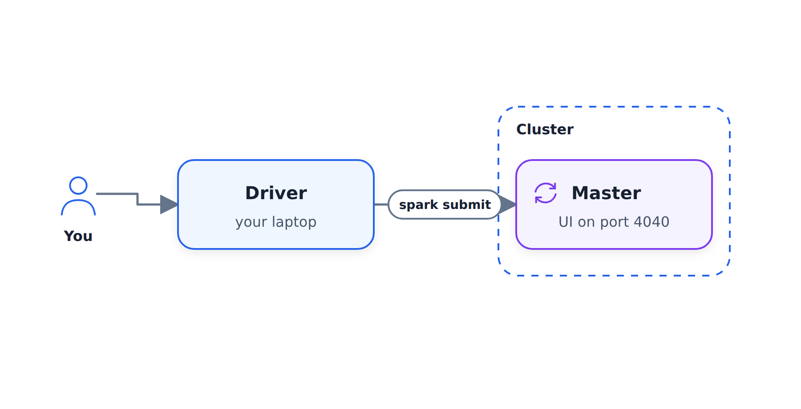
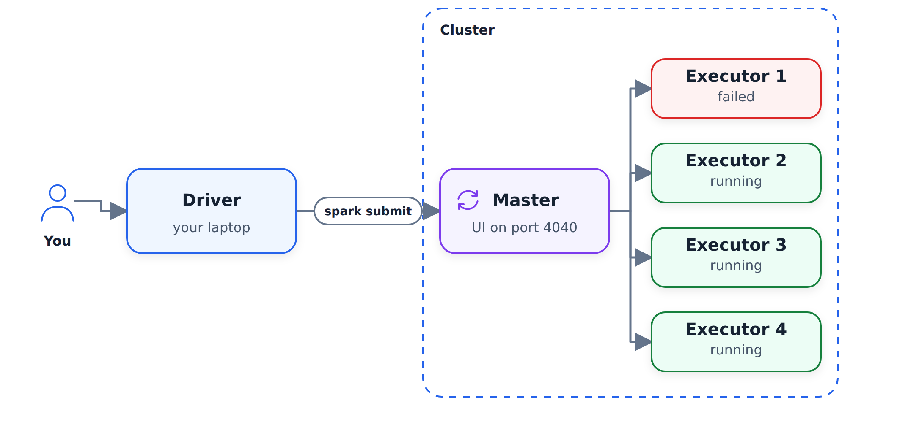
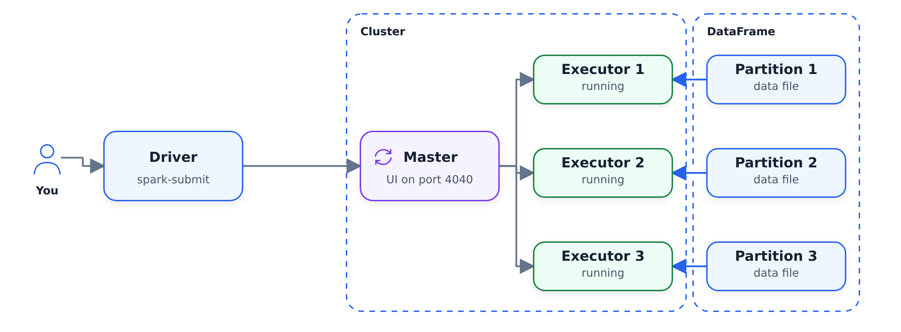
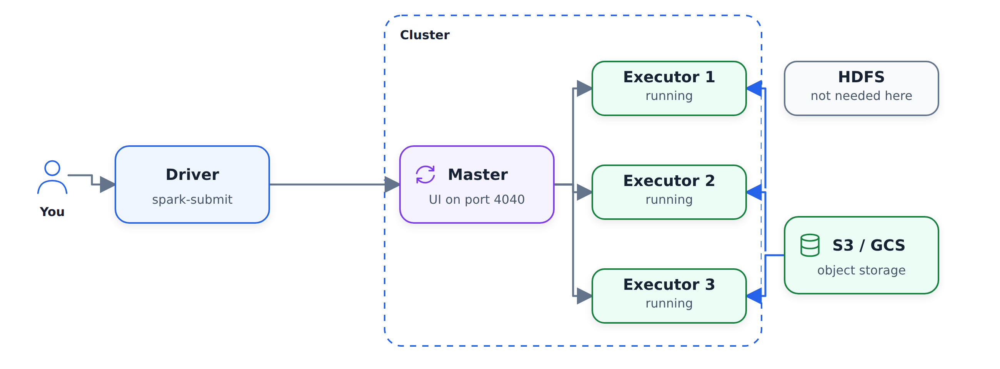

# Giải phẫu cụm tia lửa

Trong phần này, chúng ta xem xét một cụm Spark thực bao gồm những gì: trình điều khiển
gửi công việc, trình điều khiển chính điều phối công việc và trình thực thi
thực hiện tính toán thực tế. Cho đến nay, chúng tôi đã chạy Spark cục bộ và
đây là hình ảnh đằng sau URL chính và `spark-submit` mà chúng tôi sẽ sử dụng
sau này trong mô-đun.

## Thiết lập cục bộ

Mọi thứ chúng tôi làm cho đến nay đều mang tính cục bộ: chúng tôi có môi trường cục bộ và trong môi trường
này, trình thực thi của chúng tôi - thứ thực thi các công việc Spark - đã chạy trên cùng một máy tính
. Đây được gọi là thiết lập cục bộ.

Khi chúng tôi thiết lập Spark, chúng tôi chỉ định bản gốc:

```python
spark = SparkSession.builder \
    .master("local[*]") \
    .appName('test') \
    .getOrCreate()
```

`local[*]` có nghĩa là chúng tôi tạo một cụm cục bộ bằng cách sử dụng tất cả các lõi có sẵn.

## Trình điều khiển, chủ và người thực thi

Với một cụm thực sự thiết lập trông khác nhau. Bạn tạo tập lệnh trong
Python (hoặc Scala hoặc Java) bằng một số mã Spark - thường là từ máy tính xách tay của bạn,
hoặc từ Airflow, nếu bạn sử dụng Airflow để lên lịch công việc Spark.

Cụm có một máy tính mà chúng tôi gọi là Spark master. Vai trò của nó là điều phối
: nó biết những công việc nào đang chạy. Bản gốc có giao diện người dùng web trên cổng
4040 - giao diện người dùng tương tự mà chúng tôi đã mở tại localhost:4040 khi chúng tôi chạy Spark
cục bộ. Bạn có thể coi nó như một điểm vào cụm Spark: bạn
kết nối với nó và xem những gì thực sự đang được thực thi.

Để gửi gói có mã của chúng tôi tới gói chính, chúng tôi sử dụng lệnh đặc biệt
có tên là `spark-submit`. Cùng với mã, chúng tôi chỉ định loại tài nguyên
mà chúng tôi cần cho công việc này.

Trên cụm chúng tôi cũng có các máy tính thực sự thực hiện công việc.
Họ được gọi là người thi hành. Khi chúng tôi gửi một công việc cho Spark master,
sẽ phối hợp giữa những người thực thi: nó quyết định ai trong số họ sẽ làm việc trên
công việc của chúng tôi và gửi hướng dẫn cho họ.



Người chủ cần phải luôn hoạt động. Nếu một trong những người thực thi
biến mất vì bất kỳ lý do gì, người chủ sẽ biết về điều đó và giao các nhiệm vụ
mà người thực thi này đã giao cho một số người thực thi khác.



## Cách người thực thi lấy dữ liệu

Hãy tưởng tượng chúng ta có một DataFrame bao gồm nhiều phân vùng - như bạn
nhớ, phân vùng không gì khác hơn là một tệp sàn gỗ. Khi chúng tôi gửi công việc
, Spark sẽ gửi một số thông tin cho người thực thi và mỗi người thực thi sẽ kéo
một phân vùng, xử lý nó và đánh dấu nhiệm vụ là
đã hoàn thành thành công. Sau đó, nó nhận được một nhiệm vụ khác. Bằng cách này, người thực thi xử lý từng phân vùng
của DataFrame và lưu kết quả ở đâu đó.



Ngày nay, DataFrames thường tồn tại trong S3 hoặc Google Cloud Storage.

## Tại sao không phải là HDFS

Nó không phải lúc nào cũng như thế này. Trước đây Hadoop và HDFS khá phổ biến
. Trong Hadoop, các tệp của hồ dữ liệu được lưu trữ trên chính các trình thực thi
, với một số điểm dư thừa: ví dụ: cùng một phân vùng
có thể được lưu trữ trên ba nút khác nhau, vì vậy nếu một nút biến mất thì các tệp
vẫn được giữ nguyên.

Ý tưởng đằng sau Hadoop và HDFS: thay vì tải dữ liệu xuống máy
, bạn tải mã xuống máy đã có dữ liệu.
Khái niệm này được gọi là vị trí dữ liệu. Điều này rất có ý nghĩa vì các tệp
thường khá lớn - chẳng hạn như 100 MB cho mỗi phân vùng - trong khi mã
tương đối nhỏ, chẳng hạn là 10 MB. Gửi mã đến người thực thi
đã có dữ liệu sẽ rẻ hơn so với việc lấy nhiều dữ liệu qua mạng
.

Ngày nay, do có các nhà cung cấp đám mây, cụm Spark và bộ lưu trữ
trên đám mây thường nằm trong cùng một trung tâm dữ liệu. Tải xuống 100 MB cho trình thực thi
rất nhanh - chậm hơn một chút so với đọc từ đĩa cục bộ,
nhưng chậm hơn đáng kể. Vì vậy, thay vì giữ dữ liệu trên bộ thực thi
, họ có thể lấy dữ liệu từ S3 hoặc Google Cloud Storage, xử lý
và lưu kết quả trở lại hồ dữ liệu.



Đây là lý do tại sao Hadoop và HDFS trở nên ít phổ biến hơn: chúng bổ sung thêm chi phí và cách ưa thích của
hiện nay chỉ đơn giản là giữ các tệp trên S3. Bạn không cần HDFS,
, bạn không cần Hadoop - bạn chỉ cần có cụm Spark và dữ liệu của mình trong bộ lưu trữ đám mây
.

## Tóm tắt

- Trình điều khiển là thứ thực hiện công việc: tác vụ Airflow chạy
`spark-submit`, máy tính xách tay của bạn hoặc thứ gì khác.
- Người chủ là thứ điều phối mọi thứ. Spark theo dõi
máy nào khỏe, nếu máy nào không hoạt động thì
sẽ phân công lại công việc.
- Người thực thi là những cỗ máy thực hiện việc tính toán thực tế.
- Dữ liệu tồn tại trong bộ lưu trữ đám mây: chúng tôi đọc từ đó và ghi kết quả
vào đó.
