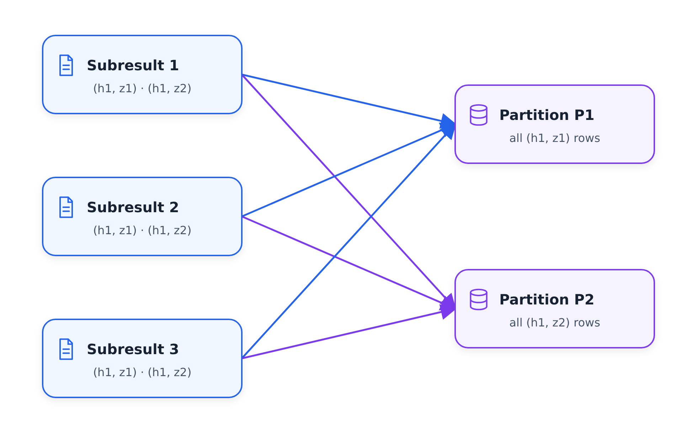

# GroupBy trong Spark

Trong phần này, chúng ta xem xét cách Spark thực sự thực thi `GROUP BY`. Chúng tôi lấy
truy vấn doanh thu theo giờ của từng khu vực từ [bài học trước](07-sql-with-spark.md),
chạy truy vấn đó cho các tập dữ liệu màu xanh lá cây và màu vàng, đồng thời theo dõi nó thông qua giao diện người dùng Spark
để xem hai giai đoạn mà Spark sử dụng - và nơi diễn ra quá trình cải tổ.

## Truy vấn

Chúng tôi bắt đầu từ cùng một ý tưởng doanh thu như trước, nhưng nhỏ hơn: đối với tập dữ liệu
màu xanh lá cây, chúng tôi muốn tổng số tiền và số chuyến đi mỗi giờ, trên mỗi vùng
:

```sql
SELECT
    date_trunc('hour', lpep_pickup_datetime) AS hour,
    PULocationID AS zone,
    SUM(total_amount) AS amount,
    COUNT(1) AS number_records
FROM
    green
WHERE
    lpep_pickup_datetime >= '2020-01-01'
GROUP BY
    1, 2
ORDER BY
    hour, zone
```

Chúng tôi đăng ký DataFrame màu xanh lá cây dưới dạng bảng tạm thời có tên `green` và chạy
với `spark.sql`. Kết quả có một hàng cho mỗi giờ và khu vực: tổng số tiền mà các tài xế taxi
đã kiếm được và bao nhiêu chuyến đi đã bắt đầu ở địa điểm
này trong giờ này.

Hai bản sửa lỗi nhỏ trên đường đi. Đầu tiên, trong sổ ghi chép này chúng ta không đổi tên các cột là
nên thời gian lấy màu xanh vẫn là `lpep_pickup_datetime` - không phải
`pickup_datetime` như ở bài trước. Thứ hai, nhìn vào đầu ra, chúng ta
thấy các bản ghi từ quá khứ - ví dụ: một bản ghi có số tiền 0 từ năm 2008,
chắc chắn có lỗi trong dữ liệu. Đó là lý do tại sao chúng tôi thêm mệnh đề `WHERE`
và chỉ xem xét dữ liệu từ tháng 1 năm 2020 trở đi. Sau đó, hàng đầu tiên
có 45 bản ghi ở vùng 7 ngay trong giờ đầu tiên của năm 2020, đúng như dự đoán.

## Spark làm gì với nó

Chúng tôi viết kết quả lên sàn gỗ và xem công việc trong giao diện người dùng Spark master.
Với `ORDER BY` có ba giai đoạn. Không có nó - hai:

- giai đoạn đầu tiên là sự chuẩn bị cho nhóm của
- giai đoạn thứ hai là nhóm thực tế của

Kế hoạch ba giai đoạn có thể được biểu diễn dưới dạng DAG tĩnh:

| Sân khấu | Toán tử, từ trên xuống dưới |
| --- | --- |
| 9 | `Scan parquet` → `WholeStageCodegen (1)` → `Exchange` |
| 10 | `Exchange` → `WholeStageCodegen (2)` → `Exchange` |
| 11 | `Exchange` → `WholeStageCodegen (3)` |

`Exchange` cuối cùng ở giai đoạn 9 cung cấp giai đoạn 10 và `Exchange` cuối cùng trong
giai đoạn 10 cung cấp giai đoạn 11.

Hãy cùng giải thích ý nghĩa của hai giai đoạn này.

## Giai đoạn 1: nhóm theo từng phân vùng

Giả sử DataFrame của chúng tôi có nhiều phân vùng - để đơn giản, có ba phân vùng. Mỗi trình thực thi
kéo một phân vùng và thực thi cùng một mã:

```text
partition 1        partition 2        partition 3
    |                  |                  |
  filter             filter             filter      (drop records < 2020)
    |                  |                  |
  group by           group by           group by    (within the partition)
    |                  |                  |
  subresults         subresults         subresults
```

Việc lọc mà chúng ta đã biết: nó loại bỏ các bản ghi từ trước năm 2020. Sau đó,
mỗi người thực thi thực hiện một nhóm ban đầu bằng - ban đầu, bởi vì người thực thi có thể
chỉ xử lý một phân vùng tại một thời điểm và nhóm này chỉ nhìn thấy các bản ghi
của phân vùng riêng của nó.

Trong phân vùng của nó, người thực thi nhóm theo hai trường chính của chúng tôi - vùng giờ và
- và thực hiện các phép tính. Ví dụ: đối với giờ một và vùng một,
đưa ra doanh thu mà nó thấy trong phân vùng này và số chuyến đi, chẳng hạn như
100 và 5 chuyến; trong cùng một giờ nhưng khu vực hai, 200 và 10 chuyến. Trình thực thi thứ hai
thực hiện tương tự cho phân vùng của nó và khi một trong số chúng
kết thúc, kết quả thứ ba sẽ xuất hiện.

Vì vậy, đối với mỗi phân vùng, chúng tôi nhận được một tập hợp các kết quả phụ - đã được nhóm lại, nhưng
chỉ trong phân vùng đó. Đây là giai đoạn một.

## Giai đoạn 2: cải tổ và rút gọn
cuối cùng
Các kết quả phụ cần được kết hợp: cùng một khóa có thể xuất hiện trong một số phân vùng
. Đây là những gì giai đoạn hai thực hiện và quá trình này được gọi là cải tổ
. Nó "xáo trộn" các bản ghi giữa các phân vùng, được hướng dẫn bởi khóa
: tất cả các bản ghi có cùng khóa phải nằm trong cùng một phân vùng.

```text
subresult 1   (h1, z1)   (h1, z2)
subresult 2   (h1, z1)   (h1, z2)
subresult 3   (h1, z1)
        |          |
        +----+-----+
             |
   reshuffle by key (hour, zone)
             |
    +--------+--------+
    |                 |
 records (h1,z1)  records (h1,z2)
    |                 |
  reduce            reduce
```

Trong ví dụ của chúng tôi, giờ một vùng một hiển thị trong kết quả phụ của cả ba phân vùng
. Sau khi cải tổ, tất cả các bản ghi này nằm trong một phân vùng.

Việc xáo trộn nội bộ được triển khai dưới dạng thuật toán có tên là sắp xếp hợp nhất
bên ngoài - một cách sắp xếp dữ liệu không vừa trong bộ nhớ và
có thể được thực hiện theo kiểu phân tán. Các bản ghi bên trong mỗi phân vùng được sắp xếp
, giúp dễ dàng tập hợp tất cả các bản ghi có cùng khóa
lại với nhau.



Khi các bản ghi có cùng khóa nằm trong cùng một phân vùng, chúng ta có thể thực hiện
một nhóm khác bằng cách giảm chúng thành một: tính tổng số lượng, tính tổng số lượng.
Thay vì một số bản ghi có cùng khóa, chúng tôi xuất một bản ghi có kết quả kết hợp
- và đó chính xác là các hàng chúng tôi đã thấy trong đầu ra truy vấn.

Nếu chúng ta xem xét công việc trong Spark UI, bước `Exchange` trong kế hoạch là
lần cải tổ này. Và `ORDER BY`? Nó cũng sử dụng cơ chế xáo trộn tương tự
- đó là lý do tại sao chúng tôi có giai đoạn thứ ba. Đối với thứ tự truy vấn khám phá của chúng tôi,
không thực sự cần thiết nên chúng tôi xóa nó.

## Xem ngẫu nhiên trong UI

Quay lại giao diện người dùng: đối với mỗi giai đoạn, bạn có thể thấy `shuffle read` và
`shuffle write` - lượng dữ liệu phải được xáo trộn lại. Đây là một hoạt động
tốn kém vì có rất nhiều dữ liệu di chuyển qua mạng, vì vậy chúng tôi thường muốn
sắp xếp lại càng ít dữ liệu càng tốt.

Bây giờ chúng tôi thực hiện tương tự với tập dữ liệu màu vàng: đăng ký nó dưới dạng bảng
tạm thời, chạy cùng một truy vấn (với `tpep_pickup_datetime` thay vì tiền tố
`lpep_`) và ghi kết quả vào `data/report/revenue/yellow`.

Màu vàng lớn hơn và khi công việc của nó chạy, chúng tôi thấy rằng giai đoạn hai tạo ra 200 phân vùng
- khá nhiều. Trong thực tế, điều đó sẽ ổn, bởi vì với bộ dữ liệu
thực, các tệp sẽ lớn hơn một vài bậc. Ở đây các tệp
nhỏ, vì vậy chúng tôi thêm một bước nữa - `repartition` - để kết hợp chúng thành các tệp
nhỏ hơn, lớn hơn. Với việc phân vùng lại, công việc lại có ba giai đoạn:
nhóm theo, tổng hợp bằng cách xáo trộn và phân vùng lại
(hợp nhất các phân vùng nhỏ hơn thành các phân vùng lớn hơn - cũng bao gồm một chút việc xáo trộn lại
). Giai đoạn hai tạo ra 200 phân vùng, giai đoạn phân vùng lại
chỉ tạo ra 20 phân vùng và toàn bộ thứ cần xáo trộn khoảng 28 MB.

Nhìn vào `data/report` với `tree`, cả thư mục màu xanh lá cây và màu vàng
đều có 20 tệp mỗi thư mục. Với `ls -lhR`, chúng tôi thấy báo cáo màu vàng có dung lượng khoảng 15 MB
và báo cáo màu xanh lá cây có dung lượng khoảng 6 MB - một tập dữ liệu nhỏ nhưng 20 tệp vẫn là
tốt hơn 200 tệp nhỏ.

Bảng các giai đoạn đã hoàn thành trong Spark UI hiển thị công việc đằng sau báo cáo
đó:

| ID giai đoạn | Mô tả | Đã gửi | Thời lượng | Nhiệm vụ | Đầu vào | Đầu ra | Đọc ngẫu nhiên |
| --- | --- | --- | --- | --- | --- | --- | --- |
| 35 | `parquet at NativeMethodAccessorImpl.java:0` | 18/02/2022 22:09:58 | 2 giây | 20/20 |  | 14,4 MiB | 28,7 MiB |
| 34 | `parquet at NativeMethodAccessorImpl.java:0` | 18/02/2022 22:09:57 | 2 giây | 200/200 |  |  |  |
| 33 | `parquet at NativeMethodAccessorImpl.java:0` | 18/02/2022 22:09:42 | 15 giây | 11/11 | 425,1 MiB |  |  |

## Tóm tắt

Nhóm theo Spark diễn ra theo hai giai đoạn:

- Giai đoạn 1: nhóm theo từng phân vùng (cộng với bất kỳ bộ lọc nào).
- Giai đoạn 2: xáo trộn lại, sao cho tất cả các bản ghi có cùng khóa sẽ nằm trong một phân vùng
, sau đó giảm các bản ghi này thành một.

Các phép nối - đơn vị tiếp theo - được triển khai với các cơ chế rất giống nhau:
sắp xếp và sắp xếp lại hợp nhất bên ngoài tương tự.

## Vật liệu

* [`code/07_groupby_join.ipynb`](code/07_groupby_join.ipynb) - nửa đầu:
tổng hợp doanh thu theo giờ cho mỗi khu vực dựa trên màu xanh lá cây và màu vàng.
