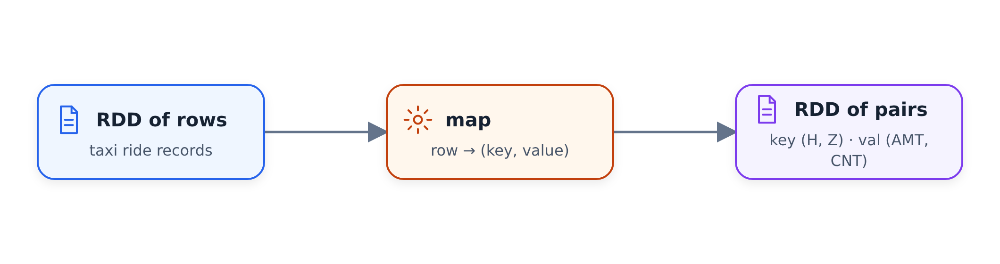

# Hoạt động trên Spark RDD

Trong đơn vị (tùy chọn) này, chúng tôi chuyển từ DataFrames sang RDD - cấu trúc
cấp thấp hơn được xây dựng trên đó - và triển khai lại truy vấn doanh thu xanh
với `filter`, `map` và `reduceByKey`. Hầu hết bạn không cần RDD
, nhưng việc xem chúng cho thấy mọi thứ được thực hiện như thế nào trước DataFrames và cách nhóm
hoạt động bên dưới.

## RDD
là gì
RDD là viết tắt của Tập dữ liệu phân tán có khả năng phục hồi. Nó rất nội bộ đối với Spark:
, các phiên bản đầu tiên của Spark được xây dựng trên RDD và DataFrames xuất hiện
sau đó dưới dạng một lớp trừu tượng khác ở trên chúng, với một API đẹp mắt.

Sự khác biệt: DataFrame tuân theo một cấu trúc cụ thể - nó có một lược đồ.
RDD chỉ là một tập hợp các đối tượng được phân phối. Giống như DataFrame, nó được phân vùng
và mỗi người thực thi lấy một phân vùng và thực thi nó - chúng tôi đã thấy
điều này rồi.

Hãy tạo một sổ ghi chép, bắt đầu phiên Spark cục bộ và đọc dữ liệu
màu xanh lục. Mục tiêu của chúng tôi là thể hiện truy vấn này bằng các hoạt động RDD:

```sql
SELECT
    date_trunc('hour', lpep_pickup_datetime) AS hour,
    PULocationID AS zone,

    SUM(total_amount) AS amount,
    COUNT(1) AS number_records
FROM
    green
WHERE
    lpep_pickup_datetime >= '2020-01-01 00:00:00'
GROUP BY
    1, 2
```

## Từ DataFrame đến RDD

DataFrame có trường được gọi là `rdd` - RDD cơ bản của các hàng. `Row`
là đối tượng đặc biệt được sử dụng để xây dựng DataFrames:

```python
df_green.rdd.take(5)
```

Điều này trả về một danh sách các hàng, giống như cách `df_green.take(5)` thực hiện. Mỗi hàng
có khá nhiều cột và chúng tôi chỉ cần ba cột trong số đó cho truy vấn này -
chúng tôi không cần đếm, vì nó chỉ đếm các bản ghi:

```python
rdd = df_green \
    .select('lpep_pickup_datetime', 'PULocationID', 'total_amount') \
    .rdd
```

Bộ lọc ##: mệnh đề WHERE

Hoạt động RDD đầu tiên là `filter`. Nó nhận một hàm trả về
đúng hoặc sai cho mọi bản ghi và giữ các bản ghi trong đó hàm trả về
đúng. Để xem nó hoạt động:

```python
rdd.filter(lambda row: True).take(1)
```

Điều này giữ tất cả mọi thứ. Thay vào đó, nếu lambda trả về `False` cho mỗi bản ghi
, chúng tôi sẽ lọc toàn bộ tập dữ liệu và nhận được một danh sách trống.

Đối với truy vấn của mình, chúng tôi muốn loại bỏ các ngoại lệ từ trước năm 2020.
Spark bên trong sử dụng các đối tượng datetime của Python, vì vậy chúng tôi so sánh với một datetime:

```python
from datetime import datetime

start = datetime(year=2020, month=1, day=1)

def filter_outliers(row):
    return row.lpep_pickup_datetime >= start
```

Đặt nó vào một hàm được đặt tên là một ý tưởng hay - lambdas có thể khiến
lộn xộn khá nhanh.

## bản đồ: chuẩn bị nhóm

Tiếp theo chúng ta cần phần `GROUP BY`. Hãy nhớ cách hoạt động của từng nhóm: mỗi phân vùng
tạo ra các kết quả phụ - một khóa (giờ, vùng) với số lượng và số lượng
trung gian - và sau đó các kết quả phụ đó sẽ giảm đi.

Để tạo ra các bản ghi trung gian như vậy, chúng tôi sử dụng `map`. Trong khi `filter` quyết định
có giữ bản ghi hay không, `map` được áp dụng cho mọi phần tử của RDD và
biến nó thành một thứ khác: chúng tôi đặt một hàng vào và lấy một số đối tượng
khác ra.



Để nhóm, đầu ra cần phải là một cặp khóa/giá trị. Trong trường hợp của chúng tôi, khóa
là tổng hợp của giờ và vùng và giá trị là tổng hợp của số lượng
và số lượng - trong đó số lượng chỉ đơn giản là 1 cho mỗi bản ghi, sẽ được tổng hợp
sau này.

Hãy thử nghiệm với một hàng trước khi viết hàm. Chúng tôi lấy hàng đầu tiên
của RDD:

```python
rows = rdd.take(10)
row = rows[0]
```

mang lại cho chúng tôi

```text
Row(lpep_pickup_datetime=datetime.datetime(2020, 1, 16, 19, 49, 27),
    PULocationID=260, total_amount=14.3)
```

Giờ là thời gian lấy hàng được rút ngắn thành giờ - điều mà chúng ta có thể thực hiện với
`replace`, đặt phút, giây và micro giây về 0. Vùng là
`PULocationID`. Bây giờ chúng ta có thể viết hàm:

```python
def prepare_for_grouping(row):
    hour = row.lpep_pickup_datetime.replace(minute=0, second=0, microsecond=0)
    zone = row.PULocationID
    key = (hour, zone)

    amount = row.total_amount
    count = 1
    value = (amount, count)

    return (key, value)
```

Vì vậy, mỗi hàng trở thành một bộ gồm hai phần tử: phần tử đầu tiên chính là bộ
- khóa - và bộ thứ hai là một bộ khác có số lượng và số lượng
. Áp dụng nó vào RDD và thực hiện `take` hiển thị chính xác hình dạng này.

## lessByKey: tập hợp

Bây giờ chúng ta cần kết hợp các giá trị thuộc cùng một khóa. Hoạt động
được gọi là `reduceByKey`. Nó lấy một RDD gồm các cặp khóa/giá trị và
tạo ra một RDD khác trong đó mỗi khóa chỉ xuất hiện một lần - tất cả các giá trị của
khóa đó được giảm thành một giá trị duy nhất.

Hàm rút gọn nhận hai giá trị trái và phải và trả về kết hợp
của chúng. Spark xâu chuỗi các cuộc gọi: đầu tiên, nó giảm hai giá trị đầu tiên
của một khóa, sau đó nó lấy đầu ra đó và giảm nó cùng với giá trị
thứ ba, v.v. - cho đến khi mọi thứ thuộc về một khóa trở thành một giá trị
.

Trong trường hợp của chúng tôi, chúng tôi muốn tính tổng cả số lượng và số lượng, do đó, đầu ra
phải tuân theo cùng một mẫu (số lượng, số lượng):

```python
def calculate_revenue(left_value, right_value):
    left_amount, left_count = left_value
    right_amount, right_count = right_value

    output_amount = left_amount + right_amount
    output_count = left_count + right_count

    return (output_amount, output_count)
```

Đặt nó lại với nhau và thực thi:

```python
rdd \
    .filter(filter_outliers) \
    .map(prepare_for_grouping) \
    .reduceByKey(calculate_revenue) \
    .take(5)
```

Kết quả có cùng định dạng như trước - khóa tổng hợp, giá trị
tổng hợp - ngoại trừ giá trị hiện được tổng hợp: tổng của tất cả các số tiền và tổng
của tất cả các số đó, là tổng số bản ghi cho giờ này và vùng
.

## Mở gói trở lại DataFrame

Cấu trúc lồng nhau không đẹp và chúng tôi muốn có lại DataFrame. Vì vậy, chúng tôi thực hiện
thêm một `map` nữa để làm phẳng mỗi bản ghi thành một bộ gồm bốn phần tử:

```python
def unwrap(row):
    return (row[0][0], row[0][1], row[1][0], row[1][1])
```

Nếu chúng ta gọi `toDF()` trên đó và `show()`, chúng ta sẽ nhận được một DataFrame - nhưng tên cột
đã biến mất (chúng ta thấy `_1`, `_2`, v.v.) và Spark phải tìm ra lược đồ
bằng cách xem qua các bản ghi.

Để lấy lại tên, chúng ta có thể sử dụng bộ dữ liệu có tên:

```python
from collections import namedtuple

RevenueRow = namedtuple('RevenueRow', ['hour', 'zone', 'revenue', 'count'])

def unwrap(row):
    return RevenueRow(
        hour=row[0][0],
        zone=row[0][1],
        revenue=row[1][0],
        count=row[1][1]
    )
```

Cùng với đó, `toDF()` tạo ra các cột được đặt tên độc đáo.

Tuy nhiên, Spark vẫn cố gắng suy ra lược đồ - bạn có thể thấy nó đang thực hiện
điều gì đó trước `show()`. Để tránh điều đó, chúng tôi chỉ định trước lược đồ:

```python
from pyspark.sql import types

result_schema = types.StructType([
    types.StructField('hour', types.TimestampType(), True),
    types.StructField('zone', types.IntegerType(), True),
    types.StructField('revenue', types.DoubleType(), True),
    types.StructField('count', types.IntegerType(), True)
])

df_result = rdd \
    .filter(filter_outliers) \
    .map(prepare_for_grouping) \
    .reduceByKey(calculate_revenue) \
    .map(unwrap) \
    .toDF(result_schema)
```

Hiện việc tạo DataFrame không thực thi bất kỳ điều gì - chính `show()` (hoặc
`write`) kích hoạt tính toán. Chúng tôi lưu kết quả vào sàn gỗ để
có thể xem biểu đồ thực thi.

## Biểu đồ thực thi

Trong Spark UI, công việc có hai giai đoạn - giống như phiên bản SQL, mặc dù
, các hộp kế hoạch trông hơi khác một chút do bản đồ của chúng tôi. Lý do
có hai giai đoạn là `reduceByKey`: nó cần sự xáo trộn mà chúng ta biết từ nhóm
theo đơn vị.

Hình dạng ổn định của kế hoạch thực hiện đó là:

| Một phần của kế hoạch | Hoạt động | Vai trò |
|---|---|---|
| Trước khi xáo trộn | `filter` → `map` | Biến mỗi hàng thành một cặp `(key, value)` trong phân vùng đầu vào của nó. |
| Ranh giới xáo trộn | `partitionBy` / xáo trộn theo phím | Gửi các bản ghi có cùng khóa tới cùng một phân vùng. |
| Sau khi xáo trộn | `mapPartitions` / `reduceByKey` → `map` | Kết hợp các giá trị cho từng khóa và mở gói tổng hợp. |

Dòng chảy tương tự như một cái cây:

```text
RDD rows
└── stage before shuffle
    ├── filter
    └── map -> (key, value)
        └── partitionBy / shuffle by key
            └── stage after shuffle
                ├── mapPartitions / reduceByKey
                └── map / unwrap
```

Các hàm ánh xạ biến mỗi bản ghi thành một cặp khóa/giá trị và tất cả các bản ghi
có cùng khóa - từ tất cả các phân vùng - phải nằm trong cùng một phân vùng
trước khi chúng có thể được rút gọn thành một.

Và đó là toàn bộ công thức: mệnh đề `WHERE` trở thành `filter`,
`SELECT` của khóa nhóm và các giá trị tổng hợp trở thành `map` thành cặp khóa/giá trị
, `GROUP BY` với `SUM` và `COUNT` trở thành
`reduceByKey`, sau đó chúng tôi mở kết quả và biến nó trở lại Khung dữ liệu
. Thông thường, chúng tôi không cần viết mã như thế này - chúng tôi có
DataFrames và SQL - nhưng nó hiển thị những gì xảy ra bên dưới và đôi khi
các thao tác cấp thấp vẫn hữu ích (đơn vị tiếp theo hiển thị một trường hợp
như vậy, `mapPartitions`).

## Vật liệu

* [`code/08_rdds.ipynb`](code/08_rdds.ipynb) - nửa đầu: giảm từ Khung dữ liệu
xuống RDD của nó và xây dựng lại báo cáo doanh thu xanh với `filter`,
`map`, `reduceByKey` và một lược đồ kết quả rõ ràng.
