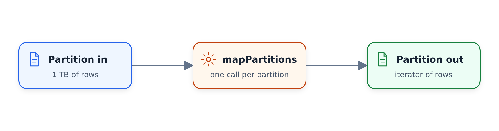

# Bản đồ Spark RDDPhân vùng

Trong phần này, chúng ta xem xét `mapPartitions`, một phép biến đổi RDD mà
xử lý toàn bộ phân vùng tại một thời điểm thay vì từng hàng một. Chúng tôi sử dụng
để áp dụng mô hình học máy cho dữ liệu taxi theo từng đoạn.
này là thiết bị tùy chọn thứ hai trên RDD và nó tiếp tục có trong sổ ghi chép từ
thiết bị trước đó: mọi thứ bên dưới nằm trong nửa sau của
[`code/08_rdds.ipynb`](code/08_rdds.ipynb).

## Từ bản đồ đến bản đồPartitions

Trong bài trước, chúng ta đã sử dụng `map`: nó lấy một phần tử của RDD và
tạo ra một phần tử khác. `mapPartitions` hoạt động ở cấp độ cao hơn. Đầu vào là
một phân vùng - toàn bộ đoạn dữ liệu - và đầu ra là một phân vùng
khác:



Điều này thuận tiện khi hàm của bạn cần nhiều hàng cùng một lúc.
Hãy tưởng tượng một tập dữ liệu một terabyte không vừa với bộ nhớ của bất kỳ máy
nào mà bạn có. Nếu mỗi phân vùng có dung lượng 100 MB, thì bạn có thể xử lý
từng đoạn dữ liệu: mỗi phân vùng vừa với bộ nhớ và Spark
áp dụng chức năng của bạn cho hết phần này đến phần khác.

Áp dụng mô hình học máy là trường hợp điển hình. Một mô hình dự đoán
cho một loạt hàng cùng lúc chứ không phải từng hàng. Vậy kế hoạch là:

- Đặt lệnh gọi mô hình bên trong hàm `mapPartitions`.
- Hãy để Spark cắt tập dữ liệu lớn thành các phân vùng.
- Áp dụng mô hình cho từng phân vùng.
- Kết hợp các kết quả và lưu chúng vào hồ dữ liệu.

## Ví dụ: dự đoán thời lượng chuyến đi

Để làm ví dụ, chúng ta quay lại tập dữ liệu taxi xanh. Hãy tưởng tượng chúng ta xây dựng một dịch vụ
để dự đoán một chuyến đi sẽ kéo dài bao lâu. Từ tập dữ liệu, chúng ta cần
các cột sau:

- `VendorID` - một số nhà cung cấp có thể nhanh hơn những nhà cung cấp khác.
- `lpep_pickup_datetime` - chuyến đi bắt đầu lúc nửa đêm có lẽ
nhanh hơn chuyến đi bắt đầu trong giờ cao điểm.
- `PULocationID` và `DOLocationID` - điểm đón và điểm trả
càng xa nhau thì chuyến đi càng dài.
- `trip_distance` - quãng đường càng xa, chuyến đi càng dài.

Chúng tôi chọn các cột và xem kết quả:

```python
columns = ['VendorID', 'lpep_pickup_datetime', 'PULocationID',
           'DOLocationID', 'trip_distance']

df_green \
    .select(columns) \
    .show()
```

```text
VendorID | lpep_pickup_datetime | PULocationID | DOLocationID | trip_distance
2        | 2020-01-16 19:49:27  | 260          | 173          | 2.59
2        | 2020-01-19 01:55:32  | 181          | 211          | 6.25
2        | 2020-01-18 15:58:31  | 74           | 244          | 2.8
null     | 2020-01-03 09:37:00  | 51           | 185          | 2.55
2        | 2020-01-27 09:27:18  | 146          | 146          | 0.02
2        | 2020-01-14 09:33:35  | 129          | 226          | 2.21
2        | 2020-01-27 22:52:52  | 74           | 194          | 2.26
null     | 2020-01-19 07:35:00  | 51           | 116          | 10.0
2        | 2020-01-07 06:36:27  | 244          | 74           | 3.18
2        | 2020-01-17 21:06:51  | 66           | 132          | 1.22
2        | 2020-01-16 17:39:15  | 75           | 143          | 2.8
2        | 2020-01-24 22:33:24  | 75           | 74           | 3.07
2        | 2020-01-09 23:58:57  | 65           | 97           | 2.19
2        | 2020-01-17 08:48:46  | 95           | 135          | 2.31
null     | 2020-01-28 20:16:30  | 42           | 10           | 15.78
```

Trong thực tế, quá trình xử lý trước sẽ diễn ra bằng SQL và vào thời điểm dữ liệu
đạt đến điểm này, nó sẽ chỉ chứa thông tin
đã chuẩn bị mà chúng tôi muốn cung cấp cho mô hình. Đó đã là trường hợp ở đây.
Bây giờ chúng tôi biến DataFrame thành RDD:

```python
duration_rdd = df_green \
    .select(columns) \
    .rdd
```

## Thử nghiệm mapPartitions đầu tiên

Trước khi áp dụng một mô hình thực tế, chúng ta hãy xem `mapPartitions` thực tế
làm được những gì. Chúng tôi viết một hàm bỏ qua đầu vào của nó và trả về một danh sách có một phần tử
:

```python
def apply_model_in_batch(partition):
    return [1]
```

Áp dụng nó và thu thập kết quả sẽ đưa ra danh sách bốn cái:

Hàm chạy một lần trên mỗi phân vùng và RDD có bốn phân vùng.
Spark sau đó đã san phẳng bốn danh sách một thành phần thành một danh sách. Lưu ý rằng
, hàm phải trả về thứ gì đó có thể lặp lại: nếu bạn chỉ trả về `1`, Spark
không thành công với lỗi cho biết đối tượng int không thể lặp lại được.

## Đếm số hàng trong mỗi phân vùng

Chúng ta hãy đếm xem mỗi phân vùng chứa bao nhiêu hàng. Một lần thử sẽ là
`len(partition)`, nhưng không thành công: phân vùng không phải là danh sách Python, nó là
một trình vòng lặp (thuộc loại `itertools.chain`). Chúng tôi không thể lấy độ dài của nó, nhưng
có thể lặp qua nó:

```python
def apply_model_in_batch(partition):
    cnt = 0
    for row in partition:
        cnt = cnt + 1
    return [cnt]

duration_rdd.mapPartitions(apply_model_in_batch).collect()
```

Việc này mất một lúc, vì Spark phải xem qua từng bản ghi của mọi phân vùng
:

Kết quả là `[1141148, 436983, 433476, 292910]`. Các phân vùng của chúng tôi
không được cân bằng cho lắm: phân vùng đầu tiên lớn hơn ba lần so với các phân vùng tiếp theo.
Điều đó không tuyệt vời - người thực thi nhận được phân vùng lớn sẽ vẫn
hoạt động rất lâu sau khi những người khác đã hoàn thành và họ sẽ phải đợi.
Để tránh điều này, chúng ta có thể phân vùng lại dữ liệu, nhưng việc phân vùng lại là một hoạt động tốn kém của
. Đây là điều bạn học cách giải quyết trong thực tế.

## Từ phân vùng đến gấu trúc DataFrames

Các nhà khoa học dữ liệu thường thích gấu trúc và các mô hình thường mong đợi Khung dữ liệu
của gấu trúc, vì vậy chúng ta hãy biến mỗi phân vùng thành một phân vùng. Đầu tiên, các hàng
trông như thế nào? `duration_rdd.take(10)` trả về một loạt đối tượng Hàng và
cung cấp chúng cho gấu trúc hoạt động nhưng các cột có tên vô nghĩa:


Chúng tôi đã có tên cột trong biến `columns`, vì vậy chúng tôi chuyển
một cách rõ ràng:

```python
import pandas as pd

def apply_model_in_batch(rows):
    df = pd.DataFrame(rows, columns=columns)
    cnt = len(df)
    return [cnt]
```

Một lưu ý: `pd.DataFrame(rows)` hiện thực hóa toàn bộ phân vùng trong bộ nhớ
, vì vậy người thực thi cần có đủ bộ nhớ cho nó. Nếu phân vùng của bạn
quá lớn, bạn cần phân vùng lại hoặc chia chúng thành các phần nhỏ hơn -
là các gói Python cho phép bạn cắt một trình lặp thành các phần phụ, chẳng hạn như
, 100.000 hàng và xử lý chúng một cách riêng biệt. Chúng tôi sẽ không cần điều đó ở đây.

Trong khi chạy tính năng này, chúng tôi đã gặp lỗi: năm cột đã trôi qua nhưng dữ liệu có ba cột
. Lý do là chức năng này đã được áp dụng cho RDD từ
đơn vị trước đó, chỉ có ba cột, thay vì
`duration_rdd`. Với RDD phù hợp, nó hoạt động và chúng tôi nhận được số lượng phân vùng
giống như trước đây.

## Thêm dự đoán bằng mô hình

Bây giờ là phần học máy. Hàm áp dụng mô hình cho Khung dữ liệu
thường trông như thế này:

```python
def model_predict(df):
    y_pred = model.predict(df)
    return y_pred
```

Chúng tôi không có mô hình được đào tạo ở đây, vì vậy chúng tôi giả sử: mô hình của chúng tôi ước tính
năm phút di chuyển mỗi dặm:

```python
# model = ...

def model_predict(df):
    y_pred = df.trip_distance * 5
    return y_pred
```

Các dự đoán sẽ trả về dưới dạng một mảng có một giá trị trên mỗi hàng của Khung dữ liệu
. Chúng tôi đặt chúng vào một cột mới:

```python
def apply_model_in_batch(rows):
    df = pd.DataFrame(rows, columns=columns)
    predictions = model_predict(df)
    df['predicted_duration'] = predictions
```

## Trả lại các hàng

Chúng tôi không thể trả về DataFrame của gấu trúc từ `mapPartitions` - chúng tôi cần
xuất từng hàng một. Pandas có `itertuples` cho việc đó: nó trả về
một trình vòng lặp và với mỗi hàng, nó mang lại một bộ dữ liệu với các giá trị hàng (cộng với
một chỉ mục mà hiện tại chúng ta có thể bỏ qua).

```python
def apply_model_in_batch(rows):
    df = pd.DataFrame(rows, columns=columns)
    predictions = model_predict(df)
    df['predicted_duration'] = predictions

    for row in df.itertuples():
        yield row
```

Nếu bạn chưa từng thấy `yield` trước đây: một hàm có `yield` trả về trình tạo
. Một ví dụ đơn giản là dãy số vô hạn:

```python
def infinite_seq():
    i = 0
    while True:
        yield i
        i = i + 1
```

Việc gọi nó không chạy vòng lặp - nó cung cấp cho bạn một đối tượng trình tạo. Mỗi lệnh gọi
tới `next` tạo ra giá trị tiếp theo và vòng lặp `for` có thể sử dụng
theo cách tương tự. Đây chính xác là những gì Spark thực hiện với chức năng của chúng tôi: nó kéo
mỗi hàng mang lại vào RDD kết quả và cuối cùng tất cả các hàng từ
, tất cả các phân vùng đều được kết hợp.

## Quay lại Spark DataFrame

Hãy để chúng tôi chạy nó. Chúng tôi không sử dụng `collect` - điều đó sẽ kéo mọi dự đoán về trình điều khiển
- vì vậy thay vào đó chúng tôi sử dụng `take(10)`. Lưu ý rằng điều này vẫn áp dụng chức năng
cho tất cả các phân vùng: Spark chạy toàn bộ công việc và chỉ sau đó lấy
mười phần tử đầu tiên.

Các hàng trở lại dưới dạng bộ dữ liệu và chúng ta có thể biến chúng thành Spark DataFrame
và xem dự đoán:

```python
df_predicts = duration_rdd \
    .mapPartitions(apply_model_in_batch) \
    .toDF() \
    .drop('Index')

df_predicts.select('predicted_duration').show()
```

Chúng tôi loại bỏ cột `Index` mà `itertuples` đã thêm và vì chúng tôi không
chỉ định một lược đồ nên Spark suy ra nó:

Đối với mỗi hàng dữ liệu, chúng tôi hiện có thời lượng dự đoán tính bằng phút -
thứ mà chúng tôi có thể hiển thị cho hành khách muốn biết chuyến đi
sẽ kéo dài bao lâu.

Tất nhiên, trong trường hợp sử dụng cụ thể này, bạn sẽ không sử dụng Spark: hành khách
muốn có câu trả lời trong thời gian thực, vì vậy trong thực tế, bạn sẽ có dịch vụ web
nhận yêu cầu từ điện thoại của hành khách và trả lời
với thời lượng dự kiến. Ví dụ ở đây cho thấy cách sử dụng `mapPartitions`
trong thực tế - chia một tập dữ liệu lớn, áp dụng mô hình cho từng đoạn,
kết hợp các kết quả. Với điều này, phần ngắn của chúng tôi về nội bộ Spark và RDD
kết thúc.

## Vật liệu

* [`code/08_rdds.ipynb`](code/08_rdds.ipynb) - nửa sau: `mapPartitions`
áp dụng mô hình cho mỗi phân vùng dưới dạng Pandas DataFrame.
