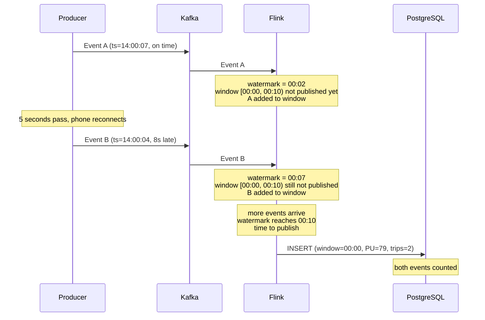
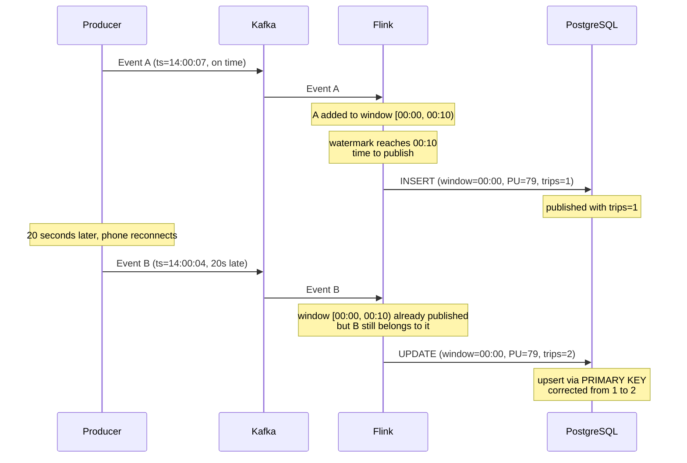

# Tập hợp với các cửa sổ lật

Bây giờ, hãy làm một việc mà người dùng Python đơn giản của chúng ta không thể dễ dàng thực hiện - tổng hợp
theo cửa sổ. Chúng tôi sẽ tính số chuyến taxi và tổng doanh thu theo địa điểm đón mỗi giờ.

Đầu tiên, hủy mọi công việc đang chạy. Sau đó tạo bảng tổng hợp trong PostgreSQL:

```sql
CREATE TABLE processed_events_aggregated (
    window_start TIMESTAMP,
    PULocationID INTEGER,
    num_trips BIGINT,
    total_revenue DOUBLE PRECISION,
    PRIMARY KEY (window_start, PULocationID)
);
```

Hai lựa chọn thiết kế quan trọng:

1. Bao gồm `PULocationID` - chúng tôi nhóm theo cả khoảng thời gian và vị trí lấy hàng
, để cả hai đều xuất hiện trong đầu ra.
2. `PRIMARY KEY` - cho phép nâng cấp hành vi. Khi Flink gửi số lượng
đã cập nhật cho cùng một cửa sổ, PostgreSQL sẽ cập nhật hàng hiện có thay vì tạo một bản sao
. Điều này quan trọng vì các sự kiện đến muộn có thể khiến Flink tới
đánh giá lại cửa sổ mà nó đã đưa ra kết quả. Với upsert, số lượng đã sửa
sẽ tự động thay thế số cũ.

Bây giờ hãy tạo `src/job/aggregation_job.py`:

```python
from pyflink.datastream import StreamExecutionEnvironment
from pyflink.table import EnvironmentSettings, StreamTableEnvironment

def create_events_source_kafka(t_env):
    table_name = "events"
    source_ddl = f"""
        CREATE TABLE {table_name} (
            PULocationID INTEGER,
            DOLocationID INTEGER,
            trip_distance DOUBLE,
            total_amount DOUBLE,
            tpep_pickup_datetime BIGINT,
            event_timestamp AS TO_TIMESTAMP_LTZ(tpep_pickup_datetime, 3),
            WATERMARK for event_timestamp as event_timestamp - INTERVAL '5' SECOND
        ) WITH (
            'connector' = 'kafka',
            'properties.bootstrap.servers' = 'redpanda:29092',
            'topic' = 'rides',
            'scan.startup.mode' = 'earliest-offset',
            'properties.auto.offset.reset' = 'earliest',
            'format' = 'json'
        );
        """
    t_env.execute_sql(source_ddl)
    return table_name

def create_events_aggregated_sink(t_env):
    table_name = 'processed_events_aggregated'
    sink_ddl = f"""
        CREATE TABLE {table_name} (
            window_start TIMESTAMP(3),
            PULocationID INT,
            num_trips BIGINT,
            total_revenue DOUBLE,
            PRIMARY KEY (window_start, PULocationID) NOT ENFORCED
        ) WITH (
            'connector' = 'jdbc',
            'url' = 'jdbc:postgresql://postgres:5432/postgres',
            'table-name' = '{table_name}',
            'username' = 'postgres',
            'password' = 'postgres',
            'driver' = 'org.postgresql.Driver'
        );
        """
    t_env.execute_sql(sink_ddl)
    return table_name

def log_aggregation():
    env = StreamExecutionEnvironment.get_execution_environment()
    env.enable_checkpointing(10 * 1000)
    env.set_parallelism(3)

    settings = EnvironmentSettings.new_instance().in_streaming_mode().build()
    t_env = StreamTableEnvironment.create(env, environment_settings=settings)

    try:
        source_table = create_events_source_kafka(t_env)
        aggregated_table = create_events_aggregated_sink(t_env)

        t_env.execute_sql(f"""
        INSERT INTO {aggregated_table}
        SELECT
            window_start,
            PULocationID,
            COUNT(*) AS num_trips,
            SUM(total_amount) AS total_revenue
        FROM TABLE(
            TUMBLE(TABLE {source_table}, DESCRIPTOR(event_timestamp), INTERVAL '1' HOUR)
        )
        GROUP BY window_start, PULocationID;

        """).wait()

    except Exception as e:
        print("Writing records from Kafka to JDBC failed:", str(e))

if __name__ == '__main__':
    log_aggregation()
```

Bảng nguồn Kafka có hai dòng mới so với công việc truyền qua:

- `event_timestamp AS TO_TIMESTAMP_LTZ(tpep_pickup_datetime, 3)` - cột
được tính toán để chuyển đổi mili giây kỷ nguyên thành dấu thời gian. `3` có nghĩa là độ chính xác đến từng mili giây của
.
- `WATERMARK for event_timestamp as event_timestamp - INTERVAL '5' SECOND` -
cho Flink biết thời điểm xuất bản kết quả cửa sổ.

Cửa sổ xác định NHỮNG GÌ bạn đang đếm - một nhóm chuyến đi taxi kéo dài 1 giờ.
Nhưng trong một luồng, các sự kiện liên tục đến. Làm cách nào để Flink biết khi nào nên dừng
chờ đợi và công bố số lượng trong khoảng thời gian từ 2 giờ chiều - 3 giờ chiều?
không thể chỉ nhìn đồng hồ vì một số sự kiện đến muộn. Nếu không có trình kích hoạt,
Flink sẽ tích lũy dữ liệu mãi mãi và không bao giờ ghi bất cứ điều gì vào PostgreSQL.

Hình mờ chính là yếu tố kích hoạt đó. Nó cho Flink biết khi nào nên xuất bản. Trong SQL:

```
WATERMARK FOR event_timestamp AS event_timestamp - INTERVAL '5' SECOND
                                                   ^^^^^^^^^^^^^^^^^^^
                                                   patience = 5 seconds
```

Hình mờ luôn chậm hơn 5 giây so với dấu thời gian sự kiện mới nhất mà Flink
đã thấy. Khi hình mờ đi qua cuối cửa sổ, Flink sẽ xuất bản
kết quả của cửa sổ đó. 5 giây là sự kiên nhẫn dành cho những người đi trễ - sự kiện
diễn ra trước khi thời gian kết thúc nhưng đến muộn vài giây.

Ba mảnh làm việc cùng nhau:

- Cửa sổ = cần tính vào nhóm nào (1 giờ)
- Hình mờ = thời điểm xuất bản kết quả (trình kích hoạt)
- Upsert (PRIMARY KEY) = mạng an toàn sửa kết quả nếu có thứ gì đó
xuất hiện sau khi xuất bản

Đây là một ví dụ cụ thể. Hai xe đón taxi ở East Village (PU=79) có
cửa sổ 10 giây và hình mờ 5 giây. Sự kiện A đúng giờ, Sự kiện B
trễ 8 giây (điện thoại của người lái bị mất sóng trong đường hầm).

Sự kiện B đến muộn nhưng Flink vẫn chưa xuất bản - cả hai sự kiện đều được tính:



Sự kiện B đến muộn nhưng vẫn nằm trong khoảng thời gian kiên nhẫn của Flink. Flink chưa
công bố kết quả nên B đã được tính vào.

Bây giờ điều gì sẽ xảy ra nếu Sự kiện B trễ 20 giây - đến sau khi Flink đã xuất bản
?



Flink đã xuất bản các chuyến đi=1, nhưng khi Sự kiện B cuối cùng cũng đến,
PRIMARY KEY cho phép Flink gửi bản sửa lỗi. PostgreSQL cập nhật hàng
từ 1 lên 2. Nếu không có PRIMARY KEY (phần chìm chỉ gắn thêm), Sự kiện B
sẽ bị mất - Flink không thể mở lại cửa sổ đã xuất bản ở chế độ chắp thêm.

Sự đánh đổi là độ trễ và tính đầy đủ. Hình mờ lớn hơn có nghĩa là
kiên nhẫn hơn đối với các sự kiện muộn, nhưng bạn phải đợi lâu hơn trước khi thấy bất kỳ kết quả nào.
5 giây là mặc định hợp lý. Trong quá trình sản xuất, bạn sẽ điều chỉnh
dựa trên mức độ thực tế của dữ liệu của bạn.

Những khác biệt khác so với công việc chuyển tiếp:

- Bồn rửa có `PRIMARY KEY` với `NOT ENFORCED` - điều này cho phép nâng cấp hành vi
trong đầu nối Flink JDBC.
- `earliest-offset` - đọc tất cả dữ liệu hiện có từ Kafka.
- `env.set_parallelism(3)` - chạy 3 bản xử lý dữ liệu song song.
- Chức năng `TUMBLE` tạo các cửa sổ có kích thước cố định, không chồng chéo.
`DESCRIPTOR(event_timestamp)` phải tham chiếu cột có `WATERMARK`
được xác định trên đó và `INTERVAL '1' HOUR` đặt kích thước cửa sổ.

Gửi và kiểm tra:

```bash
docker compose exec jobmanager ./bin/flink run \
    -py /opt/src/job/aggregation_job.py \
    --pyFiles /opt/src -d
```

Gửi dữ liệu:

```bash
uv run python src/producers/producer.py
```

Đợi ~15 giây để cửa sổ đóng lại, sau đó kiểm tra:

```sql
SELECT window_start, count(*) as locations, sum(num_trips) as total_trips,
       round(sum(total_revenue)::numeric, 2) as revenue
FROM processed_events_aggregated
GROUP BY window_start
ORDER BY window_start;
```

```
     window_start     | locations | total_trips | revenue
----------------------+-----------+-------------+---------
 2025-11-01 00:00:00  |        ...
 2025-11-01 01:00:00  |        ...
 ...
```

1000 chuyến đi bằng taxi được nhóm thành các khoảng thời gian kéo dài 1 giờ theo địa điểm đón khách
. Mỗi hàng hiển thị số lượng địa điểm có chuyến đi trong giờ đó và tổng số chuyến đi của
.

Hãy thử điều này với người dùng Python đơn giản - bạn cần triển khai logic
cửa sổ, xử lý các sự kiện muộn, quản lý trạng thái và tự viết SQL nâng cấp.
Với Flink, đó là truy vấn SQL.
