# Lý thuyết Kafka (tùy chọn)

Các bài giảng video bao gồm các khái niệm Kafka, kèm theo các ví dụ về mã bằng Java.

Mã: [java/kafka_examples](java/kafka_examples)

## Xử lý luồng

- [7.0.1 Giới thiệu](https://youtu.be/hfvju3iOIP0&list=PL3MmuxUbc_hJed7dXYoJw8DoCuVHhGEQb&index=67)
- [7.0.2 Xử lý luồng là gì](https://youtu.be/WxTxKGcfA-k&list=PL3MmuxUbc_hJed7dXYoJw8DoCuVHhGEQb&index=68)

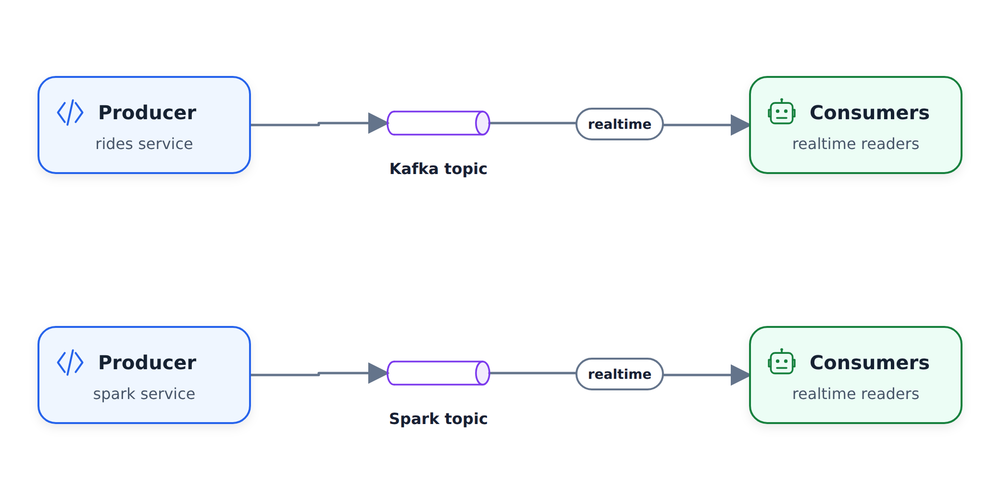

- [7.3 Kafka là gì?](https://youtu.be/zPLZUDPi4AY&list=PL3MmuxUbc_hJed7dXYoJw8DoCuVHhGEQb&index=69)

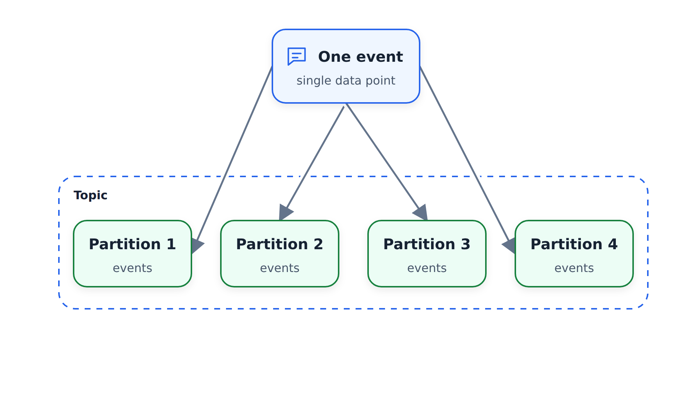

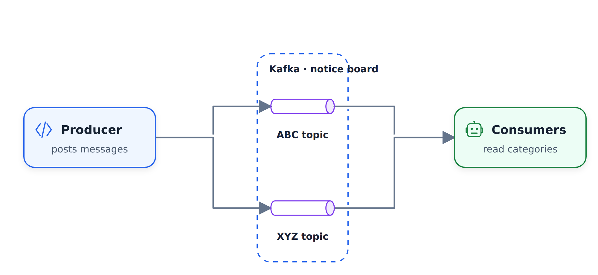

- [7.4 Đám mây hợp lưu](https://youtu.be/ZnEZFEYKppw&list=PL3MmuxUbc_hJed7dXYoJw8DoCuVHhGEQb&index=70)
- [7.5 Người tiêu dùng của nhà sản xuất Kafka](https://youtu.be/aegTuyxX7Yg&list=PL3MmuxUbc_hJed7dXYoJw8DoCuVHhGEQb&index=71)
- [Cấu hình 7.6 Kafka](https://youtu.be/SXQtWyRpMKs&list=PL3MmuxUbc_hJed7dXYoJw8DoCuVHhGEQb&index=72)

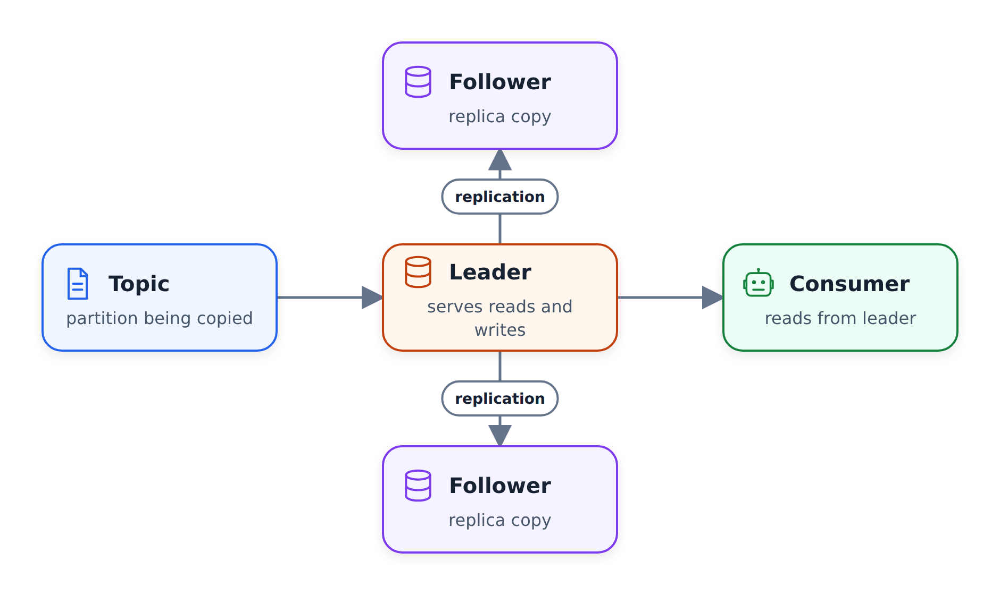

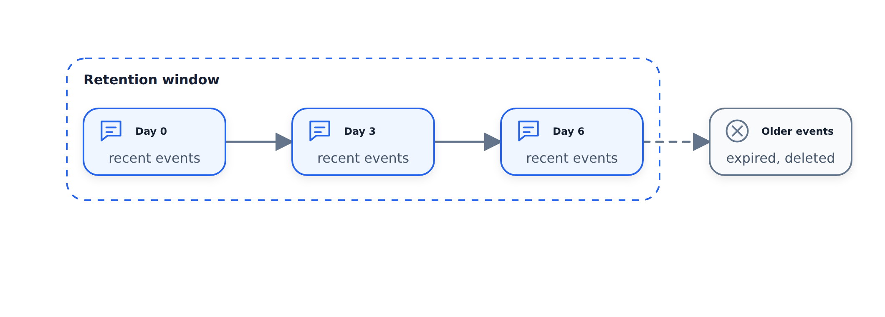

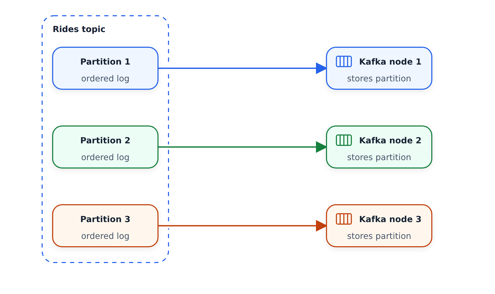

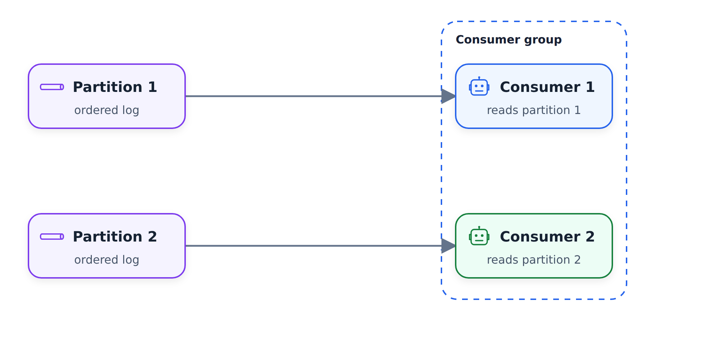

Liên kết:

- [Trang trình bày](https://docs.google.com/presentation/d/1bCtdCba8v1HxJ_uMm9pwjRUC-NAMeB-6nOG2ng3KujA/edit?usp=sharing)
- [Tham khảo cấu hình Kafka](https://docs.confluent.io/platform/current/installation/configuration/)
- [Bản dùng thử Confluent Cloud](https://www.confluent.io/confluent-cloud/tryfree/)

## Kafka phát trực tiếp

- [7.7 Thông tin cơ bản về luồng Kafka](https://youtu.be/dUyA_63eRb0&list=PL3MmuxUbc_hJed7dXYoJw8DoCuVHhGEQb&index=73)

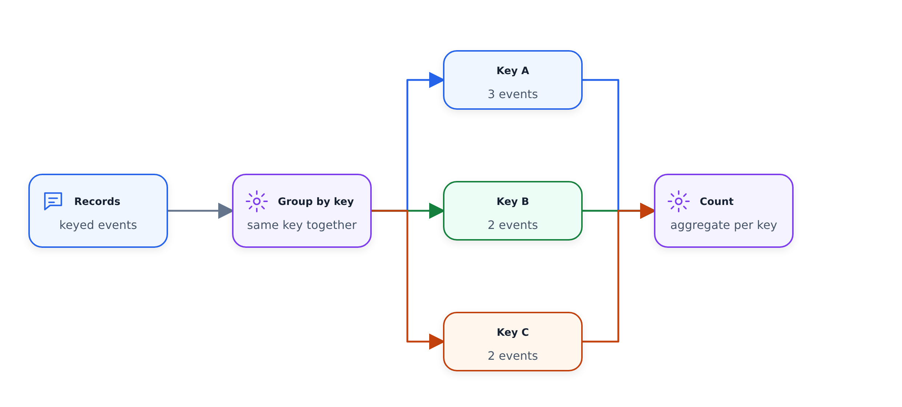

- [7.8 Tham gia luồng Kafka](https://youtu.be/NcpKlujh34Y&list=PL3MmuxUbc_hJed7dXYoJw8DoCuVHhGEQb&index=74)
- [7.9 Thử nghiệm luồng Kafka](https://youtu.be/TNx5rmLY8Pk&list=PL3MmuxUbc_hJed7dXYoJw8DoCuVHhGEQb&index=75)

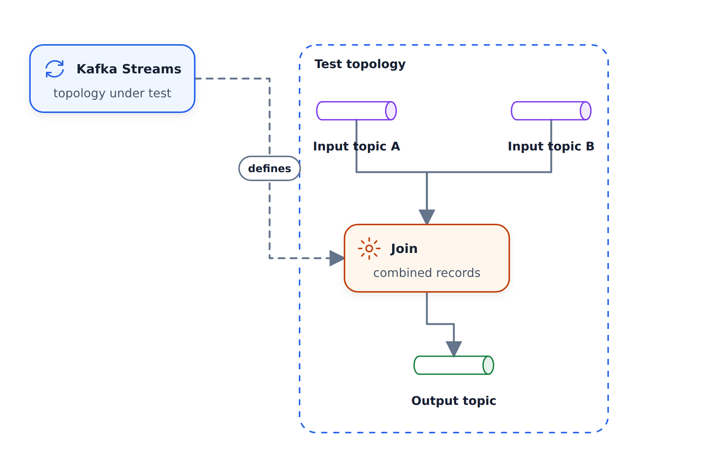

- [Cửa sổ luồng Kafka 7.10](https://youtu.be/r1OuLdwxbRc&list=PL3MmuxUbc_hJed7dXYoJw8DoCuVHhGEQb&index=76)

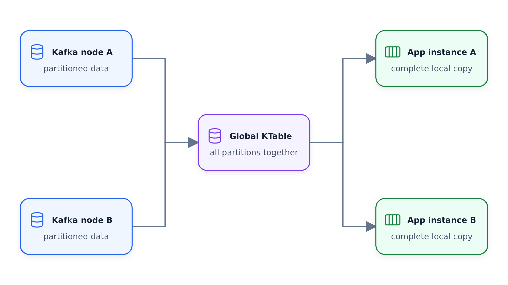

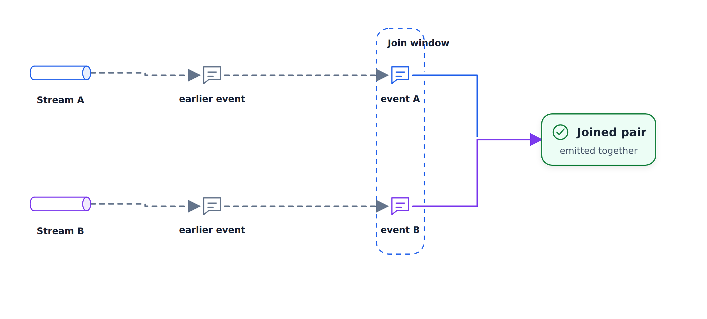

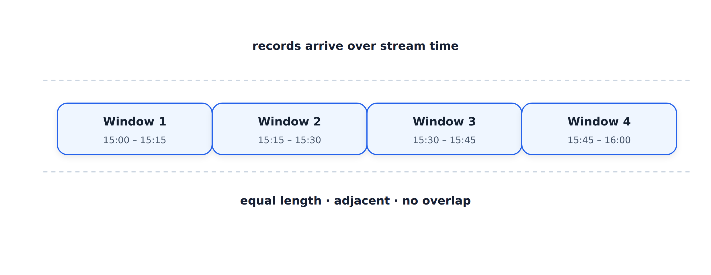

- [7.11 Kafka ksqlDB và Connect](https://youtu.be/DziQ4a4tn9Y&list=PL3MmuxUbc_hJed7dXYoJw8DoCuVHhGEQb&index=77)
- [7.12 Kafka Schema register](https://youtu.be/tBY_hBuyzwI&list=PL3MmuxUbc_hJed7dXYoJw8DoCuVHhGEQb&index=78)

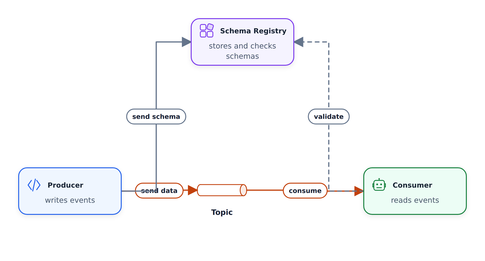

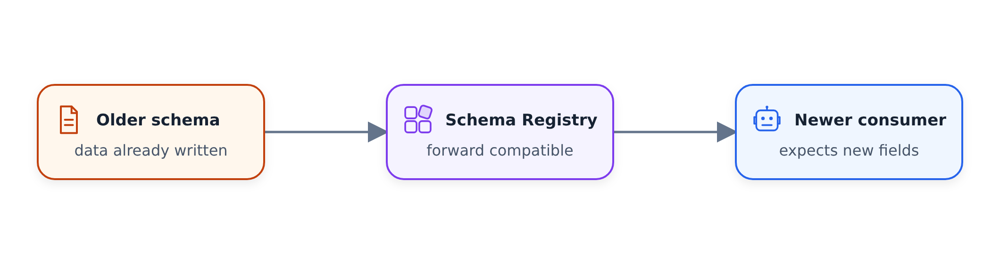

Liên kết:

- [Trang trình bày](https://docs.google.com/presentation/d/1fVi9sFa7fL2ZW3ynS5MAZm0bRSZ4jO10fymPmrfTUjE/edit?usp=sharing)
- [Khái niệm về luồng](https://docs.confluent.io/platform/current/streams/concepts.html)
