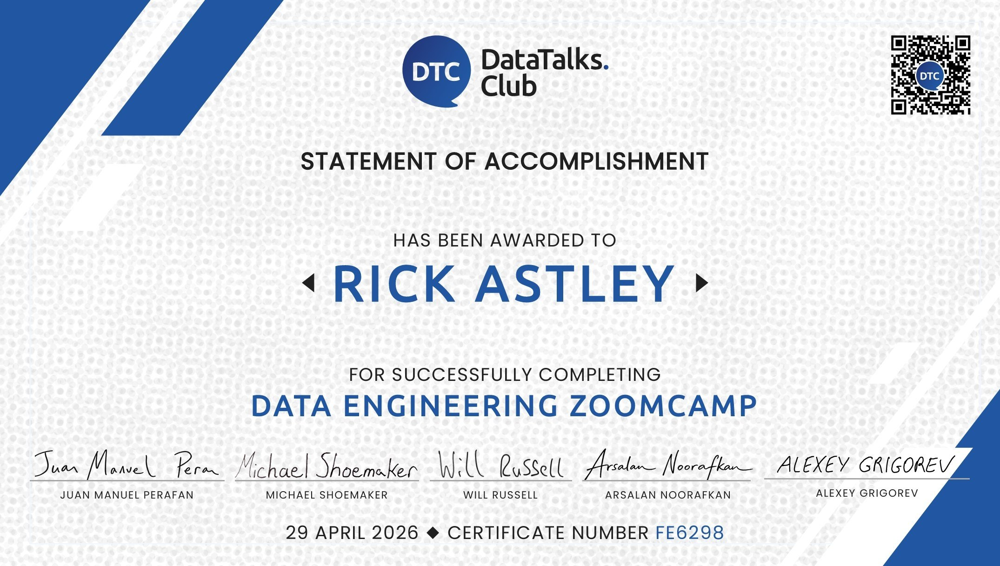
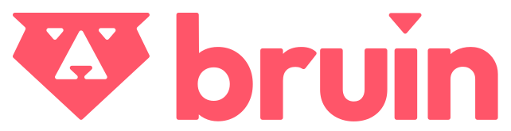
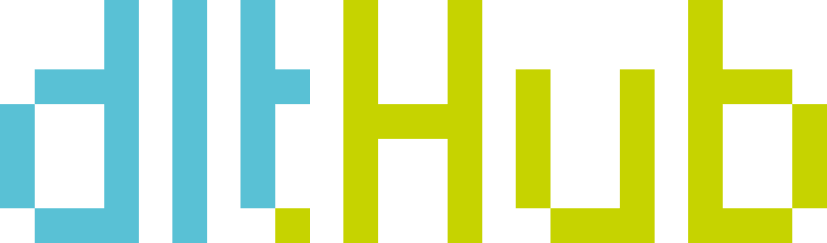

<h1 align="center">
Zoomcamp kỹ thuật dữ liệu: Khóa học 9 tuần miễn phí về các nguyên tắc cơ bản về kỹ thuật dữ liệu
</h1>

Nắm vững các nguyên tắc cơ bản về kỹ thuật dữ liệu bằng cách xây dựng đường truyền dữ liệu từ đầu đến cuối. Có được trải nghiệm thực tế với các công cụ tiêu chuẩn ngành và các phương pháp hay nhất.

<a href="https://datatalks.club/slack.html">Tham gia Slack</a> •
<a href="https://app.slack.com/client/T01ATQK62F8/C01FABYF2RG">#course-data-engineering Channel</a> •
<a href="https://t.me/dezoomcamp">Telegram Thông báo</a> •
<a href="https://www.youtube.com/playlist?list=PL3MmuxUbc_hJed7dXYoJw8DoCuVHhGEQb">Danh sách phát khóa học</a> •
<a href="https://datatalks.club/faq/data-engineering-zoomcamp.html">FAQ</a>

## Liên kết nhanh

| Tài nguyên | Liên kết |
|----------|------|
| Tài liệu khóa học | [Kho lưu trữ GitHub](https://github.com/DataTalksClub/data-engineering-zoomcamp) |
| Video bài giảng | [Danh sách phát YouTube](https://www.youtube.com/playlist?list=PL3MmuxUbc_hJed7dXYoJw8DoCuVHhGEQb) |
| Tài liệu | [Hậu cần Zoomcamp](https://datatalks.club/docs/courses/zoomcamp-logistics/) · [Zoomcamp Kỹ thuật dữ liệu](https://datatalks.club/docs/courses/data-engineering-zoomcamp/) |
| Nền tảng khóa học (thời hạn, bài tập về nhà) | [khóa học.datatalks.club](https://courses.datatalks.club/) |
| Kênh chùng | [#course-data-engineering](https://app.slack.com/client/T01ATQK62F8/C01FABYF2RG) |
| Thông báo | [Telegram](https://t.me/dezoomcamp) |
| Câu hỏi thường gặp | [Tài liệu hỏi đáp](https://datatalks.club/faq/data-engineering-zoomcamp.html) |

##Giới thiệu khóa học

Khóa học miễn phí kéo dài 9 tuần này dạy các nguyên tắc cơ bản về kỹ thuật dữ liệu bằng cách xây dựng đường dẫn dữ liệu từ đầu đến cuối từ đầu. Nó bao gồm các mô-đun có cấu trúc, hội thảo thực hành và dự án cuối cùng, mang đến cho bạn trải nghiệm thực tế với các công cụ tiêu chuẩn ngành và các phương pháp hay nhất.

## Ai nên tham gia

Khóa học này dành cho các nhà phát triển, nhà phân tích và nhà khoa học dữ liệu muốn tìm hiểu cách xây dựng đường dẫn dữ liệu và làm việc với nhóm kỹ thuật dữ liệu hiện đại. Không cần có kinh nghiệm kỹ thuật dữ liệu trước đó.

## Điều kiện tiên quyết

Để tận dụng tối đa khóa học này, bạn nên có:

- Kinh nghiệm viết mã cơ bản
- Làm quen với SQL
- Kinh nghiệm với Python (hữu ích nhưng không bắt buộc)

Không cần có kinh nghiệm kỹ thuật dữ liệu trước đó.

## Cách tham gia khóa học

Có hai cách để theo dõi khóa học: trực tiếp và tự học.

| | Đoàn hệ trực tiếp | Nhịp độ riêng |
|-|-|-|
| Bắt đầu | Tháng 1 năm 2027 | Bất cứ lúc nào |
| Bài giảng | Ghi trước | Ghi trước |
| Bài tập về nhà | Đã chấm điểm | Có sẵn nhưng không được tính điểm |
| Bảng xếp hạng | ✅ Có | ❌ Không |
| Đánh giá ngang hàng | ✅ Có | ❌ Không |
| Chứng chỉ | ✅ Có | ❌ Không |
| Chi phí | Miễn phí | Miễn phí |
| Đăng ký | [Đăng ký tại đây](https://courses.datatalks.club/register/de-zoomcamp/) | Chỉ cần bắt đầu học! |

> [!QUAN TRỌNG]
> "Nhóm trực tiếp" không có nghĩa là các lớp học trực tiếp. Tất cả các bài giảng đều được ghi âm trước. "Trực tiếp" có nghĩa là làm việc cùng với những người khác về thời hạn, bài tập về nhà được chấm điểm, bảng xếp hạng, đánh giá ngang hàng và chứng chỉ ở cuối.

Các bước tự nhịp độ:

1. Theo dõi các tài liệu trên [GitHub](https://github.com/DataTalksClub/data-engineering-zoomcamp)
2. Đặt câu hỏi và chia sẻ tiến trình trong [Slack](https://datatalks.club/slack.html)
3. Làm bài tập về nhà (tự kiểm tra) và xây dựng dự án cho danh mục đầu tư của bạn

## Giáo trình

### [Học phần 1: Bộ chứa và cơ sở hạ tầng dưới dạng mã](01-docker-terraform/)

- Giới thiệu về GCP
- Docker và Docker Compose
- Chạy PostgreSQL với Docker
- Thiết lập cơ sở hạ tầng với Terraform
- Bài tập về nhà

### [Học phần 2: Điều phối quy trình làm việc](02-workflow-orchestration/)

- Hồ dữ liệu và Điều phối quy trình công việc
- Điều phối quy trình công việc với Kestra
- Bài tập về nhà

### [Hội thảo 1: Nhập dữ liệu](cohorts/2026/workshops/dlt.md)

- Khả năng đọc API và khả năng mở rộng đường dẫn
- Chuẩn hóa dữ liệu và tải tăng dần
- Bài tập về nhà

### [Mô-đun 3: Lưu trữ dữ liệu](03-data-warehouse/)

- Giới thiệu về BigQuery
- Phân vùng, phân cụm và các phương pháp hay nhất
- Học máy trong BigQuery

### [Học phần 4: Kỹ thuật phân tích](04-analytics-engineering/)

- Kỹ thuật phân tích và lập mô hình dữ liệu
- dbt (công cụ xây dựng dữ liệu) với DuckDB & BigQuery
- Kiểm tra, tài liệu và triển khai

### [Học phần 5: Nền tảng dữ liệu](05-data-platforms/)

- Xây dựng đường dẫn dữ liệu đầu cuối với Bruin
- Nhập, chuyển đổi và chất lượng dữ liệu
- Triển khai lên đám mây (BigQuery)

### [Mô-đun 6: Xử lý hàng loạt](06-batch/)

- Giới thiệu về Apache Spark
- DataFrames và SQL
- Nội bộ của GroupBy và Joins

### [Mô-đun 7: Phát trực tuyến](07-streaming/)

- Giới thiệu về Kafka
- Kafka Streams và KSQL
- Quản lý lược đồ với Avro

## Dự án cuối cùng

[Dự án cuối cùng](projects/) áp dụng tất cả các khái niệm đã học trong tình huống thực tế, bao gồm cả quá trình đánh giá ngang hàng và phản hồi.

## Chứng chỉ

Chứng chỉ được trao cho những người học hoàn thành dự án cuối cùng trong một nhóm học trực tiếp. Xem [Chứng nhận](https://datatalks.club/docs/courses/zoomcamp-logistics/certification/) để biết cách hoạt động của chứng nhận và cách nhận chứng chỉ của bạn.

## Giảng viên

- [Alexey Grigorev](https://linkedin.com/in/agrigorev)
- [Michael Shoemaker](https://www.linkedin.com/in/michaelshoemaker1/)
- [Will Russell](https://www.linkedin.com/in/wrussell1999/)
- [Anna Geller](https://www.linkedin.com/in/anna-geller-12a86811a/)
- [Juan Manuel Perafan](https://www.linkedin.com/in/jmperafan/)
- [Arsalan Noorafkan](https://www.linkedin.com/in/arsalan0/)

Người hướng dẫn trước đây:

- [Victoria Perez Mola](https://www.linkedin.com/in/victoriaperezmola/)
- [Ankush Khanna](https://linkedin.com/in/ankushkhanna2)
- [Sejal Vaidya](https://www.linkedin.com/in/vaidyasejal/)
- [Irem Erturk](https://www.linkedin.com/in/iremerturk/)
- [Luis Oliveira](https://www.linkedin.com/in/lgsoliveira/)
- [Zach Wilson](https://www.linkedin.com/in/eczachly)

## Lời chứng thực

> Cảm ơn bạn vì những gì bạn làm! Zoomcamp Kỹ thuật Dữ liệu đã mang lại cho tôi những kỹ năng giúp tôi có được công việc công nghệ đầu tiên.
>
> — [Tim Claytor](https://www.linkedin.com/in/claytor/) ([Source](https://www.linkedin.com/feed/update/urn:li:activity:7396882073308938240?commentUrn=urn%3Ali%3Acomment%3A%28activity%3A7396882073308938240%2C7396889959711793152%29&dashCommentUrn=urn%3Ali%3Afsd_comment%3A%287396889959711793152%2Curn%3Ali%3Aactivity%3A7396882073308938240%29))

> Ba tháng có vẻ là một khoảng thời gian dài nhưng sự trưởng thành và học hỏi trong giai đoạn này thực sự đáng chú ý. Đó là một trải nghiệm tuyệt vời với nhiều điều học hỏi, kết nối với những người cùng chí hướng từ khắp nơi trên thế giới và vui vẻ. Tôi phải thừa nhận, điều này thực sự khó khăn. Nhưng cảm giác thành tựu và học hỏi khiến tất cả trở nên đáng giá. Và tôi sẽ làm điều đó một lần nữa!
>
> — [Nevenka Lukic](https://www.linkedin.com/in/nevenka-lukic/) ([Nguồn](https://www.linkedin.com/posts/nevenka-lukic_data-engineering-zoomcamp-final-project-activity-7181985646033461248-Lc1O?utm_source=share&utm_medium=member_desktop&rcm=ACoAADJu9vMBW6iyIYswCQnN6t8UJLkXH2tQPi4))

> Một trong những điều quan trọng mà tôi suy ra từ Zoomcamp là ưu tiên các nguyên tắc và nguyên tắc cơ bản hơn các công cụ và nhóm công nghệ ngày càng phát triển. Vô cùng biết ơn Alexey Grigorev vì đã tổ chức khóa học tuyệt vời này và cung cấp nó miễn phí.
>
> — [Siddhartha Gogoi](https://www.linkedin.com/in/siddhartha-gogoi/) ([Nguồn](https://www.linkedin.com/posts/activity-7325692407675604992-XSKI?utm_source=share&utm_medium=member_desktop&rcm=ACoAADJu9vMBW6iyIYswCQnN6t8UJLkXH2tQPi4))

> Thật thú vị khi đi sâu vào kỹ thuật dữ liệu, tự động hóa đám mây và điều phối. Tôi đã học được rất nhiều trên đường đi. Xin chân thành cảm ơn Alexey Grigorev và nhóm DataTalksClub vì cơ hội và sự hướng dẫn trong suốt 3 tháng tham gia khóa học miễn phí.
>
> — [Assitan NIARE](https://www.linkedin.com/in/assitan-niar%C3%A9-data/) ([Nguồn](https://www.linkedin.com/posts/activity-7317441554023874561-E3wm?utm_source=share&utm_medium=member_desktop&rcm=ACoAADJu9vMBW6iyIYswCQnN6t8UJLkXH2tQPi4))

> Nếu bạn nghiêm túc muốn thâm nhập vào lĩnh vực kỹ thuật dữ liệu, hãy bắt đầu tại đây. Cấu trúc, cộng đồng và trọng tâm thực hành của repo khiến nó trở nên vô song.
>
> — [Wady Osama](https://www.linkedin.com/in/wadyosama/) ([Nguồn](https://www.linkedin.com/posts/wadyosama_dataengineering-zoomcamp-dezoomcamp-activity-7292126824711520258-puJm?utm_source=share&utm_medium=member_desktop&rcm=ACoAADJu9vMBW6iyIYswCQnN6t8UJLkXH2tQPi4))

## Cộng đồng & Hỗ trợ

### Nhận trợ giúp về Slack

Tham gia kênh [#course-data-engineering](https://app.slack.com/client/T01ATQK62F8/C01FABYF2RG) trên [DataTalks.Club Slack](https://datatalks.club/slack.html) để thảo luận, khắc phục sự cố và kết nối mạng.

Để giữ cho các cuộc thảo luận được tổ chức:

- Thực hiện theo [nguyên tắc của chúng tôi](https://datatalks.club/docs/courses/zoomcamp-logistics/asking-questions/) khi đăng câu hỏi.
- Xem lại [nguyên tắc cộng đồng](https://datatalks.club/slack/guidelines.html).

### Học ở nơi công cộng

Chia sẻ tiến trình của bạn trong quá trình thực hiện — xem [hướng dẫn học tập dành cho công chúng](learning-in-public.md).

## Nhà tài trợ

Xin gửi lời cảm ơn đặc biệt đến các nhà tài trợ khóa học của chúng tôi vì đã biến sáng kiến ​​này thành hiện thực!

Quan tâm đến việc hỗ trợ cộng đồng của chúng tôi? Hãy liên hệ với [alexey@datatalks.club](mailto:alexey@datatalks.club).

## Câu hỏi thường gặp

Một vài câu hỏi phổ biến. Để biết mọi thông tin khác, hãy xem toàn bộ [Câu hỏi thường gặp về Kỹ thuật dữ liệu của Zoomcamp](https://datatalks.club/faq/data-engineering-zoomcamp.html).

Hỏi: Khóa học này có thực sự miễn phí không? 
A: Có. Tất cả video, tài liệu và bài tập về nhà đều miễn phí và có nguồn mở.

Câu hỏi: Tôi có cần kinh nghiệm kỹ thuật dữ liệu trước không? 
A: Không. Bạn chỉ cần kinh nghiệm viết mã cơ bản và một số hiểu biết về SQL. Python có ích nhưng không bắt buộc.

Câu hỏi: "Nhóm thuần tập trực tiếp" nghĩa là gì? Có lớp học trực tiếp không? 
A: Không có lớp học trực tiếp bắt buộc. Tất cả các bài giảng đều được ghi âm trước. "Trực tiếp" có nghĩa là thời hạn, bài tập về nhà được chấm điểm, bảng xếp hạng, đánh giá ngang hàng và tính đủ điều kiện được cấp chứng chỉ.

Hỏi: Tôi có thể tự thực hiện và liệu tôi có nhận được chứng chỉ không? 
A: Có, bạn có thể bắt đầu bất cứ lúc nào. Chứng chỉ yêu cầu hoàn thành dự án cuối cùng và đánh giá ngang hàng trong một nhóm thuần tập trực tiếp.

## Giới thiệu về DataTalks.Club

<a href="https://datatalks.club/">DataTalks.Club</a> là cộng đồng trực tuyến toàn cầu của những người đam mê dữ liệu. Đó là nơi để thảo luận về dữ liệu, học hỏi, chia sẻ kiến ​​thức, hỏi và trả lời các câu hỏi cũng như hỗ trợ lẫn nhau.

<a href="https://datatalks.club/">Trang web</a> •
<a href="https://datatalks.club/slack.html">Tham gia cộng đồng Slack</a> •
<a href="https://us19.campaign-archive.com/home/?u=0d7822ab98152f5afc118c176&id=97178021aa">Bản tin</a> •
<a href="http://lu.ma/dtc-events">Sự kiện sắp tới</a> •
<a href="https://www.youtube.com/@DataTalksClub/featured">YouTube</a> •
<a href="https://github.com/DataTalksClub">GitHub</a> •
<a href="https://www.linkedin.com/company/datatalks-club/">LinkedIn</a> •
<a href="https://x.com/DataTalksClub">X</a>

Mọi hoạt động tại DataTalks.Club chủ yếu diễn ra trên [Slack](https://datatalks.club/slack.html). Chúng tôi đăng thông tin cập nhật ở đó và thảo luận về các khía cạnh khác nhau của dữ liệu, câu hỏi nghề nghiệp, v.v.

Tại DataTalks.Club, chúng tôi tổ chức các sự kiện trực tuyến, hoạt động cộng đồng và các khóa học miễn phí. Bạn có thể tìm hiểu thêm về những gì chúng tôi làm tại [Tài liệu DataTalks.Club](https://datatalks.club/docs/general/).

