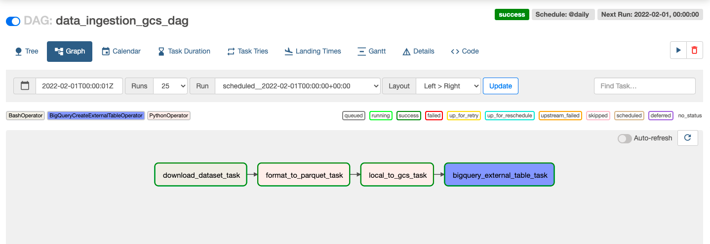

### Khái niệm

[Khái niệm và cấu trúc luồng không khí](docs/1_concepts.md)

### Quy trình làm việc


 
### Setup - Phiên bản chính thức
(Để xem phần Custom/Lightweight setup kéo xuống)

#### Thiết lập
[Thiết lập luồng không khí với Docker, thông qua các hướng dẫn chính thức](1_setup_official.md)

#### Thực thi
 
1. Tạo hình ảnh (chỉ lần đầu tiên hoặc khi có bất kỳ thay đổi nào trong `Dockerfile`, mất ~15 phút cho lần đầu tiên):
     ```shell
     docker-compose build
     ```
   
hoặc (đối với các phiên bản cũ)
   
     ```shell
     docker build .
     ```

2. Khởi tạo bộ lập lịch luồng khí, DB và cấu hình khác
    ```shell
    docker-compose up airflow-init
    ```

3. Khởi động tất cả các dịch vụ từ container:
    ```shell
    docker-compose up
    ```

4. Trong một thiết bị đầu cuối khác, chạy `docker-compose ps` để xem thùng chứa nào đang hoạt động (cần có 7 thùng, khớp với các dịch vụ trong tệp docker-compose của bạn).

5. Đăng nhập vào giao diện người dùng web Airflow trên `localhost:8080` với thông tin mặc định: `airflow/airflow`

6. Chạy DAG của bạn trên Bảng điều khiển Web.

7. Khi kết thúc quá trình chạy hoặc tắt thùng chứa:
    ```shell
    docker-compose down
    ```

Để dừng và xóa vùng chứa, xóa các ổ có dữ liệu cơ sở dữ liệu và tải xuống hình ảnh, hãy chạy:
    ```
    docker-compose down --volumes --rmi all
    ```

hoặc
    ```
    docker-compose down --volumes --remove-orphans
    ```
       
### Thiết lập - Phiên bản không rườm rà tùy chỉnh (Nhẹ)
Đây là thiết lập Airflow nhanh chóng, đơn giản và ít tốn bộ nhớ hơn hoạt động trên LocalExecutor.

#### Thiết lập
[Thiết lập luồng không khí với Docker, được tùy chỉnh](2_setup_nofrills.md)

#### Thực thi
  
1. Dừng và xóa vùng chứa, xóa các ổ có dữ liệu cơ sở dữ liệu và hình ảnh đã tải xuống (từ thiết lập trước đó):
    ```
    docker-compose down --volumes --rmi all
    ```

hoặc
    ```
    docker-compose down --volumes --remove-orphans
    ```
    
Hoặc, nếu bạn cần xóa hệ thống của mình khỏi mọi sự cố Docker được lưu vào bộ nhớ đệm trước:
    ```
    docker system prune
    ```
    
Ngoài ra, hãy làm trống thư mục `logs` của luồng khí.
    
2. Xây dựng hình ảnh (chỉ lần đầu tiên hoặc khi có bất kỳ thay đổi nào trong `Dockerfile`):
Mất ~5-10 phút cho
lần đầu tiên    ```shell
    docker-compose build
    ```
hoặc (đối với các phiên bản cũ)
    ```shell
    docker build .
    ```

3. Khởi động tất cả các dịch vụ từ vùng chứa (không cần khởi tạo đặc biệt):
    ```shell
    docker-compose -f docker-compose-nofrills.yml up
    ```

4. Trong một thiết bị đầu cuối khác, chạy `docker ps` để xem vùng chứa nào đang hoạt động (cần có 3 vùng chứa, khớp với các dịch vụ trong tệp docker-compose của bạn).

5. Đăng nhập vào giao diện người dùng web Airflow trên `localhost:8080` bằng thông tin xác thực: `admin/admin` (bắt buộc phải tạo người dùng quản trị viên rõ ràng)

6. Chạy DAG của bạn trên Bảng điều khiển Web.

7. Khi kết thúc quá trình chạy hoặc tắt thùng chứa:
    ```shell
    docker-compose down
    ```
    
### Thiết lập - Lấy từ DE Zoomcamp 2.3.4 - Tùy chọn: Thiết lập cục bộ nhẹ cho luồng khí

Sử dụng tệp docker-compose_2.3.4.yaml (và đổi tên thành docker-compose.yaml). Đừng quên thay thế các biến `GCP_PROJECT_ID` và `GCP_GCS_BUCKET`.

### Các cải tiến trong tương lai
* Triển khai thiết lập Airflow tự lưu trữ trên cụm Kubernetes hoặc sử dụng dịch vụ Managed Airflow (Cloud Composer) của GCP

### Tài liệu tham khảo
Để biết thêm thông tin, hãy xem các tài liệu chính thức sau:
* https://airflow.apache.org/docs/apache-airflow/stable/start/docker.html
* https://airflow.apache.org/docs/docker-stack/build.html
* https://airflow.apache.org/docs/docker-stack/recipes.html

