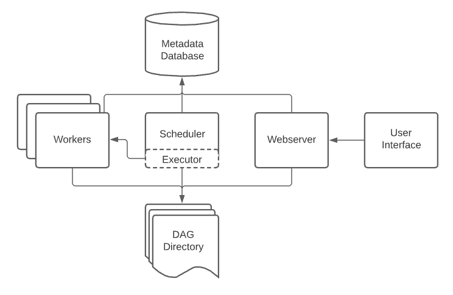

## Khái niệm luồng không khí

### Kiến trúc luồng không khí

Tham chiếu: https://airflow.apache.org/docs/apache-airflow/stable/concepts/overview.html

* **Máy chủ web**: GUI
để kiểm tra, kích hoạt và gỡ lỗi hành vi của DAG và tác vụ.
Có sẵn tại http://localhost:8080.

* **Scheduler**:
Chịu trách nhiệm lên lịch công việc. Xử lý cả quy trình kích hoạt và quy trình làm việc theo lịch trình, gửi Nhiệm vụ cho người thực thi để chạy, giám sát tất cả các nhiệm vụ và DAG, sau đó
sau đó kích hoạt các phiên bản nhiệm vụ sau khi các phần phụ thuộc của chúng hoàn tất.

* **Worker**:
Thành phần này thực thi các tác vụ do bộ lập lịch đưa ra.

* **Cơ sở dữ liệu siêu dữ liệu (postgres)**:
Phần cuối cho môi trường Airflow. Được sử dụng bởi bộ lập lịch, người thực thi và máy chủ web để lưu trữ trạng thái.

* **Các thành phần khác** (có trong các dịch vụ docker-compose):
* `redis`: Trình trung chuyển tin nhắn chuyển tiếp tin nhắn từ bộ lập lịch đến nhân viên.
* `flower`: Ứng dụng hoa giám sát môi trường. Nó có sẵn tại http://localhost:5555.
* `airflow-init`: dịch vụ khởi tạo (tùy chỉnh theo thiết kế này)

Tất cả các dịch vụ này cho phép bạn chạy Airflow với CeleryExecutor.
Để biết thêm thông tin, hãy xem [Tổng quan về kiến ​​trúc](https://airflow.apache.org/docs/apache-airflow/stable/concepts/overview.html).

### Cấu trúc dự án:

* `./dags` - `DAG_FOLDER` cho các tệp DAG (sử dụng `./dags_local` cho DAG nhập cục bộ)
* `./logs` - chứa nhật ký từ quá trình thực thi và lập lịch tác vụ.
* `./plugins` - dành cho plugin tùy chỉnh

### Các thành phần quy trình làm việc

* `DAG`: Biểu đồ tuần hoàn có hướng, chỉ định sự phụ thuộc giữa một tập hợp nhiệm vụ với thứ tự thực hiện rõ ràng và có phần mở đầu cũng như phần kết thúc. (Do đó, “không theo chu kỳ”)
* `DAG Structure`: Định nghĩa DAG, Nhiệm vụ (ví dụ: Người vận hành), Phần phụ thuộc của nhiệm vụ (luồng điều khiển: `>>` hoặc `<<` )
    
* `Task`: một đơn vị công việc được xác định (hay còn gọi là toán tử trong Airflow). Bản thân Nhiệm vụ mô tả những việc cần làm, có thể là tìm nạp dữ liệu, chạy phân tích, kích hoạt các hệ thống khác, v.v.
* Các loại phổ biến: Toán tử (được sử dụng trong hội thảo này), Cảm biến, trang trí TaskFlow
* Các lớp con của BaseOperator
của Airflow
* `DAG Run`: thực thi/chạy riêng lẻ DAG
* được lên lịch hoặc kích hoạt

* `Task Instance`: chạy riêng lẻ một tác vụ. Phiên bản tác vụ cũng có trạng thái biểu thị, có thể là “đang chạy”, “thành công”, “không thành công”, “bỏ qua”, “đang chờ thử lại”, v.v.
* Lý tưởng nhất là một tác vụ sẽ chuyển từ `none`, đến `scheduled`, đến `queued`, đến `running` và cuối cùng đến `success`.

### Tài liệu tham khảo

https://airflow.apache.org/docs/apache-airflow/stable/concepts/dags.html

https://airflow.apache.org/docs/apache-airflow/stable/concepts/tasks.html

