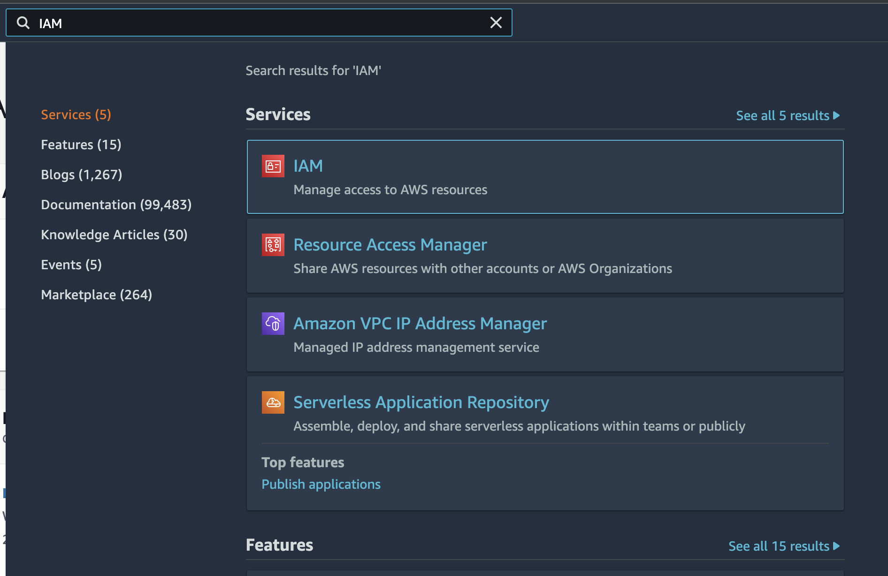

## Tạo khóa truy cập AWS
- Đăng nhập vào tài khoản AWS
- Tìm kiếm IAM

- Nhấp vào `Manage access key`
- Nhấp vào `Create New Access Key`
- Tải xuống csv, khóa truy cập và bí mật của bạn sẽ nằm trong csv đó (Xin lưu ý rằng một khi bí mật bị mất thì không thể khôi phục được)

## Dịch vụ chuyển nhượng
https://console.cloud.google.com/transfer/cloud/jobs
