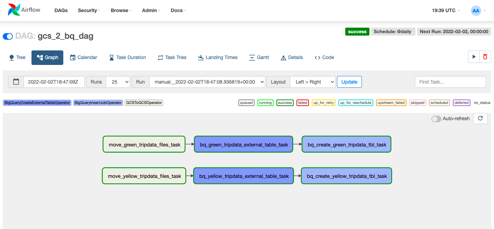
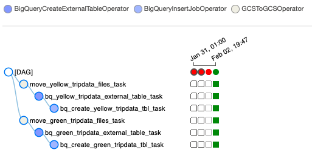

### Khái niệm

 [Airflow Concepts and Architecture](../week_2_data_ingestion/airflow/docs/1_concepts.md)

### Quy trình làm việc

 
 
 
 
### Cài đặt - Phiên bản chính thức
 (Đối với phần thiết lập Custom/Lightweight, hãy cuộn xuống)

 #### Cài đặt
  [Airflow Setup with Docker, through official guidelines](1_setup_official.md)

 #### Thi hành
 
  1. Xây dựng hình ảnh (chỉ lần đầu tiên hoặc khi có bất kỳ thay đổi nào trong `Dockerfile`, lần đầu tiên mất ~ 15 phút):
     ```shell
     docker-compose build
     ```
   
     or (for legacy versions)
   
     ```shell
     docker build .
     ```

 2. Khởi tạo bộ lập lịch luồng khí, DB và cấu hình khác
    ```shell
    docker-compose up airflow-init
    ```

 3. Khởi động tất cả các dịch vụ từ container:
    ```shell
    docker-compose up
    ```

 4. Trong một thiết bị đầu cuối khác, hãy chạy `docker-compose ps` để xem vùng chứa nào đang hoạt động (cần có 7 vùng chứa, khớp với các dịch vụ trong tệp soạn thảo docker của bạn).

 5. Đăng nhập vào Airflow web UI trên `localhost:8080` với tín dụng mặc định: `airflow/airflow`

 6. Chạy DAG của bạn trên Bảng điều khiển Web.

 7. Khi kết thúc quá trình chạy của bạn hoặc tắt container/s:
    ```shell
    docker-compose down
    ```

    To stop and delete containers, delete volumes with database data, and download images, run:
    ```
    docker-compose down --volumes --rmi all
    ```

    or
    ```
    docker-compose down --volumes --remove-orphans
    ```
       
### Cài đặt - Phiên bản không rườm rà tùy chỉnh (Nhẹ)
Đây là cách thiết lập Airflow nhanh chóng, đơn giản và ít tốn bộ nhớ hơn hoạt động trên LocalExecutor.

  #### Thiết lập
  [Airflow Setup with Docker, customized](2_setup_nofrills.md)

  #### Thực thi
  
  1. Dừng và xóa vùng chứa, xóa các tập có dữ liệu cơ sở dữ liệu và hình ảnh đã tải xuống (từ thiết lập trước đó):
    ```
    docker-compose down --volumes --rmi all
    ```

   or
    ```
    docker-compose down --volumes --remove-orphans
    ```
    
   Hoặc, nếu bạn cần xóa hệ thống của mình khỏi mọi vấn đề Docker được lưu trong bộ nhớ đệm trước:
    ```
    docker system prune
    ```
    
   Ngoài ra, hãy làm trống thư mục `logs` luồng khí.
    
  2. Xây dựng hình ảnh (chỉ lần đầu tiên hoặc khi có bất kỳ thay đổi nào trong `Dockerfile`):
  Mất ~5-10 phút cho lần đầu tiên
    ```shell
    docker-compose build
    ```
    or (for legacy versions)
    ```shell
    docker build .
    ```

  3. Khởi động tất cả các dịch vụ từ vùng chứa (không cần khởi tạo đặc biệt):
    ```shell
    docker-compose -f docker-compose-nofrills.yml up
    ```

  4. Trong một thiết bị đầu cuối khác, chạy `docker ps` để xem vùng chứa nào đang hoạt động (cần có 3 vùng, khớp với các dịch vụ trong Tệp soạn thảo docker).

  5. Đăng nhập vào Airflow web UI trên `localhost:8080` với thông tin xác thực: `admin/admin` (bắt buộc phải tạo người dùng quản trị viên rõ ràng)

  6. Chạy DAG của bạn trên Bảng điều khiển Web.

  7. Khi kết thúc quá trình chạy của bạn hoặc tắt container/s:
    ```shell
    docker-compose down
    ```
    
   

### Các cải tiến trong tương lai
* Triển khai thiết lập Luồng khí tự lưu trữ trên cụm Kubernetes hoặc sử dụng dịch vụ Luồng khí được quản lý (Trình soạn thảo đám mây) của GCP

### Tài liệu tham khảo
Để biết thêm thông tin, hãy xem các tài liệu chính thức sau:
   * https://airflow.apache.org/docs/apache-airflow/stable/start/docker.html
   * https://airflow.apache.org/docs/docker-stack/build.html
   * https://airflow.apache.org/docs/docker-stack/recipes.html

