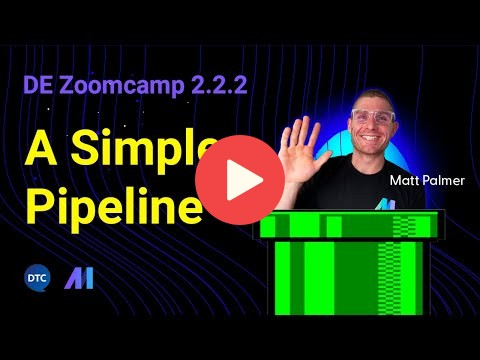
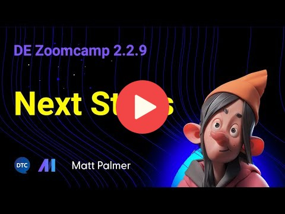

> [!NOTE]  
>Nếu bạn đang tìm video Airflow từ phiên bản 2022, hãy kiểm tra [thư mục đoàn hệ 2022](../cohorts/2022/week_2_data_ingestion/). 
>
>Nếu bạn đang tìm kiếm các video Prefect từ phiên bản 2023, hãy kiểm tra [thư mục đoàn hệ 2023](../cohorts/2023/week_2_data_ingestion/).

# Tuần 2: Điều phối quy trình làm việc

Chào mừng bạn đến với Tuần 2 của Zoomcamp Data Engineering! 🚀😤 Tuần này, chúng tôi sẽ đề cập đến việc điều phối quy trình làm việc với Mage.

Mage là một framework lai, mã nguồn mở để chuyển đổi và tích hợp dữ liệu. ✨

Tuần này, bạn sẽ học cách sử dụng nền tảng Mage để tạo và chia sẻ các đường dẫn dữ liệu _magical_. Tất cả điều này sẽ được đề cập trong khóa học, nhưng nếu bạn muốn tìm hiểu thêm một chút về Pháp sư, hãy xem tài liệu của chúng tôi [tại đây](https://docs.mage.ai/introduction/overview). 

* [2.2.1 - 📯 Giới thiệu về dàn nhạc](#221----intro-to-orchestration)
* [2.2.2 - 🧙‍♂️ Giới thiệu về pháp sư](#222---%EF%B8%8F-intro-to-mage)
* [2.2.3 - 🐘 ETL: API tới Postgres](#223----etl-api-to-postgres)
* [2.2.4 - 🤓 ETL: API tới GCS](#224----etl-api-to-gcs)
* [2.2.5 - 🔍 ETL: GCS tới BigQuery](#225----etl-gcs-to-bigquery)
* [2.2.6 - 👨‍💻 Thực thi tham số](#226----parameterized-execution)
* [2.2.7 - 🤖 Triển khai (Tùy chọn)](#227----deployment-optional)
* [2.2.8 - 🗒️ Bài tập về nhà](#228---️-homework)
* [2.2.9 - 👣 Các bước tiếp theo](#229----next-steps)

## 📕 Tài nguyên khóa học

### 2.2.1 - 📯 Giới thiệu về Điều phối

Trong phần này, chúng ta sẽ đề cập đến những kiến thức cơ bản về điều phối quy trình công việc. Chúng ta sẽ thảo luận về nó là gì, tại sao nó quan trọng và cách nó có thể được sử dụng để xây dựng đường dẫn dữ liệu.

Video
- 2.2.1a - Hòa âm là gì?

Tài nguyên
- [Slides](https://docs.google.com/presentation/d/17zSxG5Z-tidmgY-9l7Al1cPmz4Slh4VPK6o2sryFYvw/)

### 2.2.2 - 🧙‍♂️ Giới thiệu về Pháp sư

Trong phần này, chúng tôi sẽ giới thiệu nền tảng Pháp sư. Chúng tôi sẽ đề cập đến những điều khiến Mage khác biệt so với các nhà soạn nhạc khác, các khái niệm cơ bản đằng sau Mage và cách bắt đầu. Để kết thúc, chúng tôi sẽ quay Mage thông qua Docker 🐳 và chạy một quy trình đơn giản.

Video
- 2.2.2a - Pháp sư là gì?

- 2.2.2b - Định cấu hình Pháp sư

- 2.2.2c - Một quy trình đơn giản

Tài nguyên
- [Bắt đầu Repo](https://github.com/mage-ai/mage-zoomcamp)
- [Trang trình bày](https://docs.google.com/presentation/d/1y_5p3sxr6Xh1RqE6N8o2280gUzAdiic2hPhYUUD6l88/)

### 2.2.3 - 🐘 ETL: API tới Postgres

Hoan hô! Pháp sư đang hoạt động. Bây giờ, hãy xây dựng một đường dẫn _real_. Trong phần này, chúng ta sẽ xây dựng một đường dẫn ETL đơn giản để tải dữ liệu từ API vào cơ sở dữ liệu Postgres. Cơ sở dữ liệu của chúng tôi sẽ được xây dựng bằng Docker— nó sẽ chạy cục bộ nhưng cũng giống như khi chạy trên đám mây.

Video
- 2.2.3a - Định cấu hình Postgres

- 2.2.3b - Viết đường dẫn ETL: API tới postgres

### 2.2.4 - 🤓 ETL: API tới GCS

Được rồi, vậy là chúng ta đã ghi dữ liệu _locally_ vào cơ sở dữ liệu, nhưng còn đám mây thì sao? Trong hướng dẫn này, chúng ta sẽ tìm hiểu quy trình sử dụng Mage để trích xuất, chuyển đổi và tải dữ liệu từ API sang Google Cloud Storage (GCS). 

Chúng tôi sẽ đề cập đến cả việc ghi dữ liệu _partitioned_ và _unpartitioned_ vào GCS và thảo luận về _tại sao_ bạn có thể muốn thực hiện cái này hơn cái kia. Nhiều nhóm dữ liệu bắt đầu bằng việc trích xuất dữ liệu từ một nguồn và ghi dữ liệu đó vào hồ dữ liệu _trước khi_ tải dữ liệu đó vào nguồn dữ liệu có cấu trúc, chẳng hạn như cơ sở dữ liệu.

Video
- 2.2.4a - Định cấu hình GCP

- 2.2.4b - Viết đường dẫn ETL: API đến GCS

Tài nguyên
- [DTC Zoomcamp GCP Setup](../01-docker-terraform/1_terraform_gcp/2_gcp_overview.md)

### 2.2.5 - 🔍 ETL: GCS tới BigQuery

Bây giờ chúng ta đã ghi dữ liệu vào GCS, hãy tải nó vào BigQuery. Trong phần này, chúng ta sẽ tìm hiểu quy trình sử dụng Mage để tải dữ liệu của chúng ta từ GCS sang BigQuery. Điều này phản ánh chặt chẽ quy trình làm việc data engineering rất phổ biến: tải dữ liệu từ hồ dữ liệu vào kho dữ liệu.

Video
- 2.2.5a - Viết một đường ống ETL : GCS đến BigQuery

### 2.2.6 - 👨‍💻 Thực thi tham số

Hiện tại, bạn đã quen với việc xây dựng các đường ống, nhưng còn việc thêm tham số thì sao? Trong video này, chúng ta sẽ thảo luận về một số biến thời gian chạy tích hợp sẵn có trong Mage và chỉ cho bạn cách xác định biến của riêng mình! Chúng tôi cũng sẽ đề cập đến cách sử dụng các biến này để tham số hóa quy trình của bạn. Cuối cùng, chúng ta sẽ nói về ý nghĩa của *backfill* một đường dẫn và cách thực hiện điều đó trong Pháp sư.

Video
- 2.2.6a - Thực thi tham số

- 2.2.6b - Chèn lấp

Tài nguyên
- [Tổng quan về biến pháp sư](https://docs.mage.ai/development/variables/overview)
- [Biến thời gian chạy pháp sư](https://docs.mage.ai/getting-started/runtime-variable)

### 2.2.7 - 🤖 Triển khai (Tùy chọn)

Trong phần này, chúng tôi sẽ đề cập đến việc triển khai Pháp sư bằng Terraform và Google Cloud. Phần này là tùy chọn— không *cần thiết* để học Pháp sư, nhưng nó có thể hữu ích nếu bạn quan tâm đến việc tạo một dự án được triển khai đầy đủ. Nếu đang sử dụng Mage trong dự án cuối cùng của mình, bạn sẽ cần triển khai nó lên đám mây.

Video
- 2.2.7a - Điều kiện tiên quyết khi triển khai

- 2.2.7b - Quyền của Google Cloud

- 2.2.7c - Triển khai lên Google Cloud - Phần 1

- 2.2.7d - Triển khai lên Google Cloud - Phần 2

Tài nguyên
- [Cài đặt Terraform](https://developer.hashicorp.com/terraform/tutorials/aws-get-started/install-cli)
- [Cài đặt `gcloud` CLI](https://cloud.google.com/sdk/docs/install)
- [Mẫu Terraform](https://github.com/mage-ai/mage-ai-terraform-templates)

Hướng dẫn bổ sung về pháp sư
- [Terraform](https://docs.mage.ai/production/deploying-to-cloud/using-terraform)
- [Triển khai lên GCP với Terraform](https://docs.mage.ai/production/deploying-to-cloud/gcp/setup)

### 2.2.8 - 🗒️ Bài tập về nhà 

Chúng tôi đã chuẩn bị một bài tập ngắn để kiểm tra những gì bạn đã học trong tuần này. Bạn có thể tìm bài tập về nhà [tại đây](../cohorts/2024/02-workflow-orchestration/homework.md). Phần này bám sát nội dung của khóa học và không mất quá một hoặc hai giờ để hoàn thành. 😄

### 2.2.9 - 👣 Các bước tiếp theo

Xin chúc mừng! Bạn đã hoàn thành Tuần 2 của Zoomcamp Data Engineering. Chúng tôi hy vọng bạn thích tìm hiểu về Mage và hào hứng sử dụng nó trong dự án cuối cùng của mình. Nếu bạn có bất kỳ câu hỏi nào, vui lòng liên hệ với chúng tôi trên Slack. Hãy nhớ xem video "Các bước tiếp theo" của chúng tôi để có thêm cảm hứng cho phần còn lại của hành trình của bạn 😄.

Video
- 2.2.9 - Các bước tiếp theo

Tài nguyên
- [Trang trình bày](https://docs.google.com/presentation/d/1yN-e22VNwezmPfKrZkgXQVrX5owDb285I2HxHWgmAEQ/edit#slide=id.g262fb0d2905_0_12)

### 📑 Tài nguyên bổ sung

- [Tài liệu pháp sư](https://docs.mage.ai/)
- [Hướng dẫn pháp sư](https://docs.mage.ai/guides)
- [Mage Slack](https://www.mage.ai/chat)

# Ghi chú của cộng đồng

Bạn đã ghi chú chưa? Bạn có thể chia sẻ chúng tại đây:

## Ghi chú năm 2024

* [Bản ghi video 2024 tuần 2](https://drive.google.com/drive/folders/1yxT0uMMYKa6YOxanh91wGqmQUMS7yYW7?usp=sharing) của Maria Fisher
* [Ghi chú từ Jonah Oliver](https://www.jonahboliver.com/blog/de-zc-w2)
* [Ghi chú từ Linda](https://github.com/inner-outer-space/de-zoomcamp-2024/blob/main/2-workflow-orchestration/readme.md)
* [Ghi chú từ Kirill](https://github.com/kirill505/data-engineering-zoomcamp/blob/main/02-workflow-orchestration/README.md)
* [Ghi chú từ Zharko](https://www.zharconsulting.com/contents/data/data-engineering-bootcamp-2024/week-2-ingesting-data-with-mage/)
* Thêm ghi chú của bạn phía trên dòng này

## Ghi chú năm 2023

Xem [tại đây](../cohorts/2023/week_2_workflow_orchestration#community-notes)

## Ghi chú năm 2022

Xem [tại đây](../cohorts/2022/week_2_data_ingestion#community-notes)
