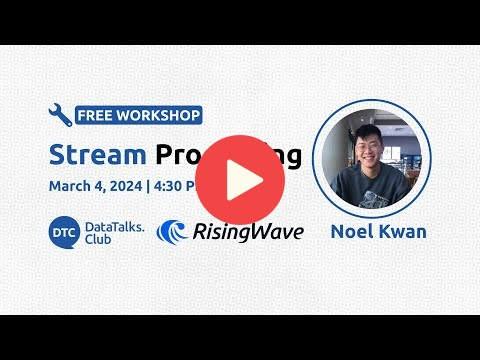

<p align="center">
  <picture>
    <source srcset="https://github.com/risingwavelabs/risingwave/blob/main/.github/RisingWave-logo-dark.svg" width="500px" media="(prefers-color-scheme: dark)">
    
  </picture>
</p>


</div>

<p align="center">
  <a
    href="https://docs.risingwave.com/"
    target="_blank"
  ><b>Tài liệu</b></a>&nbsp;&nbsp;&nbsp;📑&nbsp;&nbsp;&nbsp;
  <a
    href="https://tutorials.risingwave.com/"
    target="_blank"
  ><b>Hướng dẫn thực hành</b></a>&nbsp;&nbsp;&nbsp;🎯&nbsp;&nbsp;&nbsp;
  <a
    href="https://cloud.risingwave.com/"
    target="_blank"
  ><b>RisingWave Cloud</b></a>&nbsp;&nbsp;&nbsp;🚀&nbsp;&nbsp;&nbsp;
  <a
    href="https://risingwave.com/slack"
    target="_blank"
  >
    <b>Nhận hỗ trợ nhanh</b>
  </a>
</p>
<div align="center">
  <a
    href="https://risingwave.com/slack"
    target="_blank"
  >
    
  </a>
  <a
    href="https://twitter.com/risingwavelabs"
    target="_blank"
  >
    
  </a>
  <a
    href="https://www.youtube.com/@risingwave-labs"
    target="_blank"
  >
    
  </a>
</div>

## Xử lý Streaming với RisingWave

Trong workshop thực hành này, chúng ta sẽ học cách xử lý dữ liệu Streaming theo thời gian thực bằng SQL trong [RisingWave](https://github.com/risingwavelabs/risingwave). Đây là cơ sở dữ liệu SQL mã nguồn mở để xử lý và quản lý dữ liệu Streaming. Nếu đã quen với PostgreSQL, bạn sẽ thấy cách dùng RisingWave khá quen thuộc vì nó tương thích với giao thức kết nối của PostgreSQL.


Workshop sẽ gồm các chủ đề sau: 

- Vì sao cần Stream Processing?
- Tính toán Stateless (lọc, chọn cột)
- Tính toán Stateful (tổng hợp, join)
- Data Ingestion và phân phối dữ liệu

Tìm hiểu RisingWave trong 10 phút:
https://tutorials.risingwave.com/docs/intro

Video workshop:

<a href="https://youtube.com/live/L2BHFnZ6XjE">
  
</a>

[Repository của dự án](https://github.com/risingwavelabs/risingwave-data-talks-workshop-2024-03-04)

## Bài tập

**Trước tiên, hãy thiết lập môi trường theo phần [Bắt đầu](https://github.com/risingwavelabs/risingwave-data-talks-workshop-2024-03-04?tab=readme-ov-file#getting-started) và hướng dẫn [Bài tập](https://github.com/risingwavelabs/risingwave-data-talks-workshop-2024-03-04/blob/main/homework.md#setting-up).**

### Câu hỏi 0

_Đây là câu khởi động để làm quen với dynamic filter. Hãy thử tự làm trước khi xem lời giải._

Những khu vực trả khách nào ứng với thời điểm trả khách muộn nhất?

Ở phần này, chúng ta sẽ dùng [dynamic filter pattern](https://docs.risingwave.com/docs/current/sql-pattern-dynamic-filters/).

<details>
<summary>Lời giải</summary>

```sql
CREATE MATERIALIZED VIEW latest_dropoff_time AS
    WITH t AS (
        SELECT MAX(tpep_dropoff_datetime) AS latest_dropoff_time
        FROM trip_data
    )
    SELECT taxi_zone.Zone as taxi_zone, latest_dropoff_time
    FROM t,
            trip_data
    JOIN taxi_zone
        ON trip_data.DOLocationID = taxi_zone.location_id
    WHERE trip_data.tpep_dropoff_datetime = t.latest_dropoff_time;

--    taxi_zone    | latest_dropoff_time
-- ----------------+---------------------
--  Midtown Center | 2022-01-03 17:24:54
-- (1 row)
```

</details>

### Câu hỏi 1

Tạo materialized view để tính thời gian chuyến đi trung bình, ngắn nhất và dài nhất **giữa từng cặp khu vực taxi**.

Lưu ý: `a->b` và `b->a` không được tính là cùng một cặp chuyến đi.
Ví dụ, hai hướng sau được xem là hai cặp khác nhau:
```plaintext
Yorkville East -> Steinway
Steinway -> Yorkville East
```

Từ materialized view này, hãy tìm cặp khu vực có thời gian chuyến đi trung bình cao nhất.
Bạn có thể cần dùng [dynamic filter pattern](https://docs.risingwave.com/docs/current/sql-pattern-dynamic-filters/).

Bài tập thêm (không tính điểm): Tạo materialized view để phát hiện bất thường trong dữ liệu. Ví dụ: thời gian trung bình giữa hai khu vực là 1 phút nhưng thời gian chuyến đi dài nhất có thể là 10 hoặc 20 phút.

Các lựa chọn:
1. Yorkville East, Steinway
2. Murray Hill, Midwood
3. East Flatbush/Farragut, East Harlem North
4. Midtown Center, University Heights/Morris Heights

Lưu ý: thời gian chuyến đi giữa các khu vực không mang tính đối xứng; `A -> B` và `B -> A` được xem là hai hướng khác nhau. Quy tắc này cũng áp dụng cho các câu sau.

### Câu hỏi 2

Tạo lại materialized view ở câu 1 để tìm thêm **số chuyến đi** của cặp khu vực có thời gian chuyến đi trung bình cao nhất.

Các lựa chọn:
1. 5
2. 3
3. 10
4. 1

### Câu hỏi 3

Trong khoảng 17 giờ trước thời điểm đón khách muộn nhất, ba khu vực nào có số lượt đón khách cao nhất?
Ví dụ, nếu thời điểm đón khách muộn nhất là 2020-01-01 17:00:00,
truy vấn cần trả về ba khu vực đông nhất từ 2020-01-01 00:00:00 đến 2020-01-01 17:00:00.

GỢI Ý: Bạn có thể dùng [dynamic filter pattern](https://docs.risingwave.com/docs/current/sql-pattern-dynamic-filters/)
để tạo điều kiện lọc dựa trên thời điểm đón khách muộn nhất.

LƯU Ý: Khoảng `17 hours` được chọn để bảo đảm có đủ dữ liệu cho câu hỏi này.

Các lựa chọn:
1. Clinton East, Upper East Side North, Penn Station
2. LaGuardia Airport, Lincoln Square East, JFK Airport
3. Midtown Center, Upper East Side South, Upper East Side North
4. LaGuardia Airport, Midtown Center, Upper East Side North


## Nộp bài

- Biểu mẫu nộp bài: https://courses.datatalks.club/de-zoomcamp-2024/homework/workshop2
- Hạn nộp: 23:00 CET, thứ Hai ngày 11 tháng 3 

## Phần thưởng 🥳

Mọi người hoàn thành bài tập sẽ nhận một chiếc bút và một sticker; 5 người may mắn còn nhận áo phông cùng những phần quà bất ngờ khác!
Hãy chia sẻ thành quả sau workshop trên mạng xã hội. Chúng tôi mong được xem bài làm của bạn 😁

- Theo dõi chúng tôi trên **LinkedIn**: https://www.linkedin.com/company/risingwave
- Theo dõi chúng tôi trên **GitHub**: https://github.com/risingwavelabs/risingwave
- Tham gia **Slack**: https://risingwave-labs.com/slack

Hẹn gặp lại!


## Lời giải
