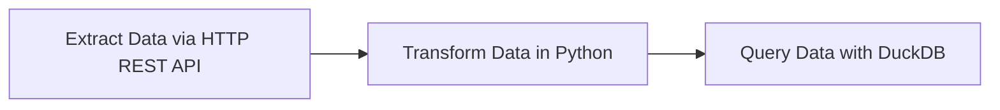
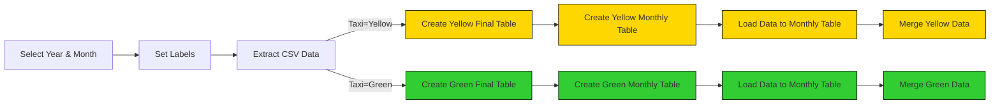
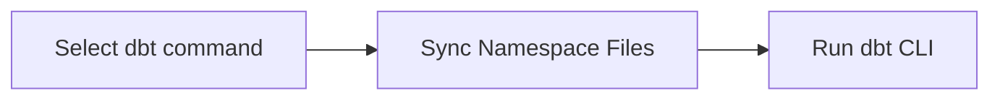
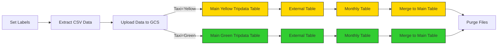
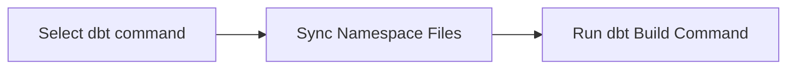

# Điều phối workflow

Chào mừng bạn đến với Module 2 của Data Engineering Zoomcamp! Tuần này, chúng ta sẽ tìm hiểu cách điều phối workflow bằng [Kestra](https://go.kestra.io/de-zoomcamp/github). 

Kestra là nền tảng điều phối mã nguồn mở theo hướng event-driven, giúp xây dựng workflow chạy theo lịch hoặc theo sự kiện dễ dàng hơn. Áp dụng cách tiếp cận Infrastructure as Code cho việc điều phối dữ liệu và quy trình, Kestra cho phép tạo workflow đáng tin cậy chỉ với vài dòng YAML.

> [!NOTE]  
>Bạn có thể xem toàn bộ video của tuần này trong [danh sách YouTube](https://go.kestra.io/de-zoomcamp/yt-playlist).

---

# Cấu trúc bài học

## 1. Kiến thức nền: Giới thiệu về điều phối và Kestra

Phần này giới thiệu nền tảng của điều phối workflow, vì sao nó quan trọng và vị trí của Kestra trong hệ sinh thái các công cụ điều phối.

### Video
- **2.2.1 - Giới thiệu về điều phối workflow**  
  [](https://youtu.be/Np6QmmcgLCs)

- **2.2.2 - Tìm hiểu các khái niệm Kestra**  
  [](https://youtu.be/o79n-EVpics)

### Tài nguyên
- [Hướng dẫn bắt đầu nhanh](https://go.kestra.io/de-zoomcamp/quickstart)
- [Cài đặt Kestra bằng Docker Compose](https://go.kestra.io/de-zoomcamp/docker-compose)
- [Bài hướng dẫn](https://go.kestra.io/de-zoomcamp/tutorial)
- [Orchestrator là gì?](https://go.kestra.io/de-zoomcamp/what-is-an-orchestrator)

---

## 2. Dự án thực hành: Xây dựng data pipeline với Kestra

Tuần này, chúng ta sẽ xây dựng pipeline ETL cho dữ liệu taxi Yellow và Green của Ủy ban Taxi và Limousine Thành phố New York (TLC). Bạn sẽ:
1. Trích xuất dữ liệu từ [các file CSV](https://github.com/DataTalksClub/nyc-tlc-data/releases).
2. Nạp dữ liệu vào Postgres hoặc Google Cloud (GCS + BigQuery).
3. Tìm hiểu cách lên lịch và Backfill workflow.

>[!NOTE] 
Nếu dùng môi trường Docker PostgreSQL và PgAdmin từ Module 1 cho bài Kestra tuần này, hãy bảo đảm PostgreSQL image từ phiên bản 15 trở lên (nên dùng bản mới nhất). Câu lệnh MERGE xuất hiện từ PostgreSQL 15; phiên bản cũ sẽ không chạy được và có thể gây lỗi cú pháp trong flow Kestra.

### Cấu trúc file

Dự án được tổ chức như sau:
```
.
├── flows/
│   ├── 01_getting_started_data_pipeline.yaml
│   ├── 02_postgres_taxi.yaml
│   ├── 02_postgres_taxi_scheduled.yaml
│   ├── 03_postgres_dbt.yaml
│   ├── 04_gcp_kv.yaml
│   ├── 05_gcp_setup.yaml
│   ├── 06_gcp_taxi.yaml
│   ├── 06_gcp_taxi_scheduled.yaml
│   └── 07_gcp_dbt.yaml
```

### Thiết lập Kestra

Chúng ta sẽ dùng Docker Compose với một container chạy Kestra server và một container chạy cơ sở dữ liệu Postgres:

```bash
cd 02-workflow-orchestration/docker/combined
docker compose up -d
```

Khi container khởi động, bạn có thể truy cập giao diện Kestra tại [http://localhost:8080](http://localhost:8080).

Nếu muốn thêm flow bằng Kestra API, hãy chạy các lệnh sau:

```bash
curl -X POST http://localhost:8080/api/v1/flows/import -F fileUpload=@flows/01_getting_started_data_pipeline.yaml
curl -X POST http://localhost:8080/api/v1/flows/import -F fileUpload=@flows/02_postgres_taxi.yaml
curl -X POST http://localhost:8080/api/v1/flows/import -F fileUpload=@flows/02_postgres_taxi_scheduled.yaml
curl -X POST http://localhost:8080/api/v1/flows/import -F fileUpload=@flows/03_postgres_dbt.yaml
curl -X POST http://localhost:8080/api/v1/flows/import -F fileUpload=@flows/04_gcp_kv.yaml
curl -X POST http://localhost:8080/api/v1/flows/import -F fileUpload=@flows/05_gcp_setup.yaml
curl -X POST http://localhost:8080/api/v1/flows/import -F fileUpload=@flows/06_gcp_taxi.yaml
curl -X POST http://localhost:8080/api/v1/flows/import -F fileUpload=@flows/06_gcp_taxi_scheduled.yaml
curl -X POST http://localhost:8080/api/v1/flows/import -F fileUpload=@flows/07_gcp_dbt.yaml
```

---

## 3. Pipeline ETL trong Kestra: Hướng dẫn chi tiết

### Pipeline khởi đầu

Flow đầu tiên minh họa pipeline đơn giản: trích xuất dữ liệu qua HTTP REST API, biến đổi bằng Python rồi truy vấn bằng DuckDB. Ở bước này, chúng ta tạo một cơ sở dữ liệu Postgres riêng cho bài tập. 

**Lưu ý:** Kiểm tra để `pgAdmin` không dùng cùng cổng với Kestra. Nếu bị trùng, xem phần [FAQ](#troubleshooting-tips) ở cuối README.

### Video

- **2.2.3 - Tạo pipeline ETL với Postgres trong Kestra**   
  [](https://youtu.be/OkfLX28Ecjg?si=vKbIyWo1TtjpNnvt)
- **2.2.4 - Quản lý lịch chạy và Backfill với Postgres trong Kestra**  
  [](https://youtu.be/_-li_z97zog?si=G6jZbkfJb3GAyqrd)
- **2.2.5 - Biến đổi dữ liệu bằng dbt và Postgres trong Kestra**  
  [](https://youtu.be/ZLp2N6p2JjE?si=tWhcvq5w4lO8v1_p)




Nếu chưa thêm flow [`01_getting_started_data_pipeline.yaml`](flows/01_getting_started_data_pipeline.yaml) từ giao diện, hãy thêm và chạy để xem kết quả. Kiểm tra các tab Gantt và Logs để hiểu quá trình thực thi.

### Cơ sở dữ liệu cục bộ: Nạp dữ liệu taxi vào Postgres

Trước khi nạp dữ liệu lên GCP, chúng ta sẽ thực hành với dữ liệu taxi Yellow và Green trong Postgres cục bộ chạy bằng Docker. Dùng [file Docker Compose này](docker/postgres/docker-compose.yml) để tạo cơ sở dữ liệu Postgres cho ví dụ. Hãy tải file vào thư mục mới, chuyển đến thư mục đó rồi chạy lệnh sau:

```bash
docker compose up -d
```

Flow sẽ trích xuất dữ liệu CSV theo năm và tháng, tạo bảng, nạp vào bảng theo tháng rồi merge vào bảng đích cuối cùng.



Code của flow: [`02_postgres_taxi.yaml`](flows/02_postgres_taxi.yaml).


> [!NOTE]  
> Dữ liệu chuyến đi do Ủy ban Taxi và Limousine Thành phố New York (TLC) cung cấp trên [nyc.gov](https://www.nyc.gov/site/tlc/about/tlc-trip-record-data.page) hiện chỉ có định dạng Parquet, nhưng đó KHÔNG phải bộ dữ liệu dùng trong khóa này. Chúng ta sẽ dùng **file CSV** có [trên GitHub](https://github.com/DataTalksClub/nyc-tlc-data/releases). Với người mới, Parquet có thể khó xem trực tiếp, còn CSV có thể mở bằng Excel, Google Sheets hoặc trình soạn thảo văn bản.

### Cơ sở dữ liệu cục bộ: Lên lịch và Backfill

Giờ chúng ta có thể lên lịch để pipeline trên chạy hằng ngày lúc 9:00 UTC, đồng thời thực hành Backfill dữ liệu lịch sử.

Lưu ý: Vì bộ dữ liệu lớn, chúng ta chỉ Backfill dữ liệu taxi Green năm 2019.

Code của flow: [`02_postgres_taxi_scheduled.yaml`](flows/02_postgres_taxi_scheduled.yaml).

### Cơ sở dữ liệu cục bộ: Điều phối dbt model (tùy chọn)

Khi dữ liệu thô đã được nạp vào Postgres cục bộ, chúng ta có thể dùng dbt để biến đổi dữ liệu cho mục đích phân tích. Flow đồng bộ các dbt model từ Git sang Kestra và chạy `dbt build` để build model.



Đây chỉ là phần minh họa nhanh cách dùng dbt trong Kestra; bài tập không phụ thuộc vào phần này. Khóa học sẽ trình bày dbt kỹ hơn trong [Tuần 4](../04-analytics-engineering).

Code của flow: [`03_postgres_dbt.yaml`](flows/03_postgres_dbt.yaml).

### Tài nguyên
- [Tải pgAdmin](https://www.pgadmin.org/download/)
- [Docker Compose cho Postgres DB](docker/postgres/docker-compose.yml)

---

## 4. Pipeline ETL trong Kestra: Google Cloud Platform

Sau khi biết cách xây dựng pipeline ETL cục bộ với Postgres, chúng ta sẽ chuyển lên Cloud. Phần này nạp dữ liệu taxi Yellow và Green lên Google Cloud Platform (GCP) bằng: 
1. Google Cloud Storage (GCS) làm Data Lake  
2. BigQuery làm Data Warehouse.

### Video

- **2.2.6 - Tạo pipeline ETL với GCS và BigQuery trong Kestra**  
  [](https://youtu.be/nKqjjLJ7YXs)
- **2.2.7 - Quản lý lịch chạy và Backfill với BigQuery trong Kestra**   
  [](https://youtu.be/DoaZ5JWEkH0)
- **2.2.8 - Biến đổi dữ liệu bằng dbt và BigQuery trong Kestra**   
  [](https://youtu.be/eF_EdV4A1Wk)

### Thiết lập Google Cloud Platform (GCP)

Trước khi nạp dữ liệu lên GCP, chúng ta cần thiết lập môi trường Google Cloud Platform. 

Trước tiên, chỉnh flow [`04_gcp_kv.yaml`](flows/04_gcp_kv.yaml) để lưu service account, GCP project ID, BigQuery dataset và tên GCS bucket (_kèm vị trí của chúng_) dưới dạng giá trị trong KV Store:
- GCP_CREDS
- GCP_PROJECT_ID
- GCP_LOCATION
- GCP_BUCKET_NAME
- GCP_DATASET.


> [!WARNING]  
> Service account trong `GCP_CREDS` chứa thông tin nhạy cảm. Hãy bảo vệ nó như mật khẩu và tuyệt đối không commit lên Git.

### Tạo tài nguyên GCP

Nếu chưa tạo GCS bucket và BigQuery dataset ở tuần đầu khóa học, bạn có thể dùng flow này: [`05_gcp_setup.yaml`](flows/05_gcp_setup.yaml).


### Workflow GCP: Nạp dữ liệu taxi vào BigQuery



Code của flow: [`06_gcp_taxi.yaml`](flows/06_gcp_taxi.yaml).

### Workflow GCP: Lên lịch và Backfill toàn bộ dữ liệu

Giờ có thể lên lịch cho pipeline chạy hằng ngày lúc 9:00 UTC với dữ liệu Green và 10:00 UTC với dữ liệu Yellow. Bạn có thể Backfill dữ liệu lịch sử trực tiếp từ giao diện Kestra.

Vì việc xử lý diễn ra trên Cloud với tài nguyên lưu trữ và tính toán có thể mở rộng, chúng ta có thể Backfill toàn bộ dữ liệu taxi Yellow và Green mà không lo máy cục bộ cạn tài nguyên.

Code của flow: [`06_gcp_taxi_scheduled.yaml`](flows/06_gcp_taxi_scheduled.yaml).

### Workflow GCP: Điều phối dbt model (tùy chọn)

Sau khi nạp dữ liệu thô vào BigQuery, chúng ta có thể dùng dbt để biến đổi dữ liệu. Flow đồng bộ dbt model từ Git sang Kestra và chạy `dbt build`:



Đây chỉ là phần minh họa nhanh cách dùng dbt trong Kestra; bài tập không phụ thuộc vào phần này. Khóa học sẽ trình bày dbt kỹ hơn trong [Tuần 4](../04-analytics-engineering).

Code của flow: [`07_gcp_dbt.yaml`](flows/07_gcp_dbt.yaml).

---

## 5. Bổ sung: Deploy lên Cloud (tùy chọn)

Khi pipeline ETL đã chạy được cả cục bộ lẫn trên Cloud, chúng ta có thể deploy Kestra lên Cloud để tiếp tục điều phối pipeline theo lịch. Phần này hướng dẫn cài Kestra trên Google Cloud trong môi trường production, đồng thời tự động đồng bộ và deploy workflow từ Git repository.

Lưu ý: Khi commit workflow vào Kestra, hãy bảo đảm workflow không chứa thông tin nhạy cảm. Bạn có thể dùng [Secrets](https://go.kestra.io/de-zoomcamp/secret) và [KV Store](https://go.kestra.io/de-zoomcamp/kv-store) để tách dữ liệu nhạy cảm khỏi logic workflow.

### Video

- **2.2.9 - Deploy workflow lên Cloud bằng Git**   
  [](https://youtu.be/l-wC71tI3co)

Tài nguyên

- [Cài Kestra trên Google Cloud](https://go.kestra.io/de-zoomcamp/gcp-install)
- [Chuyển từ Development sang Production](https://go.kestra.io/de-zoomcamp/dev-to-prod)
- [Dùng Git trong Kestra](https://go.kestra.io/de-zoomcamp/git)
- [Deploy flow bằng GitHub Actions](https://go.kestra.io/de-zoomcamp/deploy-github-actions)

## 6. Tài nguyên bổ sung 📚

- Xem [tài liệu Kestra](https://go.kestra.io/de-zoomcamp/docs)
- Khám phá thư viện [Blueprint](https://go.kestra.io/de-zoomcamp/blueprints)
- Xem hơn 600 [plugin](https://go.kestra.io/de-zoomcamp/plugins) có sẵn trong Kestra
- Ủng hộ dự án trên [GitHub](https://go.kestra.io/de-zoomcamp/github)
- Tham gia [cộng đồng Slack](https://go.kestra.io/de-zoomcamp/slack) nếu bạn có câu hỏi
- Xem mọi video trong [danh sách YouTube](https://go.kestra.io/de-zoomcamp/yt-playlist)


### Mẹo xử lý sự cố

Nếu gặp vấn đề với flow Kestra trong Module 2, hãy kiểm tra Docker image và cổng:
- `kestra/kestra:latest` là bản stable mới nhất nên dùng; `kestra/kestra:develop` là bản đang phát triển và có thể còn lỗi
- `postgres:latest` — bảo đảm image Postgres dùng **PostgreSQL 15** trở lên
- Nếu `pgAdmin` hoặc ứng dụng khác chiếm cổng 8080, hãy đổi port mapping trong docker-compose của Kestra sang 18080, rồi truy cập giao diện tại http://localhost:18080/ thay vì http://localhost:8080/

Trên Linux, bạn có thể gặp lỗi `Connection Refused` khi Kestra kết nối Postgres vì `host.docker.internal` hoạt động khác so với các hệ điều hành khác. File Docker Compose đã chỉnh bên dưới cho phép chạy Kestra, Postgres riêng của Kestra và Postgres dành cho bài tập cùng lúc. Trong `pluginDefaults`, dùng tên container `postgres_zoomcamp` thay cho `host.docker.internal` để Kestra truy cập được cơ sở dữ liệu; pgAdmin cũng vậy. Nếu muốn giữ các file Docker Compose riêng, bạn cần thiết lập mạng Docker để các container giao tiếp với nhau.

<details>
<summary>Ví dụ Docker Compose</summary>

File Docker Compose này thêm container Zoomcamp DB và pgAdmin để mọi thứ nằm trong cùng một file.

Những thay đổi gồm:
- Thêm `volume` mới cho container Zoomcamp DB
- Thêm container Zoomcamp DB và đặt tên riêng để không trùng với Kestra DB
- Thêm điều kiện depends_on để bảo đảm Kestra chạy trước khi container khởi động
- Thêm pgAdmin chạy ở cổng 8085 để không trùng với Kestra dùng cổng 8080 và 8081

```yaml
volumes:
  postgres-data:
    driver: local
  kestra-data:
    driver: local
  zoomcamp-data:
    driver: local

services:
  postgres:
    image: postgres
    volumes:
      - postgres-data:/var/lib/postgresql/data
    environment:
      POSTGRES_DB: kestra
      POSTGRES_USER: kestra
      POSTGRES_PASSWORD: k3str4
    healthcheck:
      test: ["CMD-SHELL", "pg_isready -d $${POSTGRES_DB} -U $${POSTGRES_USER}"]
      interval: 30s
      timeout: 10s
      retries: 10

  kestra:
    image: kestra/kestra:latest
    pull_policy: always
    # Note that this setup with a root user is intended for development purpose.
    # Our base image runs without root, but the Docker Compose implementation needs root to access the Docker socket
    # To run Kestra in a rootless mode in production, see: https://kestra.io/docs/installation/podman-compose
    user: "root"
    command: server standalone
    volumes:
      - kestra-data:/app/storage
      - /var/run/docker.sock:/var/run/docker.sock
      - /tmp/kestra-wd:/tmp/kestra-wd
    environment:
      KESTRA_CONFIGURATION: |
        datasources:
          postgres:
            url: jdbc:postgresql://postgres:5432/kestra
            driverClassName: org.postgresql.Driver
            username: kestra
            password: k3str4
        kestra:
          server:
            basicAuth:
              enabled: false
              username: "admin@kestra.io" # it must be a valid email address
              password: kestra
          repository:
            type: postgres
          storage:
            type: local
            local:
              basePath: "/app/storage"
          queue:
            type: postgres
          tasks:
            tmpDir:
              path: /tmp/kestra-wd/tmp
          url: http://localhost:8080/
    ports:
      - "8080:8080"
      - "8081:8081"
    depends_on:
      postgres:
        condition: service_started
    
  postgres_zoomcamp:
    image: postgres
    environment:
      POSTGRES_USER: kestra
      POSTGRES_PASSWORD: k3str4
      POSTGRES_DB: postgres-zoomcamp
    ports:
      - "5432:5432"
    volumes:
      - zoomcamp-data:/var/lib/postgresql/data
    depends_on:
      kestra:
        condition: service_started

  pgadmin:
    image: dpage/pgadmin4
    environment:
      - PGADMIN_DEFAULT_EMAIL=admin@admin.com
      - PGADMIN_DEFAULT_PASSWORD=root
    ports:
      - "8085:80"
    depends_on:
      postgres_zoomcamp:
        condition: service_started
```

</details>

Nếu vẫn gặp vấn đề, hãy dừng và xóa các container Kestra + Postgres hiện có rồi khởi động lại bằng `docker-compose up -d`. Nếu vẫn chưa khắc phục được, hãy hỏi trên Slack của DataTalksClub hoặc Kestra tại http://kestra.io/slack.

- **DE Zoomcamp FAQ - Thiết lập PostgresDB và cài pgAdmin**   
  [](https://youtu.be/ywAPYNYFaB4?si=5X9AD0nFAT2WLWgS)
- **DE Zoomcamp FAQ - Cổng và image**  
  [](https://youtu.be/l2M2mW76RIU?si=oqyZ7KUaI27vi90V)
- **DE Zoomcamp FAQ - Thiết lập Docker**  
  [](https://youtu.be/73g6qJN0HcM)


Nếu gặp lỗi tương tự:
```
BigQueryError{reason=invalid, location=null, 
message=Error while reading table: kestra-sandbox.zooomcamp.yellow_tripdata_2020_01, 
error message: CSV table references column position 17, but line contains only 14 columns.; 
line_number: 2103925 byte_offset_to_start_of_line: 194863028 
column_index: 17 column_name: "congestion_surcharge" column_type: NUMERIC 
File: gs://anna-geller/yellow_tripdata_2020-01.csv}
```

Điều này nghĩa là số cột trong file CSV bạn nạp vào BigQuery không khớp giữa bảng nguồn bên ngoài (file trên GCS) và bảng đích. Nguyên nhân có thể do lỗi mạng hoặc truyền tải làm file chưa được tải đầy đủ từ GitHub hoặc tải lên GCS không đúng. Thông báo lỗi trông giống lỗi schema nhưng thực tế không phải. Hãy chạy lại toàn bộ flow, bao gồm tải lại CSV và đưa lại lên GCS.

---

## Bài tập 

Xem [thư mục khóa 2025](../cohorts/2025/02-workflow-orchestration/homework.md)


---

# Ghi chú cộng đồng

Bạn có ghi chú khi học? Hãy chia sẻ bằng cách tạo PR cho file này! 

* [Ghi chú của Manuel Guerra)](https://github.com/ManuelGuerra1987/data-engineering-zoomcamp-notes/blob/main/2_Workflow-Orchestration-(Kestra)/README.md)
* [Ghi chú của Horeb Seidou](https://spotted-hardhat-eea.notion.site/Week-2-Workflow-Orchestration-17129780dc4a80148debf61e6453fffe)
* [Ghi chú của Livia](https://docs.google.com/document/d/1Y_QMonvEtFPbXIzmdpCSVsKNC1BWAHFBA1mpK9qaZko/edit?usp=sharing)
* [Ghi chú Gitbook năm 2025 của Tinker0425](https://data-engineering-zoomcamp-2025-t.gitbook.io/tinker0425/module-2/introduction-to-module-2)
* [Ghi chú của Mercy Markus: Mẹo và điều chỉnh cho Linux/Fedora](https://mercymarkus.com/posts/2025/series/dtc-dez-jan-2025/dtc-dez-2025-module-2/)
* Thêm ghi chú của bạn phía trên dòng này

---

# Các khóa trước

* 2022: [ghi chú](../cohorts/2022/week_2_data_ingestion#community-notes) và [video](../cohorts/2022/week_2_data_ingestion)
* 2023: [ghi chú](../cohorts/2023/week_2_workflow_orchestration#community-notes) và [video](../cohorts/2023/week_2_workflow_orchestration)
* 2024: [ghi chú](../cohorts/2024/02-workflow-orchestration#community-notes) và [video](../cohorts/2024/02-workflow-orchestration)

