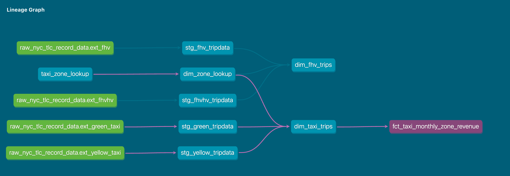

## Bài tập Module 4

Bài tập cần các bộ dữ liệu sau:
* [Dữ liệu taxi Green (2019 và 2020)](https://github.com/DataTalksClub/nyc-tlc-data/releases/tag/green)
* [Dữ liệu taxi Yellow (2019 và 2020)](https://github.com/DataTalksClub/nyc-tlc-data/releases/tag/yellow)
* [Dữ liệu For-Hire Vehicle (2019)](https://github.com/DataTalksClub/nyc-tlc-data/releases/tag/fhv)

### Trước khi bắt đầu

1. Bảo đảm dữ liệu **ít nhất** đã có trên GCS và được truy cập qua External Table **HOẶC** Native Table. Bạn có thể chọn cách làm phù hợp (điều phối workflow bằng [pandas-gbq](https://cloud.google.com/bigquery/docs/samples/bigquery-pandas-gbq-to-gbq-simple), [dlt cho GCS](https://dlthub.com/docs/dlt-ecosystem/destinations/filesystem), [dlt cho BigQuery](https://dlthub.com/docs/dlt-ecosystem/destinations/bigquery), [gsutil](https://cloud.google.com/storage/docs/gsutil), v.v.).
2. Bảng taxi Green cần có đúng `7,778,101` bản ghi
3. Bảng taxi Yellow cần có đúng `109,047,518` bản ghi
4. Bảng FHV cần có đúng `43,244,696` bản ghi
5. Xây dựng staging model cho taxi Green/Yellow theo ví dụ [tại đây](../../../04-analytics-engineering/taxi_rides_ny/models/staging/)
6. Xây dựng dimension/fact cho taxi_trips, join với `dim_zones` theo ví dụ [tại đây](../../../04-analytics-engineering/taxi_rides_ny/models/core/fact_trips.sql)

**Lưu ý**: Nếu không có quyền truy cập GCP, bạn có thể chạy Postgres cục bộ và nạp các bộ dữ liệu trên.


### Câu hỏi 1: Tìm hiểu cách dbt phân giải model

Giả sử bạn có file sources.yaml sau:
```yaml
version: 2

sources:
  - name: raw_nyc_tripdata
    database: "{{ env_var('DBT_BIGQUERY_PROJECT', 'dtc_zoomcamp_2025') }}"
    schema:   "{{ env_var('DBT_BIGQUERY_SOURCE_DATASET', 'raw_nyc_tripdata') }}"
    tables:
      - name: ext_green_taxi
      - name: ext_yellow_taxi
```

và thiết lập các environment variable sau tại nơi chạy `dbt`:
```shell
export DBT_BIGQUERY_PROJECT=myproject
export DBT_BIGQUERY_DATASET=my_nyc_tripdata
```

Model .sql này được biên dịch thành câu lệnh gì?
```sql
select * 
from {{ source('raw_nyc_tripdata', 'ext_green_taxi' ) }}
```

- `select * from dtc_zoomcamp_2025.raw_nyc_tripdata.ext_green_taxi`
- `select * from dtc_zoomcamp_2025.my_nyc_tripdata.ext_green_taxi`
- `select * from myproject.raw_nyc_tripdata.ext_green_taxi`
- `select * from myproject.my_nyc_tripdata.ext_green_taxi`
- `select * from dtc_zoomcamp_2025.raw_nyc_tripdata.green_taxi`


### Câu hỏi 2: Biến dbt và model động

Giả sử bạn cần sửa dbt model `fct_recent_taxi_trips.sql` để Analytics Engineer có thể điều chỉnh khoảng ngày một cách linh hoạt. 

- Trong môi trường development, chỉ xử lý **các chuyến của 7 ngày gần nhất**
- Trong môi trường production, cần xử lý **30 ngày gần nhất** để phân tích

```sql
select *
from {{ ref('fact_taxi_trips') }}
where pickup_datetime >= CURRENT_DATE - INTERVAL '30' DAY
```

Bạn sẽ sửa thế nào để đối số dòng lệnh được ưu tiên hơn environment variable, và environment variable được ưu tiên hơn giá trị mặc định?

- Thêm `ORDER BY pickup_datetime DESC` và `LIMIT {{ var("days_back", 30) }}`
- Sửa mệnh đề WHERE thành `pickup_datetime >= CURRENT_DATE - INTERVAL '{{ var("days_back", 30) }}' DAY`
- Sửa mệnh đề WHERE thành `pickup_datetime >= CURRENT_DATE - INTERVAL '{{ env_var("DAYS_BACK", "30") }}' DAY`
- Sửa mệnh đề WHERE thành `pickup_datetime >= CURRENT_DATE - INTERVAL '{{ var("days_back", env_var("DAYS_BACK", "30")) }}' DAY`
- Sửa mệnh đề WHERE thành `pickup_datetime >= CURRENT_DATE - INTERVAL '{{ env_var("DAYS_BACK", var("days_back", "30")) }}' DAY`


### Câu hỏi 3: Data Lineage và cách thực thi dbt

Xét Data Lineage bên dưới **và** giả sử taxi_zone_lookup là đối tượng được materialize **duy nhất** (từ seed file .csv):



Chọn lệnh **KHÔNG** dùng được để materialize `fct_taxi_monthly_zone_revenue`:

- `dbt run`
- `dbt run --select +models/core/dim_taxi_trips.sql+ --target prod`
- `dbt run --select +models/core/fct_taxi_monthly_zone_revenue.sql`
- `dbt run --select +models/core/`
- `dbt run --select models/staging/+`


### Câu hỏi 4: dbt macro và Jinja

Giả sử bạn đang xử lý dữ liệu nhạy cảm (ví dụ [PII](https://en.wikipedia.org/wiki/Personal_data)) tại `raw layer` của Data Warehouse (chẳng hạn một BigQuery dataset hoặc PostgreSQL schema riêng), và dữ liệu này **chỉ nhóm bạn cùng một số ít người được chọn mới có quyền truy cập**. 

 - Bạn quyết định che bớt thông tin nhạy cảm qua các staging model, rồi đưa dữ liệu vào schema khác (`staging layer`) để các Data/Analytics Engineer khác khám phá.

- **Nếu cần**, bạn tạo thêm `service layer` chứa bảng dimension (`dim_`) và fact (`fct_`) theo [mô hình Star Schema](https://www.databricks.com/glossary/star-schema), phục vụ dashboard và Tech Product Owner/Manager.

Bạn tạo macro để đóng gói logic này:

```sql


    
    

     {{- env_var(target_env_var) -}}
                        {{- env_var(stging_env_var, env_var(target_env_var)) -}}
    


```

Và dùng macro trong các model staging, `dim_`, `fact_` như sau:
```sql
{{ config(
    schema=resolve_schema_for('core'), 
) }}
```

Với macro trên, **hãy chọn tất cả phát biểu đúng về các model dùng macro**:
- Bắt buộc đặt environment variable `DBT_BIGQUERY_TARGET_DATASET`; nếu không, quá trình biên dịch sẽ lỗi
- Bắt buộc đặt environment variable `DBT_BIGQUERY_STAGING_DATASET`; nếu không, quá trình biên dịch sẽ lỗi
- Khi dùng `core`, model được materialize trong dataset xác định bởi `DBT_BIGQUERY_TARGET_DATASET`
- Khi dùng `stg`, model được materialize trong dataset xác định bởi `DBT_BIGQUERY_STAGING_DATASET`, hoặc mặc định là `DBT_BIGQUERY_TARGET_DATASET`
- Khi dùng `staging`, model được materialize trong dataset xác định bởi `DBT_BIGQUERY_STAGING_DATASET`, hoặc mặc định là `DBT_BIGQUERY_TARGET_DATASET`


## SQL nâng cao

Ở Module 1, bạn đã ôn lại SQL. Giờ chúng ta sẽ vận dụng kiến thức đó vào các bài SQL nâng cao.

Các câu hỏi này không dễ, nhưng sẽ giúp bạn nâng cao kỹ năng SQL và Analytics.  
Hãy bắt đầu!

Bạn có thể thêm các dimension `year` (ví dụ 2019, 2020), `quarter` (1, 2, 3, 4), `year_quarter` (ví dụ `2019/Q1`, `2019-Q2`) và `month` (ví dụ 1, 2, ..., 12), **trích xuất từ pickup_datetime**, vào model `fct_taxi_trips` HOẶC `dim_taxi_trips.sql` để dễ lọc dữ liệu khi truy vấn.


### Câu hỏi 5: Tăng trưởng doanh thu taxi theo quý

1. Tạo model mới `fct_taxi_trips_quarterly_revenue.sql`
2. Tính doanh thu theo quý cho từng năm dựa trên `total_amount`
3. Tính tăng trưởng doanh thu YoY (Year-over-Year, so với cùng kỳ năm trước) theo quý
  * Ví dụ: Trong 2020/Q1, doanh thu taxi Green tăng -12.34% so với 2019/Q1
  * Ví dụ: Trong 2020/Q4, doanh thu taxi Yellow tăng +34.56% so với 2019/Q4

***Lưu ý quan trọng: Các tỷ lệ tăng trưởng YoY ở ví dụ chỉ mang tính minh họa. Bạn sẽ không thu được đúng các giá trị đó từ dữ liệu của bài tập.***

Xét tăng trưởng YoY năm 2020, quý nào có kết quả tốt nhất (hoặc ít tệ nhất) và tệ nhất đối với taxi Green và Yellow?

- green: {best: 2020/Q2, worst: 2020/Q1}, yellow: {best: 2020/Q2, worst: 2020/Q1}
- green: {best: 2020/Q2, worst: 2020/Q1}, yellow: {best: 2020/Q3, worst: 2020/Q4}
- green: {best: 2020/Q1, worst: 2020/Q2}, yellow: {best: 2020/Q2, worst: 2020/Q1}
- green: {best: 2020/Q1, worst: 2020/Q2}, yellow: {best: 2020/Q1, worst: 2020/Q2}
- green: {best: 2020/Q1, worst: 2020/Q2}, yellow: {best: 2020/Q3, worst: 2020/Q4}


### Câu hỏi 6: Phân vị P97/P95/P90 của giá vé taxi theo tháng

1. Tạo model mới `fct_taxi_trips_monthly_fare_p95.sql`
2. Lọc bỏ bản ghi không hợp lệ (`fare_amount > 0`, `trip_distance > 0`, và `payment_type_description in ('Cash', 'Credit card')`)
3. Tính **phân vị liên tục** của `fare_amount` theo service_type, năm và tháng

Các giá trị `p97`, `p95`, `p90` của taxi Green và Yellow trong tháng 4/2020 là bao nhiêu?

- green: {p97: 55.0, p95: 45.0, p90: 26.5}, yellow: {p97: 52.0, p95: 37.0, p90: 25.5}
- green: {p97: 55.0, p95: 45.0, p90: 26.5}, yellow: {p97: 31.5, p95: 25.5, p90: 19.0}
- green: {p97: 40.0, p95: 33.0, p90: 24.5}, yellow: {p97: 52.0, p95: 37.0, p90: 25.5}
- green: {p97: 40.0, p95: 33.0, p90: 24.5}, yellow: {p97: 31.5, p95: 25.5, p90: 19.0}
- green: {p97: 55.0, p95: 45.0, p90: 26.5}, yellow: {p97: 52.0, p95: 25.5, p90: 19.0}


### Câu hỏi 7: Khu vực có thời gian chuyến đi P90 dài thứ hai đối với FHV

Điều kiện chuẩn bị:
* Tạo staging model cho dữ liệu FHV (2019) và **KHÔNG** thêm bước khử trùng lặp; chỉ lọc bản ghi theo `where dispatching_base_num is not null`
* Tạo core model cho dữ liệu FHV (`dim_fhv_trips.sql`), join với `dim_zones`, tương tự ví dụ [tại đây](../../../04-analytics-engineering/taxi_rides_ny/models/core/fact_trips.sql)
* Thêm các dimension `year` (ví dụ 2019) và `month` (ví dụ 1, 2, ..., 12) dựa trên `pickup_datetime` vào core model để dễ lọc dữ liệu

Tiếp theo:
1. Tạo model mới `fct_fhv_monthly_zone_traveltime_p90.sql`
2. Với mỗi bản ghi trong `dim_fhv_trips.sql`, dùng [timestamp_diff](https://cloud.google.com/bigquery/docs/reference/standard-sql/timestamp_functions#timestamp_diff) để tính số giây giữa dropoff_datetime và pickup_datetime; trong bài này gọi kết quả là `trip_duration`
3. Tính **phân vị liên tục** `p90` của `trip_duration` theo năm, tháng, pickup_location_id và dropoff_location_id

Với các chuyến khởi hành **lần lượt** từ `Newark Airport`, `SoHo` và `Yorkville East` trong tháng 11/2019, những **dropoff_zones** nào có p90 trip_duration dài thứ hai?

- LaGuardia Airport, Chinatown, Garment District
- LaGuardia Airport, Park Slope, Clinton East
- LaGuardia Airport, Saint Albans, Howard Beach
- LaGuardia Airport, Rosedale, Bath Beach
- LaGuardia Airport, Yorkville East, Greenpoint


## Nộp bài

* Biểu mẫu nộp bài: https://courses.datatalks.club/de-zoomcamp-2025/homework/hw4


## Lời giải 

* Sẽ được công bố sau hạn nộp bài
