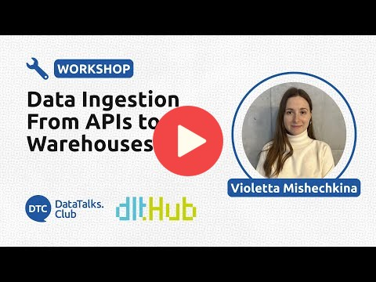

# Data Ingestion với dlt

Bài tập: [dlt_homework.md](dlt_homework.md)

🎥 **Xem video workshop**

[](https://www.youtube.com/watch?v=pgJWP_xqO1g "Watch the workshop video")

Chào mừng bạn đến với workshop thực hành xây dựng các pipeline Data Ingestion hiệu quả và có khả năng mở rộng.

### **Bạn sẽ học gì trong workshop này?**  

Trong workshop, bạn sẽ học các kỹ năng cốt lõi để xây dựng và quản lý data pipeline:  
- **Cách xây dựng pipeline ổn định, mở rộng được và ít cần bảo trì thủ công**.  
- **Cách làm hiệu quả**, như tích hợp Data Governance để bảo đảm luồng dữ liệu sạch và đáng tin cậy.  
- **Kỹ thuật Incremental Load** giúp cập nhật dữ liệu nhanh và tiết kiệm chi phí.  
- **Cách xây dựng Data Lake** với dlt.

Sau workshop, bạn sẽ biết cách xây dựng data pipeline nhanh, gọn và áp dụng các cách làm hiệu quả thường dùng trong công việc của Data Engineer giàu kinh nghiệm.


--- 

## 📂 Điều hướng và tài nguyên

- Workshop:
  - [Nội dung workshop](data_ingestion_workshop.md).
  - [Notebook Colab của workshop](https://colab.research.google.com/drive/1FiAHNFenM8RyptyTPtDTfqPCi5W6KX_V?usp=sharing).
- Bài tập:
  - [Bài tập Markdown](dlt_homework.md).
  - [Notebook Colab của bài tập](https://colab.research.google.com/drive/1plqdl33K_HkVx0E0nGJrrkEUssStQsW7).
- 🌐 [Tài liệu chính thức của dlt](https://dlthub.com/docs/intro).
- 💬 Tham gia [cộng đồng Slack](https://dlthub.com/community).

---

## 📖 Tổng quan nội dung
Workshop gồm ba phần chính:

1️⃣ **[Trích xuất dữ liệu](data_ingestion_workshop.md#extracting-data)** – Học kỹ thuật trích xuất dữ liệu có khả năng mở rộng.  
2️⃣ **[Chuẩn hóa dữ liệu](data_ingestion_workshop.md#normalizing-data)** – Làm sạch và cấu trúc dữ liệu trước khi nạp.  
3️⃣ **[Nạp và cập nhật dữ liệu gia tăng](data_ingestion_workshop.md#loading-data)** – Nạp và cập nhật dữ liệu hiệu quả.  

📌 **Xem đầy đủ nội dung tại đây**: [File bài học](data_ingestion_workshop.md)  

---

## 👩‍🏫 Giảng viên

Chào mừng bạn đến với workshop Data Ingestion của DataTalks.Club Data Engineering Zoomcamp!

Tôi là Violetta Mishechkina, Solutions Engineer tại dltHub. 👋
- Tôi làm việc trong lĩnh vực dữ liệu từ năm 2018, với nền tảng Machine Learning.
- Ban đầu tôi là Data Scientist, huấn luyện model ML và mạng nơ-ron.
- Dần dần tôi nhận ra rằng trong production, chỉ số RMSE không phải yếu tố duy nhất quan trọng; kích thước model, hạ tầng và chất lượng dữ liệu cũng rất quan trọng. Vì vậy tôi chuyển sang MLOps.
- Một năm trước, tôi gia nhập nhóm Customer Success của dltHub và biết đến dlt, thư viện Python tự động hóa phần lớn các công việc Data Engineering lặp lại.
- Hiện tôi làm việc sát với khách hàng và đối tác để giúp họ tích hợp, tối ưu dlt trong production.
- Tôi cũng cộng tác với nhóm phát triển để truyền đạt nhu cầu của khách hàng, giúp sản phẩm đáp ứng các bài toán Data Engineering thực tế.
- Kinh nghiệm về ML, MLOps và Data Engineering giúp tôi có góc nhìn thực hành khi giải quyết các bài toán dữ liệu.

---

## Bài tập

- [Bài tập Markdown](dlt_homework.md).
- [Notebook Colab của bài tập](https://colab.research.google.com/drive/1plqdl33K_HkVx0E0nGJrrkEUssStQsW7).

--- 
## Chạy pipeline dlt bằng orchestrator

Để chạy pipeline dlt theo lịch, hãy đưa nó vào công cụ điều phối workflow như Apache Airflow hoặc Kestra.

### Apache Airflow

Đặt lời gọi pipeline trong `PythonOperator`:

```python
from airflow import DAG
from airflow.operators.python import PythonOperator
from datetime import datetime, timedelta
import dlt
from my_dlt_pipeline import load_data  # Import your dlt pipeline function

default_args = {
    "owner": "airflow",
    "depends_on_past": False,
    "start_date": datetime(2024, 2, 16),
    "retries": 1,
    "retry_delay": timedelta(minutes=5),
}

def run_dlt_pipeline():
    pipeline = dlt.pipeline(
        pipeline_name="my_pipeline",
        destination="duckdb",  # Change this based on your database
        dataset_name="my_dataset"
    )
    info = pipeline.run(load_data())
    print(info)  # Logs for debugging

with DAG(
    "dlt_airflow_pipeline",
    default_args=default_args,
    schedule_interval="@daily",
    catchup=False,
) as dag:
    run_dlt_task = PythonOperator(
        task_id="run_dlt_pipeline",
        python_callable=run_dlt_pipeline,
    )
    run_dlt_task
```

### Kestra

Chạy pipeline từ script task:

```yaml
id: dlt_ingestion

namespace: my.dlt

description: "Run dlt pipeline with Kestra"

tasks:

- id: run_dlt

  type: io.kestra.plugin.scripts.python.Commands

  commands:

  - |

    import dlt

    from my_dlt_pipeline import load_data  # Import your dlt function

    pipeline = dlt.pipeline(

      pipeline_name="kestra_pipeline",

      destination="duckdb",

      dataset_name="kestra_dataset"

    )

    info = pipeline.run(load_data())

    print(info)
```

Thay `"duckdb"` bằng destination thực tế và điều chỉnh `load_data` cho phù hợp với pipeline của bạn.

## Bước tiếp theo

Trong khi học các khái niệm Data Engineering,
bạn có thể làm thêm một dự án portfolio để đào sâu kiến thức.

Việc chứng minh khả năng xây dựng giải pháp end-to-end sẽ giúp bạn thuận lợi hơn khi tìm công việc đầu tiên.
Ngay cả khi nhà tuyển dụng không xem trực tiếp dự án, bạn vẫn hiểu sâu hơn và có thể tự tin trao đổi về cách triển khai.

Một số dự án mẫu do người khác thực hiện với dlt:
- dlt-dbt serverless trên Cloud Functions: [Bài viết](https://docs.getdbt.com/blog/serverless-dlt-dbt-stack)
- Tìm hiểu các loài chim: [Phần 1](https://publish.obsidian.md/lough-on-data/blogs/bird-finder-via-dlt-i), [Phần 2](https://publish.obsidian.md/lough-on-data/blogs/bird-finder-via-dlt-ii)
- Data Ingestion cho event trên GCP: [Bài viết và repository](https://dlthub.com/docs/blog/streaming-pubsub-json-gcp)
- Data Ingestion cho event trên AWS: [Bài viết và repository](https://dlthub.com/docs/blog/dlt-aws-taktile-blog)
- Hoặc xem các demo do học viên xây dựng: [Hacker News](https://dlthub.com/docs/blog/hacker-news-gpt-4-dashboard-demo), 
[GA4 events](https://dlthub.com/docs/blog/ga4-internal-dashboard-demo), 
[an E-Commerce](https://dlthub.com/docs/blog/postgresql-bigquery-metabase-demo), 
[Google Sheets](https://dlthub.com/docs/blog/google-sheets-to-data-warehouse-pipeline), 
[Motherduck](https://dlthub.com/docs/blog/dlt-motherduck-demo), 
[MongoDB + Holistics](https://dlthub.com/docs/blog/MongoDB-dlt-Holistics), 
[Deepnote](https://dlthub.com/docs/blog/deepnote-women-wellness-violence-tends), 
[Prefect](https://dlthub.com/docs/blog/dlt-prefect),
[PowerBI vs GoodData vs Metabase](https://dlthub.com/docs/blog/semantic-modeling-tools-comparison),
[Dagster](https://dlthub.com/docs/blog/dlt-dagster),
[Ingesting events via gcp webhooks](https://dlthub.com/docs/blog/dlt-webhooks-on-cloud-functions-for-event-capture),
[SAP to snowflake replication](https://dlthub.com/docs/blog/sap-hana-to-snowflake-demo-blog),
[Read emails and send sumamry to slack with AI and Kestra](https://dlthub.com/docs/blog/dlt-kestra-demo-blog),
[Mode +dlt capabilities](https://dlthub.com/docs/blog/dlt-mode-blog),
[dbt on cloud functions](https://dlthub.com/docs/blog/dlt-dbt-runner-on-cloud-functions)
- Nếu muốn dùng dlt trong dự án, [hãy xem danh sách API công khai này](https://dlthub.com/docs/blog/practice-api-sources)


Nếu làm dự án cá nhân, bạn có thể gửi bài giới thiệu cho blog của chúng tôi. Chúng tôi rất vui được chia sẻ dự án của bạn; hãy nhắn trong Slack của dlt.


## **💛 Nếu thấy dlt hữu ích, hãy ủng hộ chúng tôi!**  

* ⭐ **Tặng dự án một [GitHub Star](https://github.com/dlt-hub/dlt)!**  
* 💬 **Tham gia [cộng đồng Slack](https://dlthub.com/community)!**  
* 🚀 **Hãy cùng xây dựng những data pipeline chất lượng!**  

---

# Ghi chú cộng đồng

Bạn có ghi chú khi học? Hãy chia sẻ bằng cách tạo PR cho file này!

* [Nạp dữ liệu vào GCS bằng dlt, của peatwan](https://github.com/peatwan/de-zoomcamp/tree/main/workshop/dlt/homework/load_to_gcs)
* Thêm ghi chú của bạn phía trên dòng này 
